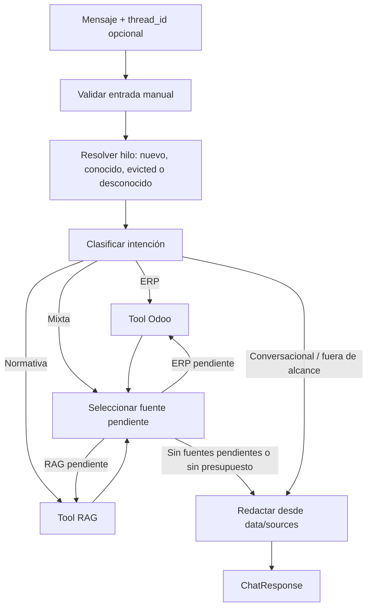

# Spec 001 — Chat Fiscal (MVP)

| Campo | Valor |
|---|---|
| Estado | Borrador revisado — QA r5 incorporado |
| Fecha | 2026-10-23 |
| Revisión | r6 |
| Autor | Planner SDD |
| Repo | `contafis-assistant` |
| Referencias | `docs/constitution.md`, `AGENTS.md`, `docs/memory.md` |
| ERP de referencia | `MrErov/contafis-odoo-19.0v` — Odoo 19, addon `l10n_ve_compliance_manager` |

> Cambio de protocolo respecto de `docs/memory.md`: la conexión con Odoo deja de ser XML-RPC y pasa a ser **JSON/2 de Odoo 19**. `docs/memory.md` debe actualizarse al aprobar esta spec; esta edición no lo modifica.
>
> `AGENTS.md` todavía dice “AWS/OpenSearch a definir”. Esta spec fija OpenAI + Chroma; `AGENTS.md` se actualizará al aprobar y no se edita en esta revisión.

---

## 1. Contexto

ContaFis es un ERP Odoo 19 para contadores venezolanos. El addon `l10n_ve_compliance_manager` concentra el estado operativo de cada contribuyente: obligaciones y vencimientos SENIAT, clientes de cumplimiento, documentos y cartelera fiscal, y alertas. Ese estado hoy se consulta navegando vistas del ERP, y la normativa aplicable (Ley de ISLR, Ley de IVA, providencias SENIAT) vive en PDFs separados.

El asistente fiscal es una capa conversacional que responde en un mismo turno preguntas sobre **datos vivos del ERP** y sobre **normativa**, decidiendo con LangGraph qué fuente consultar. El MVP valida dos cosas: la orquestación del grafo y la calidad del RAG; no la infraestructura de ingesta ni los cálculos contables.

El despliegue es **mono-tenant / una sola base Odoo** (`contea`). La visibilidad de datos no es global por defecto: el addon aplica record rules por `accountant_id` y por `company_ids`, y la cartelera no tiene record rule de compañía. Por eso el MVP exige un usuario/API key de solo lectura con alcance explícito y verificado, y filtros de compañía en cada tool.

## 2. Objetivo y métricas de éxito

**Objetivo:** que un contador obtenga, en una conversación en español, el estado operativo de sus clientes (vencimientos, documentos faltantes, alertas) y respuestas normativas citadas, sin datos inventados y sin escribir en Odoo.

**Métricas de éxito del MVP:**

- El 100% de los criterios de aceptación (sección 11) pasan en CI con mocks, sin red ni tokens reales.
- El 100% de las respuestas con contenido normativo incluye al menos una fuente del corpus.
- 0 respuestas con datos del ERP que no provengan de un `ToolResult` del turno actual; los turnos previos solo aportan entidad, filtro y rango.
- 0 respuestas que presenten un total en 0 cuando el alcance de visibilidad del usuario de API es incompleto; en ese caso la respuesta es `partial` con advertencia.
- Un set dorado de 10 preguntas (ERP, normativa y mixtas) se revisa manualmente y no presenta alucinaciones ni escrituras en Odoo.

## 3. Usuarios y casos de uso

**Usuario principal:** contador del despacho, operador único del despliegue.
**Usuario secundario:** auxiliar contable con las mismas capacidades (no hay roles en el MVP).
**Fuera de alcance:** portal para el contribuyente final.

| ID | Caso de uso | Ejemplo |
|---|---|---|
| UC-01 | Vencimientos agregados | "¿Qué clientes tienen vencimientos de IVA esta semana?" |
| UC-02 | Vencimientos de una entidad | "¿Qué vencimientos tiene Distribuidora El Sol?" |
| UC-03 | Estado documental | "¿Qué le falta a El Sol para estar solvente?" |
| UC-04 | Alertas urgentes | "¿Hay algo urgente que revisar hoy?" |
| UC-05 | Consulta normativa | "¿Cuál es el tope de deducción de sueldos directivos para ISLR?" |
| UC-06 | Consulta mixta | "¿Qué vencimientos tiene El Sol y qué sanción aplica por pagar tarde?" |
| UC-07 | Seguimiento conversacional | "¿Y cuáles están vencidas?" |

## 4. Glosario

| Término | Significado en esta spec |
|---|---|
| Compañía | `res.company` de Odoo. Agrupa clientes de cumplimiento. Su `name` se asume único en la instancia. |
| Cliente | `l10n.ve.compliance.client`: el contribuyente. Pertenece a una compañía (`company_id`, obligatorio). Su `name` **no** es único entre compañías. |
| Obligación | `l10n.ve.obligation`: vencimiento fiscal de un cliente. Estados almacenados: `pending`, `paid`, `overdue`, `cancelled`. `client_id`, `obligation_type_id` y `due_date` pueden ser nulos/falsos. |
| Documento | `l10n.ve.document`: documento del cliente. Estados: `valid`, `expired`, `pending`, `rejected`; `state` no tiene default y puede ser `False`. |
| Cartelera | `l10n.ve.cartelera.status`: snapshot mensual por tipo de documento. `month` es un Selection **string** `'1'..'12'`. Agrega `missing` (faltante) y `rejected` (rechazado). |
| Snapshot | Fila de `l10n.ve.cartelera.status` para un cliente, año, mes y tipo de documento. El cron del ERP genera el **mes anterior**, no el mes en curso. |
| Documento vivo | Fila actual de `l10n.ve.document`, usada como fallback cuando no hay snapshot del mes en curso. |
| Alerta | `l10n.ve.alert`: aviso generado o manual. Estados: `pending`, `sent`, `done`. `date` y `client_id` pueden ser nulos. |
| Brecha documental | Documento o snapshot con estado distinto de `valid`: `missing`, `pending`, `expired` o `rejected`. Alineado con `cartelera_pending_count = total - valid`. |
| Turno | Un mensaje del usuario y su respuesta completa. |
| Tool | Función expuesta al LLM (Odoo o RAG), con entrada y salida Pydantic. |
| Entidad | Compañía o cliente mencionado por el usuario; se resuelve a una u otra. |
| `today_caracas()` | Fecha actual en `America/Caracas`, calculada desde un reloj UTC inyectable. |
| `effective_state` | Estado de una obligación corregido por `due_date` contra `today_caracas()`; se rige por la Tabla 9.3-A. |
| `effective_document_state` | Estado de un documento/snapshot corregido por `expiry_date`, `state=False`, `missing`/`rejected` según la Tabla 9.3-A. |
| `effective_state_adjusted` | Warning cuando el estado efectivo difiere del almacenado por fecha; no aplica a `state=False` ni `expiry_date=False`. |
| `company_archived` | `EntityRef.company_archived=true` si la compañía está archivada; en un cliente indica que su compañía lo está. |
| `ToolResult` | Unión Pydantic discriminada por `kind` con `total`, `returned`, `items`, `breakdown`, `truncated`, `source` y `warnings`; es la única fuente de datos ERP para `answer`. |
| `data` | Lista de `ToolResult` de la respuesta; default `[]`. |
| `sources_used` | Estado del grafo con las fuentes ya consultadas en el turno; evita repetirlas. |
| `scope_check` | Verificación de usuario no admin, cobertura de compañías y atestación read-only; no infiere todas las ACLs. |
| `corpus_status` | `ok`, `missing`, `empty` o `mismatch`; lo reporta health. |
| Manifiesto | `manifest.json` del corpus con archivos, versiones, páginas, hashes, versión/hash de BM25. |
| RRF | Reciprocal Rank Fusion: fusión de rankings dense y BM25 ya filtrados por señal. |

## 5. Alcance del MVP

1. Endpoint HTTP de conversación (FastAPI), sin interfaz gráfica.
2. Orquestador LangGraph con clasificación de intención y ciclo acotado de tools.
3. Tools de **solo lectura** sobre Odoo vía JSON/2: compañías, clientes, obligaciones, documentos/cartelera y alertas.
4. RAG sobre Chroma local con corpus pre-ingestado (3 PDFs confirmados + 1 opcional) mediante script offline y manifiesto verificable.
5. Multi-company: agregación por defecto, filtro explícito por entidad nombrada y verificación de alcance de visibilidad.
6. Respuestas en español con fuentes, `warnings`, `truncated`, manejo explícito de errores y cero alucinaciones.
7. Observabilidad LangSmith en desarrollo con redacción de PII y tests deterministas con mocks.
8. Un solo worker uvicorn y memoria de conversación in-process, con pérdida de contexto documentada al reiniciar.

## 6. Fuera de alcance del MVP

- Montos, retenciones, libros de compra/venta, declaraciones de IVA y conciliación ISLR: modelos `l10n.retention`, `l10n.ve.retention.service`, `l10n.ve.islr.reconciliation`, `l10n.ve.islr.reconciliation.line`, `l10n.ve.vat.book.line`, `l10n.ve.vat.book.generate`, `l10n.ve.vat.return` y tablas ISLR.
- Cualquier escritura en Odoo: crear/editar obligaciones, generar alertas, marcar pagos, enviar email/WhatsApp ni ejecutar `action_*`.
- Ingesta dinámica: subida de PDFs por el usuario, OCR, versionado, curaduría y reindexado en runtime.
- Interfaz gráfica, autenticación multiusuario, roles y multi-tenant (varias bases Odoo).
- Persistencia durable de conversaciones (sobrevive al reinicio del proceso).
- Cálculo o asesoría fiscal, y cualquier jurisdicción distinta de Venezuela.
- Idiomas distintos del español.
- Modificar el addon `l10n_ve_compliance_manager`, sus modelos, ACL o record rules. La configuración de un grupo de lectura en Odoo es una tarea de despliegue, no un cambio de código del asistente.
- Registros con `client_id=False` en obligaciones, documentos o alertas: las record rules globales de `client_id.company_id` los ocultan al usuario read-only. No se consultan ni se crea una cubeta "sin cliente".

## 7. Decisiones confirmadas

| ID | Decisión | Origen |
|---|---|---|
| D1 | **Mono-tenant**: una única base Odoo, `contea`, con credenciales fijas por variables de entorno. La conexión usa **JSON/2** (`POST /json/2/<model>/<method>`) con `Authorization: Bearer $ODOO_API_KEY` y `X-Odoo-Database: contea`; XML-RPC queda descartado. | Clarificación 1 + QA B-01 |
| D2 | Multi-company: si no se nombra entidad, se agregan todas las compañías activas; si se nombra, se filtra por nombre o ID. La entidad se extrae **del mensaje**; `company_name` no es un parámetro público. Fuzzy determinista: RapidFuzz `token_set_ratio`, `FUZZY_MIN_SCORE` (85), normalización de acentos/mayúsculas/espacios, candidatos activos, orden score desc/id, empate o más de un candidato sobre el umbral → aclaración. | Clarificación 2 + QA B-02/B-06 + QA r2 |
| D3 | Consultas de solo lectura sobre obligaciones/vencimientos, datos del cliente, documentos/cartelera y alertas. Montos, retenciones, libros y conciliación ISLR quedan fuera. | Clarificación 3 |
| D4 | RAG con Chroma local pre-ingestado: Ley de ISLR, Ley de IVA y Providencia SENIAT, más un cuarto documento opcional declarado en el manifiesto. Indexado por un script Python fuera de FastAPI; sin ingesta en runtime. BM25 en memoria, offline, con hash/versión en el manifiesto. | Clarificación 4 + QA r2 |
| D5 | Orquestación LangGraph con preguntas mixtas: **máximo 3 tool calls por turno**, contador separado del `recursion_limit`, estado `sources_used` y `RECURSION_LIMIT >= 2*MAX_TOOL_CALLS+4`. Reintentos cuentan y solo se permiten con presupuesto y error transitorio. | Clarificación 5 + QA B-05 + QA r2 |
| D6 | Entrega como API FastAPI sin UI (derivada de `AGENTS.md`; no relevada en clarificación). | Derivada |
| D7 | Memoria conversacional por `thread_id` en memoria del proceso; sin persistencia durable. Un solo worker uvicorn. LRU con `MEMORY_MAX_THREADS` y warning `thread_evicted`. | Derivada + QA B-08 + QA r2 |
| D8 | El alcance se verifica (`scope_check`): usuario interno no admin, cobertura de `allowed_company_ids`, atestación `ODOO_READONLY_ATTESTED` y filtro explícito por compañía. En producción, `scope_unsafe` inicial → no arranca; refresh unsafe → health no saludable y 503; `scope_partial` → arranca y responde partial; en dev/test `scope_unsafe` → degradado. `base.group_user=false` (portal/público) es `scope_unsafe` aunque la atestación y la cobertura sean válidas. No se infieren todas las ACLs por RPC. | QA B-02 + QA r2 + QA r3 + QA r5 |
| D9 | Las fechas de negocio se resuelven con `today_caracas()` y `effective_state`; el ERP puede marcar `overdue` antes de tiempo porque usa `fields.Date.today()` en UTC. Los rangos son semiabiertos. | QA B-07 + QA r2 |
| D10 | `thread_id` opcional: si falta se genera un UUID4 y no lleva warning. Un UUID4 provisto que desapareció por reinicio se trata como desconocido y lleva `thread_context_unavailable`; un ID no UUID4 elegido por el cliente se considera nuevo, sin warning. | QA B-08 + QA r2 |
| D11 | El contrato incluye `data: list[ToolResult]` (unión discriminada), `sources`, `entities`, `options`, `warnings`, `truncated`, `tool_call_count` y `partial`. `answer` solo renderiza `data`/`sources`; no puede introducir totales ni ítems. | QA B-05/B-06 + QA r2 |

**Interpretación de "empresa" (D2):** el request solo lleva `message` y `thread_id`. El nombre de compañía o cliente se extrae del mensaje; no hay parámetro público `company_name`. La resolución busca con esta precedencia:

1. Compañía exacta (nombre normalizado, `active_test=False` para detectar archivadas).
2. Cliente exacto (nombre normalizado, dentro de compañías; si su compañía está archivada, no es consultable).
3. Fuzzy determinista solo sobre candidatos **activos**: RapidFuzz `token_set_ratio`, score normalizado 0..100, `FUZZY_MIN_SCORE=85`; orden `score desc, id`; si más de un candidato supera el umbral o hay empate en el primer lugar, se pide aclaración.
4. Si hay más de una coincidencia, se pide aclaración con hasta 5 opciones.

Las palabras "cliente", "empresa" o "compañía" en el mensaje actúan como type hint y tienen prioridad sobre la precedencia anterior. Una colisión de ID numérico entre compañía y cliente obliga a preguntar el tipo. Una compañía exacta archivada se devuelve como `ok` + `company_archived`, sin datos; el fuzzy y los agregados solo usan activas.

## 8. Flujo funcional y contrato



Reglas del grafo:

- **Máximo 3 tool calls por turno.** El contador es independiente del `recursion_limit` de LangGraph.
- La resolución de entidad **cuenta como tool call si consulta Odoo**; si resuelve desde la memoria del hilo, no cuenta. El presupuesto total es 3.
- `sources_used` registra las fuentes ya consultadas en el turno. `S` es source-aware: si la intención es mixta y el ERP ya respondió, selecciona RAG; si RAG ya respondió, no repite ERP salvo que falte un dato y quede presupuesto. Un reintento cuenta como llamada.
- Una tool puede ejecutar varias RPC secuenciales para agregar; eso no consume presupuesto adicional, pero debe ser secuencial y acotado.
- Al intentar una cuarta tool, al no quedar presupuesto para un reintento o al alcanzar el `recursion_limit`, el grafo corta antes de ejecutar y responde `iteration_limit` con la información parcial y una advertencia.
- El grafo siempre termina en un `ChatResponse` válido, incluso ante error. Los hechos operativos/normativos de `answer` se renderizan desde `data`/`sources`; un validador post-generación rechaza números, IDs, fechas, ítems o citas que no estén allí y usa el render determinista si falla. Las preguntas de aclaración, las alternativas `out_of_scope` y los mensajes canónicos no son hechos y pueden no tener `data`.

### 8.1 Request

`ChatRequest` es **permisivo** para poder responder `invalid_request` con HTTP 200 en lugar de 422:

| Campo | Tipo | Requerido | Descripción |
|---|---|---|---|
| `message` | `Any` | Sí | Se valida manualmente como `str` no vacío, 1..`MAX_MESSAGE_CHARS` (2000 por defecto). Solo espacios se considera vacío. |
| `thread_id` | `Any` | No | Se valida manualmente como `str` de 1..64 caracteres `[A-Za-z0-9_-]`. Si falta o es inválido, se genera un UUID4 y se devuelve en `ChatResponse`. |

La configuración del modelo usa `extra="allow"` y `strict=False` solo para esta frontera. Si el body no se puede interpretar, se responde `invalid_request` con HTTP 200, sin tools ni LLM. No existe `company_name` ni ningún otro parámetro público en el MVP. La entidad se extrae del mensaje.

### 8.2 Response (`ChatResponse`)

| Campo | Tipo | Descripción |
|---|---|---|
| `request_id` | `str` | UUID4 trazable del turno. |
| `thread_id` | `str` | Hilo de conversación; el mismo del request válido o el UUID4 generado. |
| `status` | `enum` | `ok`, `needs_clarification`, `not_found`, `insufficient_context`, `out_of_scope`, `partial`, `iteration_limit`, `upstream_error`, `invalid_request`. |
| `answer` | `str` | Respuesta en español (es-VE). Los hechos operativos/normativos solo salen de `data`/`sources`; no inventa totales, IDs, fechas, ítems ni citas. En aclaración/sugerencia puede usar nombres/IDs de `options`; en `out_of_scope` puede dar una alternativa. |
| `data` | `list[ToolResult]` | Resultados estructurados del turno. Default `[]`. Es la única fuente de datos del ERP para redactar. |
| `sources` | `list[Source]` | Fragmentos RAG usados; vacío si no hay RAG. |
| `tools_used` | `list[str]` | Nombres únicos de tools ejecutadas en el turno actual. |
| `tool_call_count` | `int` | Número real de invocaciones del turno, incluyendo reintentos. |
| `entities` | `list[EntityRef]` | Entidades que acotan la consulta: compañías y clientes. Para agregado, todas las compañías activas consultadas. |
| `options` | `list[EntityRef]` | Alternativas de entidad cuando `status=needs_clarification` o `not_found`; vacío en otros estados. |
| `truncated` | `bool` | `true` si algún detalle alcanzó `DETAIL_LIMIT` o si el total no pudo confirmarse. |
| `warnings` | `list[Warning]` | Advertencias estructuradas, incluyendo fallbacks y alcance parcial. |

**`ToolResult` — unión discriminada por `kind`:**

| `kind` | Clase | `items` |
|---|---|---|
| `obligations` | `ObligationsResult` | `list[ObligationItem]` |
| `clients` | `ClientsResult` | `list[ClientItem]` |
| `documents` | `DocumentsResult` | `list[DocumentGapItem]` |
| `alerts` | `AlertsResult` | `list[AlertItem]` |
| `companies` | `CompaniesResult` | `list[CompanyItem]` |

Todos los resultados comparten: `kind` (discriminante), `total: int \| None`, `returned: int`, `items`, `breakdown: list[CompanyBreakdown]` (vacío cuando no aplica), `truncated: bool`, `source: Literal["odoo"]`, `warnings: list[Warning]`. Validación Pydantic: `returned == len(items)`; si `total` es `int`, `total >= returned`; si `total` es `None`, `truncated=true` y `count_unavailable`. `DocumentsResult` añade `pending_count: int \| None` (= `total - valid`, calculado en Python; no se solicita a Odoo).

**Modelos de ítem (campos mínimos):**

| Modelo | Campos |
|---|---|
| `ObligationItem` | `id`, `client_id`, `client_name`, `company_id`, `company_name`, `obligation_type_id: int \| None`, `obligation_type_name: str \| None`, `tax_type: str \| None`, `period: str \| None`, `due_date: date \| None`, `state` (almacenado), `effective_state`, `warnings` |
| `ClientItem` | `id`, `name`, `rif: str \| None`, `company_id`, `company_name`, `company_archived: bool`, `compliance_status` (`al_dia`/`pendiente`/`vencido`), `obligations_total`, `obligations_overdue`, `alerts_pending`, `warnings` |
| `DocumentGapItem` | `id` (snapshot o documento), `document_id: int \| None`, `client_id`, `client_name`, `company_id`, `company_name`, `document_type_id`, `document_type_code`, `document_type_name`, `state` (efectivo), `stored_state`, `expiry_date: date \| None`, `source` (`current_snapshot`/`live_document`/`previous_snapshot`), `as_of: date`, `warnings` |
| `AlertItem` | `id`, `alert_type`, `state`, `date: datetime \| None` (ISO 8601 con offset de Caracas), `client_id`, `client_name`, `company_id`, `company_name`, `obligation_id: int \| None`, `document_id: int \| None`, `due_date: date \| None`, `channel: str \| None`, `message_clean: str \| None`, `warnings` |
| `CompanyItem` | `id`, `name`, `company_archived: bool`, `clients_total`, `obligations_total`, `obligations_overdue`, `alerts_pending` |
| `CompanyBreakdown` | `company_id`, `company_name`, `total`, `counts: dict[str, int]` (claves documentadas por `kind`; no se usa para inventar ítems) |

**`Source` (Pydantic):**

| Campo | Tipo | Regla |
|---|---|---|
| `document_id` | `str` | ID estable del manifiesto. |
| `document` | `str` | Título del manifiesto. |
| `page` | `int \| None` | Página 1-based; `None` si no hay metadatos. |
| `section` | `str \| None` | Encabezado más cercano. |
| `locator` | `str \| None` | Fallback textual, por ejemplo "fragmento 12". |
| `chunk_id` | `str` | ID del chunk. |
| `score` | `float` | Score RRF final; `>= 0`. |
| `collection` | `str` | Colección Chroma. |

**`EntityRef`:**

| Campo | Tipo | Regla |
|---|---|---|
| `id` | `int` | ID de la compañía o del cliente. |
| `name` | `str` | Nombre visible. |
| `type` | `"company" \| "client"` | Tipo resuelto. |
| `company_id` | `int \| None` | Para `client`: obligatorio. Para `company`: puede ser `None`. |
| `company_name` | `str \| None` | Para `client`: obligatorio. Para `company`: puede ser `None`. |
| `rif` | `str \| None` | Solo clientes; puede faltar. |
| `company_archived` | `bool` | `true` si la compañía está archivada. Para un cliente, indica que su compañía está archivada. |

Validación Pydantic: si `type="client"`, `company_id`, `company_name` y `company_archived` son obligatorios. `options` usa el mismo tipo.

**`Warning` (Pydantic):**

| Campo | Tipo | Regla |
|---|---|---|
| `code` | `str` | Código estable de la sección 8.4; nunca una combinación con `/`. |
| `message` | `str` | Texto en español, sin PII innecesaria. |
| `source` | `"odoo" \| "rag" \| "system" \| None` | Fuente de la advertencia. |
| `entity_id` | `int \| None` | Entidad afectada, si aplica. |
| `context` | `dict[str, str \| int \| bool]` | Contexto acotado (por ejemplo `company_id`, `client_id`, `field`). |

`Warning` no incluye credenciales, mensajes crudos de tools ni resultados completos. El render de `answer` no puede introducir valores que no estén en `data`/`sources`.

### 8.3 Matriz de estados

| Condición | `status` | `data` |
|---|---|---|
| Request inválido (mensaje vacío/excedido o no textual; `thread_id` inválido, que se reemplaza por UUID4) | `invalid_request` | No; HTTP 200, sin tools ni LLM. |
| Entidad ambigua, colisión de ID, empate fuzzy o más de 5 coincidencias | `needs_clarification` | No; solo `options` de entidad. |
| Entidad inexistente y `scope_complete=true` | `not_found` | No; hasta 5 sugerencias. |
| Entidad inexistente y `scope_complete=false` | `partial` | No; `scope_partial`; nunca `not_found` ni total 0. |
| Consulta ERP válida con 0 resultados | `ok` | Sí; `total=0`, sin tratarlo como `not_found`. |
| Normativa fuera del corpus o sin señal y **no hay** datos de ERP utilizables | `insufficient_context` | No; mensaje canónico. |
| Normativa con score bajo, pero el ERP devolvió datos utilizables | `partial` | Sí; ERP conservado + `retrieval_low_score`. |
| Pedido fuera del MVP (montos, escrituras, otra jurisdicción) | `out_of_scope` | No; alternativa in-MVP. |
| Una fuente cayó, el manifiesto es inválido o el alcance es incompleto, pero hay datos utilizables | `partial` | Sí; `source_unavailable`/`manifest_mismatch`/`scope_partial`. |
| Se intentó una cuarta tool, se necesitó un reintento sin presupuesto o se alcanzó el `recursion_limit` | `iteration_limit` | Parcial; con advertencia. |
| Odoo/Chroma/LLM falló y no hay datos utilizables | `upstream_error` | No; sugerencia de reintento. |
| RAG-only con manifiesto/Chroma/BM25 inválido | `upstream_error` | No; `corpus_unavailable` y, si aplica, `manifest_mismatch`. |
| ERP-only con manifiesto inválido | `ok` | Sí; el corpus no afecta la consulta ERP. |
| Respuesta completa | `ok` | Sí. |

**Estados de `scope_check`:**

| Estado | Condición | Efecto |
|---|---|---|
| `scope_ok` | Usuario interno no admin, `ODOO_READONLY_ATTESTED=true` y cobertura completa de compañías activas. | `scope_complete=true`; operación normal. |
| `scope_partial` | Usuario interno no admin, `ODOO_READONLY_ATTESTED=true` y cobertura incompleta. | `scope_complete=false`; el servicio sigue; agregados y no-match responden `partial` + `scope_partial`; prohibido `not_found` y total 0 engañoso. |
| `scope_unsafe` | Admin, `ODOO_READONLY_ATTESTED=false/revocada` o `has_group('base.group_user')=false` (portal/público). | En producción el arranque es fail-fast; solo un refresh posterior a `scope_unsafe` deja health no saludable y turnos 503; en dev/test arranca degradado con `scope_complete=false` (admin/atestación: `scope_admin_key`; no interno: sin tools). |

**Precedencia:** `invalid_request` > `out_of_scope` (solo si todo el pedido está fuera) > `needs_clarification` > `not_found` (solo con `scope_complete=true`; si no, la fila de `partial` manda) > `iteration_limit` > `upstream_error` > `partial` > `insufficient_context` > `ok`.

Reglas de coherencia:

- `not_found` **solo** se emite con `scope_complete=true`. La guarda está en la tabla, no es una excepción posterior.
- Si una consulta mixta tiene una fuente caída y la otra devolvió datos, el estado es `partial`, nunca `upstream_error`.
- Si el ERP devolvió datos y el RAG quedó por debajo del umbral, se conserva el ERP y se responde `partial` con `retrieval_low_score`; `insufficient_context` se reserva para cuando no hay ningún dato utilizable.
- Si el pedido mezcla una parte fuera del MVP con una parte respondible, se responde la parte in-MVP con `partial` y `out_of_scope_component`; `out_of_scope` se reserva para el pedido completamente fuera.
- Si hay presupuesto agotado y además una fuente caída, prevalece `iteration_limit`.
- En producción, `scope_unsafe` al arrancar es fail-fast (RNF-016). Solo si el refresh posterior pasa a `scope_unsafe`, `/health` queda no saludable y el endpoint de turnos responde HTTP 503 con `upstream_error`, sin ejecutar tools (RNF-013). `scope_partial` no es unsafe: el servicio sigue y responde `partial` con `scope_partial`.

### 8.4 Códigos de advertencia principales

| Código | Uso |
|---|---|
| `thread_context_unavailable` | `thread_id` UUID4 que existió y se perdió por reinicio; se creó un hilo nuevo. No se emite para un hilo nuevo generado ni para un ID no UUID4 elegido por el cliente. |
| `thread_evicted` | El `thread_id` fue expulsado por LRU al superar `MEMORY_MAX_THREADS`; se creó un hilo nuevo. |
| `thread_history_truncated` | Se descartaron turnos viejos por el tope de memoria. |
| `scope_partial` | El usuario/API key no cubre todas las compañías activas o la cartera completa. |
| `scope_admin_key` | La API key es de administrador o no está atestada como read-only; en dev/test se arranca degradado. |
| `company_archived` | Se nombró una compañía archivada o un cliente de compañía archivada; no se consultaron datos. |
| `no_active_companies` | No hay compañías activas para agregar. |
| `cartelera_fallback_live_documents` | Faltan pares del snapshot del mes; se usaron documentos vivos. |
| `cartelera_fallback_previous_snapshot` | No se pudieron usar los vivos; se usó el último snapshot anterior por cliente/tipo. |
| `cartelera_snapshot_incomplete` | El snapshot del mes existe pero no cubre todos los pares cliente/tipo requeridos. |
| `count_unavailable` | No se pudo confirmar el total o el estado de un par; `truncated=true`. |
| `truncated` | El detalle se limitó a `DETAIL_LIMIT`. |
| `null_obligation_type` | Obligación sin tipo; cubeta separada, sin doble conteo. |
| `null_document_state` | Documento o snapshot con `state=False`; se trata como `pending`. |
| `null_alert_date` | Alerta sin fecha; va al final del orden. |
| `effective_state_adjusted` | El estado efectivo difiere del almacenado por fecha; no aplica a `state=False` ni a `expiry_date=False`. |
| `no_due_date` | Obligación sin vencimiento calculado; conserva su estado. |
| `no_expiry_date` | Documento/snapshot sin vencimiento; conserva su estado. |
| `fuzzy_match` | Se resolvió una entidad por coincidencia fuzzy única. |
| `out_of_scope_component` | Parte del pedido está fuera del MVP. |
| `source_unavailable` | Una fuente falló en una consulta mixta. |
| `retrieval_low_score` | Ningún fragmento supera la señal dense/BM25; si hay ERP, la respuesta es `partial`. |
| `corpus_unavailable` | Chroma ausente/vacío, manifiesto inválido o índice BM25 ausente. |
| `page_metadata_missing` | El PDF no tiene metadatos de página; se usa `section`/`locator`. |
| `manifest_mismatch` | Hash, versión del corpus o versión/hash de BM25 no coincide con el manifiesto. |
| `odoo_retry` | Se reintentó una llamada a Odoo una vez, dentro del presupuesto. |
| `no_alerts_today` | No hay alertas en el rango de hoy en Caracas. |
| `invalid_tool_args` | La tool intentó un modelo/método/campo/operador fuera de la allowlist; se bloqueó antes del HTTP. |

## 9. Requisitos funcionales (EARS)

### 9.1 Entrada y contrato

- **RF-001** El sistema deberá exponer un endpoint HTTP de conversación que reciba `message` (obligatorio) y `thread_id` (opcional) y devuelva un `ChatResponse` validado con Pydantic.
- **RF-002** El sistema deberá usar un `ChatRequest` permisivo y validación manual: si `message` no es `str`, está vacío, solo tiene espacios o excede `MAX_MESSAGE_CHARS`, o si `thread_id` no es `str`/no cumple `[A-Za-z0-9_-]{1,64}`, devolverá `status=invalid_request` con HTTP 200, sin invocar tools ni el LLM. Si el `thread_id` es inválido, generará un UUID4 y lo devolverá en `ChatResponse`; si falta, también generará uno y no es error. La autenticación HTTP puede devolver 401.
- **RF-003** El sistema deberá incluir en cada respuesta `request_id`, `thread_id`, `status`, `answer`, `data`, `sources`, `tools_used`, `tool_call_count`, `entities`, `options`, `truncated` y `warnings`. `data` es una lista de `ToolResult` discriminada por `kind`; `answer` no puede introducir hechos operativos/normativos, totales, IDs, fechas, ítems ni citas ausentes de `data`/`sources`; en `needs_clarification`/`not_found` puede usar nombres/IDs de `options`, y en `out_of_scope` puede dar una alternativa.
- **RF-004** Cuando `status=needs_clarification`, `answer` deberá contener una pregunta concreta y `options` solo deberá contener `EntityRef` (compañías o clientes); no deberá incluir datos operativos del ERP, resultados de tools ni citas. Si la aclaración no es entitativa (por ejemplo, idioma incomprensible), `options` podrá estar vacío, pero nunca incluirá datos operativos ni citas.
- **RF-005** Cuando `status=insufficient_context`, `answer` deberá comenzar con "No tengo información sobre eso" y explicar qué falta.
- **RF-006** El sistema deberá tratar `thread_id` como opcional: si falta, generará un UUID4, lo devolverá y no emitirá warning. Si el `thread_id` provisto existe, reanudará el hilo. Si no existe: (a) si está en el registro LRU de expulsados, creará uno nuevo y emitirá `thread_evicted`; (b) si es un UUID4, asumirá que se perdió por reinicio, creará uno nuevo y emitirá `thread_context_unavailable`; (c) si es un ID no UUID4, lo tratará como hilo nuevo y no emitirá warning. No deberá fallar ni mezclar historial.
- **RF-007** El sistema deberá aplicar la matriz de estados de la sección 8.3: `not_found` solo para entidad inexistente con `scope_complete=true`; con alcance incompleto, el no-match es `partial` + `scope_partial`; cero resultados de una entidad existente es `ok`; corpus insuficiente es `insufficient_context`; ERP con RAG bajo es `partial`; pedido fuera del MVP es `out_of_scope`; fallo sin datos es `upstream_error`; validación es `invalid_request`.
- **RF-008** El sistema deberá devolver `warnings` Pydantic con códigos estables y mensajes en español; no deberá incluir credenciales, mensajes crudos de tools ni PII innecesaria. Los códigos no se combinan con `/`: `null_obligation_type` y `null_alert_date` son códigos separados; `null_client`/`null_alert_client` no existen en el MVP.

### 9.2 Orquestación LangGraph

- **RF-010** El sistema deberá clasificar cada mensaje en `erp`, `normativa`, `mixta`, `conversacional` o `fuera_de_alcance`.
- **RF-011** Cuando la clasificación sea `erp` o `mixta`, el sistema deberá invocar al menos una tool de Odoo antes de redactar, salvo que el presupuesto ya esté agotado.
- **RF-012** Cuando la clasificación sea `normativa` o `mixta`, el sistema deberá invocar la tool de normativa antes de redactar, salvo que el presupuesto ya esté agotado.
- **RF-013** El bucle será source-aware: con intención mixta, tras consultar el ERP deberá seleccionar RAG si aún no lo hizo; tras consultar RAG no repetirá ERP salvo que falte un dato y quede presupuesto. `sources_used` evita repetir una fuente ya resuelta. La resolución de entidad cuenta si consulta Odoo; el presupuesto total es 3.
- **RF-014** `iteration_limit` solo se emite si se intenta una cuarta tool call, si se necesita un reintento y no queda presupuesto, o si se alcanza el `recursion_limit`; en esos casos el sistema deberá detener el ciclo antes de ejecutar y responder `status=iteration_limit`, la información parcial y una advertencia. Alcanzar exactamente 3 invocaciones con las fuentes resueltas no genera `iteration_limit`: el estado se determina por `data`/`warnings` (`ok` o `partial`).
- **RF-015** Cuando el mensaje sea `conversacional` o `fuera_de_alcance`, el sistema deberá responder sin invocar tools.
- **RF-016** El sistema no deberá afirmar datos del ERP si en el turno actual no recibió un `ToolResult` exitoso de Odoo. Los resultados de turnos previos no son fuente de hechos.
- **RF-017** El sistema no deberá afirmar contenido normativo si en el turno actual no recibió fragmentos del corpus.
- **RF-018** Cuando una tool falle por error transitorio, el sistema podrá reintentar como máximo una vez, solo si queda presupuesto. Un truncamiento no se reintenta con los mismos argumentos: exige cambiar `offset`/`limit`; si no hay presupuesto, no se reintenta y se aplica `iteration_limit` (RF-014). Si no hacía falta reintentar, responderá `upstream_error`, `partial` o `insufficient_context` según los datos disponibles.
- **RF-019** El sistema deberá registrar en `tools_used` los nombres únicos de las tools ejecutadas en el turno actual y en `tool_call_count` el número real de invocaciones, incluyendo reintentos.
- **RF-057** El sistema deberá tratar el contenido de documentos y de resultados del ERP como datos, nunca como instrucciones (defensa ante prompt injection).
- **RF-058** El presupuesto de 3 tool calls deberá ser independiente del `recursion_limit` de LangGraph. `RECURSION_LIMIT` deberá ser `>= 2*MAX_TOOL_CALLS+4` (default 12); si es menor, el arranque falla. `MAX_TOOL_CALLS` solo puede configurarse a la baja; 3 es el techo del MVP.
- **RF-059** El estado `sources_used` deberá registrar las fuentes ya consultadas en el turno. No se repetirá una fuente ya resuelta; un reintento por error transitorio o paginación cuenta como llamada y solo se permite si queda presupuesto. Un reintento por truncamiento debe cambiar `offset`/`limit`.
- **RF-060** Cuando una consulta mixta tenga una fuente caída, un manifiesto inválido o un score bajo y la otra fuente haya devuelto datos utilizables, el sistema deberá responder `status=partial` con los datos disponibles y `warnings` (`source_unavailable`, `manifest_mismatch` o `retrieval_low_score`), no `upstream_error` ni `insufficient_context`.

### 9.3 Consultas a Odoo (solo lectura)

- **RF-020** Cuando el usuario no mencione una entidad, el sistema deberá consultar todas las compañías activas y devolver `data` con el total agregado y el desglose por compañía, excluyendo compañías archivadas. Si no hay activas, `ok` con `no_active_companies`.
- **RF-021** Cuando el usuario mencione una entidad por nombre o ID, el sistema deberá extraerla del mensaje, resolverla y filtrar. Compañía exacta usa `active_test=False`; si está archivada, `ok` + `company_archived`, sin datos, `EntityRef.company_archived=true`. Cliente exacto de compañía archivada es no consultable (`ok` + `company_archived`). Fuzzy solo candidatos activos: RapidFuzz `token_set_ratio`, `FUZZY_MIN_SCORE` (85), normalización de acentos/mayúsculas/espacios, orden `score desc, id`; más de un candidato sobre el umbral o empate → `needs_clarification`. `company_name` no es público.
- **RF-022** Si el nombre resuelve a más de una compañía o cliente, a más de 5 coincidencias, a un empate fuzzy o a una colisión de ID entre compañía y cliente, el sistema deberá responder `needs_clarification` con hasta 5 opciones ordenadas `score desc, id`, cada una con nombre, ID, tipo y, para clientes, `company_id`/`company_name`; no elegirá por el usuario.
- **RF-023** Si el nombre no existe y `scope_complete=true`, el sistema deberá responder `not_found` y ofrecer hasta 5 nombres similares. Si `scope_complete=false`, deberá responder `partial` con `scope_partial` y no afirmar inexistencia ni total 0.
- **RF-024** Las tools de Odoo deberán devolver `ToolResult` con los modelos de 8.2: `ObligationItem`, `ClientItem`, `DocumentGapItem`, `AlertItem`, `CompanyItem` y `CompanyBreakdown`. Campos mínimos:
  - obligaciones: `id`, cliente, tipo, período, vencimiento, `state`, `effective_state`, compañía y warnings;
  - clientes: `id`, nombre, RIF, compañía, `company_archived`, `compliance_status`, `obligations_total`, `obligations_overdue`, `alerts_pending` y warnings;
  - documentos/cartelera: `id`, `document_id`, cliente, compañía, tipo, estado efectivo, vencimiento, origen y fecha de corte;
  - alertas: `id`, tipo, estado, fecha, cliente, compañía, obligación/documento, vencimiento, canal, `message_clean` y warnings;
  - compañías: `id`, nombre, `company_archived`, clientes, obligaciones y alertas.
  No deberán solicitarse `amount`, `currency_id`, `payment_*`, `retention_id`, `move_id`, `notes`, adjuntos, `compliance_status`, `cartelera_pending_count` ni `compliance_score` como campos; los tres últimos se calculan en Python. Para un par de cartelera sin fila, `DocumentGapItem.id=0` y la clave es `(client_id, document_type_id)`.
- **RF-025** Por defecto, las consultas de obligaciones deberán incluir los estados efectivos `pending` y `overdue`, y excluir `paid` y `cancelled` salvo pedido explícito.
- **RF-026** El estado efectivo de una obligación se calcula según la Tabla 9.3-A contra `today_caracas()`; los filtros y totales usan los dominios exactos de esa tabla, no el `state` crudo.
- **RF-027** Las referencias temporales se resuelven en `America/Caracas` con intervalos semiabiertos: "hoy" `[00:00, siguiente 00:00)`; "esta semana" `[lunes 00:00, lunes siguiente 00:00)`. "Vencido" es `due_date < today_caracas()` y "vence hoy" es `due_date == today_caracas()`.
- **RF-028** Cuando se pida un impuesto (IVA, ISLR, IGTF, municipal, IVSS, INCES, BANAVIH), el sistema deberá filtrar por `obligation_type_id.tax_type`, no por texto. Las obligaciones sin tipo se **excluyen** del total filtrado por impuesto y se informan en cubeta separada con su conteo (`null_obligation_type`). En agregados sin filtro de impuesto, las obligaciones sin tipo **se incluyen** en `total` y en `CompanyBreakdown.counts.null_type`; no se suman dos veces.
- **RF-029** Cuando se pregunte por "qué le falta" o estado documental, el sistema deberá listar las brechas (`missing`, `pending`, `expired`, `rejected`) del universo de cartelera de RF-069, con `total = pares cliente/tipo` y `pending_count = total - valid` recalculado en Python; no usará el campo computado de Odoo para el fallback.
- **RF-030** El sistema deberá considerar alertas vigentes a las de estado `pending` y `sent`; `done` solo si se pide. Orden determinista `date desc nulls last, id` (si Odoo no soporta nulls last, ordenar en Python). Para "hoy", convertirá `date` a `America/Caracas` y usará `[00:00, siguiente 00:00)`; si no hay alertas en ese rango, mostrará las últimas 5 y advertirá `no_alerts_today`.
- **RF-031** Cada tool deberá devolver `total`, `returned`, `items`, `breakdown`, `truncated` y `warnings`. `items` se limita a `DETAIL_LIMIT` (50); `total` y `breakdown` se calculan con `search_count` o una lectura mínima de clasificación (`search_read` de `id`, `client_id`, `company_id`, `state`, `due_date`, sin el detalle truncado). Si el total no se confirma: `total=None`, `truncated=true`, `count_unavailable`. Para cartelera, `total` es el número de pares y `DocumentsResult.pending_count` se calcula en Python; nunca 0 por un fallo.
- **RF-032** El sistema no deberá ejecutar métodos de escritura (`create`, `write`, `unlink`, `action_*`) ni RPC arbitrario. Solo se permitirán `search_read`, `read`, `search_count`, `context_get` y `res.users.has_group` sobre la allowlist cerrada de la Tabla 9.3-B; `read_group` queda eliminado. Las tools construyen los argumentos; el LLM no pasa dominios, campos, contexto crudo ni XML IDs. `has_group` se acepta únicamente con `ids=[uid]` y `group_ext_id` (XML ID) exacto en `base.group_system`, `base.group_erp_manager` o `base.group_user`; no se usa `ir.model.data` para resolver XML IDs. El cliente valida `(modelo, método, campos, operadores, argumentos)` antes del HTTP; un XML ID arbitrario → `invalid_tool_args`.
- **RF-033** Si Odoo no responde, expira el timeout o rechaza credenciales, el sistema deberá responder `upstream_error` sin datos y sugerir reintentar; no presentará caché como dato actual. En consulta mixta con RAG disponible, responderá `partial`.
- **RF-034** Cuando una obligación no tenga `due_date`, el sistema deberá incluirla como "sin vencimiento calculado", conservar su estado y advertir `no_due_date`.
- **RF-061** Cada tool de Odoo deberá filtrar explícitamente por compañía: `company_id` en clientes, `client_id.company_id` en obligaciones/documentos/alertas y `client_id.company_id` en cartelera (que no tiene record rule de compañía). Además, enviará `context.allowed_company_ids` con todas las compañías activas en cada llamada JSON/2.
- **RF-062** El sistema deberá ejecutar `scope_check` al iniciar y cada `SCOPE_CHECK_TTL_SECONDS` (300), y clasificarlo en `scope_ok`, `scope_partial` o `scope_unsafe` según §8.3; verificará usuario interno no admin mediante `res.users.has_group` con `base.group_system`/`base.group_erp_manager` y baseline `base.group_user`, cobertura de `allowed_company_ids` sobre todas las compañías activas y `ODOO_READONLY_ATTESTED=true`. Solo se aceptan esos tres XML IDs; no se resuelven XML IDs con `ir.model.data` ni se ejecutan métodos arbitrarios. Si `has_group('base.group_user')=false` (portal/público), clasificará `scope_unsafe` aunque la atestación sea verdadera y la cobertura completa: en producción no arranca; en dev/test arranca degradado con `scope_complete=false` y no ejecuta tools. No inferirá todas las ACLs por RPC. Con `APP_ENV=production`: `scope_unsafe` al arrancar → fallo (RNF-016); `scope_partial` → arranca y responde `partial` con `scope_partial`; solo un refresh posterior a `scope_unsafe` → health no saludable y turnos 503. En `development`/`test`: `scope_unsafe` por admin/atestación → arranque degradado con `scope_complete=false` y `scope_admin_key`; `scope_unsafe` por no interno → arranque degradado con `scope_complete=false` y sin tools; `scope_partial` → `partial`; nunca se presenta alcance incompleto como completo.
- **RF-063** El estado efectivo de obligaciones, documentos y snapshots se calcula según la Tabla 9.3-A. Se usa en filtros, totales, breakdown y respuesta; `state=False` es `pending`; `rejected` y `missing` prevalecen; `expiry_date=False` conserva el estado; un `expired` con vencimiento futuro pasa a `pending` con `effective_state_adjusted`.
- **RF-064** Orden determinista: obligaciones `due_date, id`; alertas `date desc nulls last, id`; documentos/cartelera por `document_type_id, id`; nulos al final. Los empates se resuelven por `id`.
- **RF-065** El sistema deberá tolerar nulos sin romper consultas: `obligation_type_id` y `due_date` pueden ser falsos en obligaciones; `state` puede ser `False` en documentos; `date` puede ser falso en alertas. Las cubetas del MVP son `null_obligation_type`, `no_due_date`, `null_document_state` y `null_alert_date`. Los registros con `client_id=False` quedan **fuera del MVP**: las record rules globales de `client_id.company_id` los ocultan al usuario read-only; no se consultan ni se crea cubeta "sin cliente".
- **RF-066** El sistema no deberá filtrar por `compliance_status`, `cartelera_pending_count`, `compliance_score` ni otros campos computados no almacenados. `compliance_status` se calcula en Python con estados efectivos: `vencido` si hay alguna vencida, `pendiente` si hay alguna pendiente, `al_dia` en caso contrario.
- **RF-067** Las compañías archivadas se excluyen del agregado y del fuzzy. Si se nombra exactamente una compañía archivada, `ok` con `company_archived`, sin datos y con `EntityRef.company_archived=true`; un cliente de compañía archivada se trata igual y no entra en agregados. No se presenta 0 como cartera vacía.
- **RF-068** El sistema deberá ejecutar `search_read` y `search_count` en forma secuencial; no en paralelo. Si aparece la anomalía documentada (`unhashable type: 'dict'`, `Invalid field 'Count'`), reintentará una vez si queda presupuesto y luego devolverá `upstream_error` o `count_unavailable`.
- **RF-069** El universo de cartelera son los pares `(cliente, tipo)` de clientes en alcance y tipos con `required_for='company'`. Por par: snapshot del mes actual; si falta, documento vivo más reciente (`expiry_date desc, id desc`); si no hay documento y la consulta fue exitosa, `missing`; si la consulta de vivos falla, último snapshot anterior del par con mayor `(year,month)`; si no hay, `partial`/`count_unavailable` (nunca 0). Si el snapshot actual existe pero no cubre todos los tipos, se completan los faltantes con vivos y se emite `cartelera_snapshot_incomplete`. `total = pares`, `pending_count = total - valid` en Python. Cada `DocumentGapItem` expone `source` (`current_snapshot`/`live_document`/`previous_snapshot`) y `as_of`. Un par sin fila se materializa con `id=0`, `document_id=None`, `state='missing'`, `source='current_snapshot'` si existe snapshot del mes o `'live_document'` si se consultaron vivos, y `as_of` igual al corte del snapshot o `today`; la clave del ítem es `(client_id, document_type_id)`. El filtro de mes usa `str(month)`.
- **RF-070** El sistema deberá sanear `alert.message`: quitar montos, símbolos de moneda, emails, links `wa.me`/`api.whatsapp.com`, `tel:`/`mailto:` y teléfonos en formatos alternativos. Devolverá campos estructurados (`alert_type`, cliente, obligación/documento, vencimiento, estado, fecha, canal) y `message_clean` solo si queda texto útil.

**Tabla 9.3-A — Estado efectivo**

| Entidad | Precedencia / condición | Estado efectivo | Warning |
|---|---|---|---|
| Obligación | `paid` o `cancelled` | Igual al almacenado | — |
| Obligación | `due_date=False` | Igual al almacenado | `no_due_date` |
| Obligación | `overdue` y `due_date >= today` | `pending` | `effective_state_adjusted` |
| Obligación | `pending` y `due_date < today` | `overdue` | `effective_state_adjusted` |
| Obligación | `pending` y `due_date >= today` | `pending` | — |
| Obligación | `overdue` y `due_date < today` | `overdue` | — |
| Documento/snapshot | `state='rejected'` | `rejected` (prevalece sobre fecha) | — |
| Documento/snapshot | `state='missing'` (solo snapshot) | `missing` (prevalece) | — |
| Documento/snapshot | `state=False` | `pending` | `null_document_state` |
| Documento/snapshot | `expiry_date=False` | Igual al almacenado | `no_expiry_date` |
| Documento/snapshot | `valid`/`pending`/`expired` y `expiry_date < today` | `expired` | `effective_state_adjusted` si el almacenado no era `expired` |
| Documento/snapshot | `expired` y `expiry_date >= today` | `pending` | `effective_state_adjusted` |
| Documento/snapshot | `valid`/`pending` y `expiry_date >= today` | Igual al almacenado | — |

Dominios exactos de obligación (`today = today_caracas()`; `False` representa nulo):

```text
D_pending = ['|',
  '&', ('state','=','pending'), '|', ('due_date','=',False), ('due_date','>=',today),
  '&', ('state','=','overdue'), ('due_date','>=',today)]
D_overdue = ['|',
  '&', ('state','=','overdue'), '|', ('due_date','=',False), ('due_date','<',today),
  '&', ('state','=','pending'), ('due_date','<',today)]
D_paid = [('state','=','paid')]
D_cancelled = [('state','=','cancelled')]
```

`D_pending` y `D_overdue` son disjuntos. El total activo es `search_count(D_pending) + search_count(D_overdue)`; si se piden `paid`/`cancelled`, se suman sus dominios exactos. El desglose y los contadores de clientes usan una lectura mínima en lote (`id`, `client_id`, `company_id`, `state`, `due_date`) y agrupan en Python; no usan `read_group` ni el detalle truncado.

Dominios exactos de documento/snapshot (`today = today_caracas()`; `missing` solo existe en snapshot):

```text
D_doc_expired = ['|',
  '&', ('state','in',['valid','pending','expired']), ('expiry_date','!=',False), ('expiry_date','<',today),
  '&', ('state','=','expired'), ('expiry_date','=',False)]
D_doc_pending = ['|',
  ('state','=',False),
  '|',
    '&', ('state','=','pending'), '|', ('expiry_date','=',False), ('expiry_date','>=',today),
    '&', ('state','=','expired'), ('expiry_date','!=',False), ('expiry_date','>=',today)]
D_doc_valid = ['|',
  '&', ('state','=','valid'), ('expiry_date','=',False),
  '&', ('state','=','valid'), ('expiry_date','>=',today)]
D_doc_rejected = [('state','=','rejected')]
D_doc_missing = [('state','=','missing')]
```

`D_doc_*` son disjuntos: `rejected` y `missing` prevalecen; `state=False` es pending; `expiry_date=False` conserva el estado; los vencidos se calculan solo para estados `valid`/`pending`/`expired`. Los totales y breakdown de cartelera usan estos dominios sobre el par cliente/tipo, nunca el campo computado de Odoo.

**Tabla 9.3-B — Allowlist cerrada de Odoo**

| Modelo | Métodos | Campos | Dominio permitido |
|---|---|---|---|
| `res.company` | `search_read`, `read`, `search_count` | `id`, `name`, `active` | `id`, `name`, `active` |
| `l10n.ve.compliance.client` | `search_read`, `read`, `search_count` | `id`, `name`, `rif`, `company_id`, `accountant_id`, `partner_id` | `id`, `name`, `rif`, `company_id`, `accountant_id` |
| `l10n.ve.obligation` | `search_read`, `read`, `search_count` | `id`, `name`, `client_id`, `obligation_type_id`, `period`, `due_date`, `state` | `id`, `client_id`, `obligation_type_id`, `period`, `due_date`, `state` |
| `l10n.ve.document` | `search_read`, `read`, `search_count` | `id`, `client_id`, `document_type_id`, `state`, `expiry_date` | `id`, `client_id`, `document_type_id`, `state`, `expiry_date` |
| `l10n.ve.cartelera.status` | `search_read`, `read`, `search_count` | `id`, `client_id`, `year`, `month`, `document_type_id`, `state`, `expiry_date`, `document_id`, `date_generated` | `id`, `client_id`, `year`, `month`, `document_type_id`, `state` |
| `l10n.ve.alert` | `search_read`, `read`, `search_count` | `id`, `client_id`, `obligation_id`, `document_id`, `alert_type`, `date`, `state`, `channel`, `message`, `sent_date` | `id`, `client_id`, `obligation_id`, `document_id`, `alert_type`, `date`, `state`, `channel` |
| `l10n.ve.document.type` | `search_read`, `read`, `search_count` | `id`, `name`, `code`, `required_for` | `id`, `name`, `code`, `required_for` |
| `l10n.ve.obligation.type` | `search_read`, `read`, `search_count` | `id`, `name`, `tax_type`, `periodicity` | `id`, `name`, `tax_type`, `periodicity` |
| `res.users` | `context_get`, `read`, `has_group` | `id`, `company_ids`, `group_ids` | `id` (solo el uid actual); `has_group` con `ids=[uid]` |
| `res.groups` | `read` | `id`, `name` | IDs del usuario |
| `ir.rule` | `search_read` (opcional) | `id`, `name`, `model_id`, `groups`, `domain_force`, `perm_read`, `perm_write`, `perm_create`, `perm_unlink` | `model_id`, `groups` |

Operadores de hoja permitidos: `=`, `!=`, `in`, `not in`, `>`, `>=`, `<`, `<=`, `ilike`, `=ilike`; lógicos `&`, `|`, `!`. No se permiten `read_group`, `child_of`, `like`, `not ilike`, `fields_get`, `search` sin `read`, ni campos fuera de la tabla. `context.allowed_company_ids` es contexto de la llamada, no un dominio libre. `ir.rule` es solo diagnóstico y no decide `scope_complete`. `res.users.has_group` solo se permite con `ids=[uid]` y `group_ext_id` (XML ID) exacto en `{base.group_system, base.group_erp_manager, base.group_user}`; el cliente valida ese argumento antes del HTTP y no usa `ir.model.data` para resolver XML IDs. Cualquier otro XML ID → `invalid_tool_args`.

### 9.4 Consultas normativas (RAG)

- **RF-040** Cuando la intención sea normativa, el sistema deberá recuperar fragmentos del corpus y redactar solo con base en ellos.
- **RF-041** Toda respuesta con contenido normativo deberá incluir al menos una fuente `Source` con documento, página o sección, `chunk_id`, `score` RRF y colección.
- **RF-042** El umbral de señal se aplica **antes** de RRF: dense cosine >= `DENSE_MIN_SCORE` (0.30) o BM25 >= `BM25_MIN_SCORE` (1.0). Si ningún candidato supera la señal, no hay fusión. Sin datos de ERP, responde `insufficient_context` con `retrieval_low_score`; con datos de ERP, `partial` conservando el ERP.
- **RF-043** El sistema no deberá citar normas, artículos, gacetas ni números que no aparezcan en los fragmentos recuperados.
- **RF-044** Cuando la consulta sea mixta, el sistema deberá separar explícitamente en la respuesta los datos del ERP (`data`) y la referencia normativa (`sources`).
- **RF-045** El sistema deberá combinar búsqueda semántica y BM25 en memoria, fusionar con RRF y mantener corpus e índice BM25 en solo lectura durante runtime. BM25 usa `BM25_INDEX_PATH`, `BM25_INDEX_VERSION`, el mismo tokenizador para indexar/consultar y un hash/versión declarado en el manifiesto. La build es offline o al arrancar antes de aceptar tráfico; el runtime no reindexa.
- **RF-046** Cuando la consulta contenga términos fiscales venezolanos, el sistema deberá conservarlos en la consulta de recuperación, sin traducirlos ni expandirlos a sinónimos ausentes del corpus. Se permite el mapa de alias curado de RF-074.
- **RF-047** El sistema deberá responder en español (es-VE).
- **RF-071** El corpus deberá tener un `manifest.json` con, por documento: `id`, título, versión, archivo, SHA-256, número de páginas, fecha de publicación, idioma y ruta/origen; y a nivel de índice: `bm25_index_version` y `bm25_index_sha256`. Solo los documentos del manifiesto podrán indexarse y citarse. El manifiesto confirmado lista Ley de ISLR, Ley de IVA y Providencia SENIAT; el cuarto es opcional (Código Orgánico Tributario o Providencia SNAT/2019/000009).
- **RF-072** Si Chroma no existe, la colección está vacía, el manifiesto no coincide o el índice BM25 falta/no coincide, el sistema **arranca degradado** (no fail-fast): health reporta `corpus_status` (`missing|empty|mismatch`) y versión. RAG-only → `upstream_error` con `corpus_unavailable` y, si es hash/versión, `manifest_mismatch`; ERP-only → `ok`; mixta → `partial` con `source_unavailable` + `manifest_mismatch`; score bajo → `insufficient_context` + `retrieval_low_score` (o `partial` si hay ERP).
- **RF-073** El retrieval híbrido usará: dense top 10, BM25 top 10, señal dense/BM25 antes de RRF, RRF `k=60`, top 5 final. `Source.score` es el RRF final; no hay umbral RRF adicional. Tokenizador español: normaliza mayúsculas, acentos y espacios, preserva acrónimos fiscales y es idéntico al de indexación. Colección `contafis_normativa_v1`.
- **RF-074** El sistema deberá aplicar un mapa de alias curado: "ISLR" ↔ "Impuesto sobre la Renta", "IVA" ↔ "Impuesto al Valor Agregado", "IGTF" ↔ "Impuesto a las Grandes Transacciones Financieras" y "RIF" ↔ "Registro de Información Fiscal". No expandirá otros sinónimos.
- **RF-075** Cuando el PDF no tenga metadatos de página, `Source.page` será `None` y se completarán `section` y `locator` (por ejemplo, "fragmento 12"), con `page_metadata_missing`. La cita usará página, sección o localizador.

### 9.5 Seguridad, alcance y trazabilidad

- **RF-050** El sistema no deberá calcular montos, retenciones, libros de compra/venta, IVA ni conciliación ISLR; si se le pide, deberá indicar que está fuera del alcance del MVP y ofrecer una consulta in-MVP.
- **RF-051** El sistema no deberá revelar credenciales, URL internas, cadenas de conexión ni valores de `.env`.
- **RF-052** Cuando `LANGSMITH_TRACING` esté habilitado, cada turno deberá generar un run con `request_id`, tools invocadas, estado y latencia, sin PII.
- **RF-053** Los logs deberán enmascarar RIF, email, teléfono, nombres de clientes y números de documento; no deberán incluir el mensaje completo del usuario en nivel `info` ni resultados crudos de tools.
- **RF-054** Mientras un `thread_id` tenga historial en memoria, los turnos previos solo podrán aportar **entidad, filtros y rango temporal** para resolver referencias como "¿y cuáles están vencidas?". Los hechos operativos se vuelven a consultar en el turno actual y solo se afirman si están en el `ToolResult` actual; nunca se reutilizan resultados de tools previos.
- **RF-055** Cuando el usuario mencione una entidad distinta en un turno posterior, el sistema deberá reemplazar el filtro anterior dentro del hilo y volver a consultar.
- **RF-056** Cuando el pedido esté fuera de alcance, el sistema deberá responder `out_of_scope` con una alternativa disponible en el MVP.
- **RF-076** El servicio deberá escuchar en `127.0.0.1` por defecto. Si `API_HOST` no es loopback y `API_SHARED_SECRET` no está definido, deberá negarse a arrancar. Si el secreto está definido, deberá exigir `X-API-Key` en todas las peticiones y compararlo en tiempo constante.
- **RF-077** El servicio deberá ejecutarse con un solo worker uvicorn y memoria in-process protegida por lock. El historial por hilo se limitará a `MEMORY_MAX_TURNS` (20) y el número de hilos a `MEMORY_MAX_THREADS` (500), con **LRU**: al expulsar un hilo se registra su ID en un set acotado y el siguiente uso emite `thread_evicted`. Al reiniciar se pierde el contexto y aplica RF-006.
- **RF-078** LangSmith deberá tener trazas habilitadas en desarrollo con redacción u ocultamiento de PII: RIF, nombres, mensajes completos y resultados crudos de tools no deberán aparecer en los runs. Solo se registrarán IDs, conteos, nombres de tools, estado y latencia.
- **RF-079** La API key de Odoo deberá ser dedicada y de solo lectura: usuario sin permisos `create/write/unlink/action_*`, sin grupos que otorguen escritura y sin reutilizar la key administradora del MCP. La key se generará como clave global de RPC (en Odoo 19 el scope `rpc` no es real; se usa scope nulo) y será revocable. La condición de solo lectura se declara con `ODOO_READONLY_ATTESTED=true`; no se infiere de un RPC.
- **RF-080** Toda configuración y secreto deberá leerse de variables de entorno con `os.getenv()`/Pydantic Settings; `.env` no se versiona y `.env.example` solo contiene placeholders.

## 10. Requisitos no funcionales

- **RNF-001 Tipado:** Pydantic v2 en todas las fronteras (request, response, argumentos y resultados de tools, configuración). Prohibido pasar `dict` sin validar entre nodos.
- **RNF-002 Tests sin costo:** pytest con `Mock`/`FakeListChatModel`; sin red, sin tokens reales, sin Odoo ni Chroma reales; suite determinista. El reloj se inyecta para probar `today_caracas()`.
- **RNF-003 Configuración:** todo por variables de entorno:
  `ODOO_URL`, `ODOO_DB=contea`, `ODOO_PROTOCOL=json2`, `ODOO_API_KEY`, `ODOO_TIMEOUT_SECONDS`, `ODOO_READONLY_ATTESTED`, `APP_ENV`;
  `OPENAI_API_KEY`, `LLM_MODEL`, `EMBEDDING_MODEL`, `LLM_TIMEOUT_SECONDS`;
  `CHROMA_PATH`, `CHROMA_COLLECTION`, `BM25_INDEX_PATH`, `BM25_INDEX_VERSION`;
  `RETRIEVAL_DENSE_TOP_K`, `RETRIEVAL_BM25_TOP_K`, `RETRIEVAL_FINAL_TOP_K`, `RRF_K`, `DENSE_MIN_SCORE`, `BM25_MIN_SCORE`, `RETRIEVAL_TIMEOUT_SECONDS`;
  `FUZZY_MIN_SCORE`;
  `LANGSMITH_TRACING`, `LANGSMITH_API_KEY`, `LANGSMITH_PROJECT`;
  `API_HOST`, `API_PORT`, `API_SHARED_SECRET`;
  `MAX_MESSAGE_CHARS`, `MAX_TOOL_CALLS`, `RECURSION_LIMIT`, `DETAIL_LIMIT`, `MEMORY_MAX_TURNS`, `MEMORY_MAX_THREADS`, `SCOPE_CHECK_TTL_SECONDS`.
  No se admiten `ODOO_USER`/`ODOO_PASSWORD` ni fallback a XML-RPC.
- **RNF-004 Observabilidad:** LangSmith habilitado por defecto en desarrollo; deshabilitado en tests/CI. Cada run identifica tools, estado, latencia y `request_id`, con PII redactada.
- **RNF-005 Privacidad:** corpus y base vectorial privados; sin fine-tuning con datos de clientes; prompts limitados a los campos necesarios; sin PII completa en traces ni logs.
- **RNF-006 Cero alucinaciones:** toda afirmación factual debe estar respaldada por un resultado de tool o un fragmento recuperado; si no, aplica RF-005/RF-042.
- **RNF-007 Timeouts:** `ODOO_TIMEOUT_SECONDS`, `LLM_TIMEOUT_SECONDS` y `RETRIEVAL_TIMEOUT_SECONDS` configurables; sin reintentos infinitos ni esperas bloqueantes.
- **RNF-008 Trazabilidad:** `request_id` propagado de punta a punta (API, grafo, tools, logs y LangSmith).
- **RNF-009 Idioma y formato:** respuestas en es-VE; fechas `dd/mm/aaaa`; sin símbolos de moneda (montos fuera de alcance).
- **RNF-010 Idempotencia:** repetir una consulta de solo lectura no deberá alterar el estado de Odoo.
- **RNF-011 Zona horaria:** todas las fechas de negocio se resuelven en `America/Caracas` con `zoneinfo`; UTC solo se usa para transporte. Alertas en `Datetime` se convierten a Caracas y se comparan con intervalos semiabiertos.
- **RNF-012 Concurrencia y memoria:** un solo worker; llamadas a Odoo secuenciales; prohibido `search_read` + `search_count` en paralelo por la anomalía de concurrencia documentada; store de hilos con lock, LRU y topes de memoria.
- **RNF-013 Arranque y salud:** validación de configuración y `scope_check` al iniciar; `/health` reporta `scope_state` (`scope_ok|scope_partial|scope_unsafe`), `scope_complete`, `corpus_status` (`ok|missing|empty|mismatch`), `corpus_version`, estado de Chroma/BM25 y conectividad Odoo, sin secretos. En producción, `scope_unsafe` al arrancar es fail-fast; solo un refresh posterior a `scope_unsafe` deja health no saludable y rechaza turnos con 503. `scope_partial` sigue y responde `partial`.
- **RNF-014 Dependencias:** `requirements.txt` deberá incluir, además del stack actual, `chromadb`, `rank-bm25`, `rapidfuzz`, `pypdf`, `httpx`, `pydantic`, `pydantic-settings` y dependencias de test. `.env.example` refleja RNF-003. Esta spec no edita esos archivos.
- **RNF-015 Redacción:** la misma política de PII de RF-078 aplica a logs, warnings de error y exportación de trazas.
- **RNF-016 Fail-fast:** si falta una variable requerida, `APP_ENV` es inválido, el protocolo no es `json2`, `RECURSION_LIMIT < 2*MAX_TOOL_CALLS+4`, en producción el `scope_check` inicial es `scope_unsafe` (API key admin, `ODOO_READONLY_ATTESTED=false/revocada` o `has_group('base.group_user')=false`), o el host remoto no tiene secreto, el servicio falla al arrancar sin exponer secretos. `scope_partial` **no** es fail-fast: arranca y responde `partial`. Un manifiesto/BM25 inválido **no** es fail-fast: arranca degradado (RF-072).
- **RNF-017 Corpus e índice inmutables:** Chroma y BM25 se abren en solo lectura durante runtime; la ingesta, la build BM25 y el reindexado son offline o previos a aceptar tráfico.

## 11. Criterios de aceptación

Todos se verifican con pytest y dobles de prueba (LLM fake, cliente Odoo fake, Chroma temporal, reloj inyectable).

| ID | Escenario | Resultado esperado | RF |
|---|---|---|---|
| AC-01 | "¿Qué clientes tienen vencimientos de IVA esta semana?" | `data[0].kind=obligations`; no RAG; agrega compañías activas con `allowed_company_ids`; `total`, `returned`, `breakdown`; estados efectivos; fechas Caracas; orden `due_date, id`; `answer` no introduce números fuera de `data`. | RF-011, 020, 024, 027, 028, 031, 061, 063 |
| AC-02 | "¿Qué vencimientos tiene Distribuidora El Sol?" | Extrae la entidad, resuelve compañía o cliente, filtra por compañía y muestra el alcance en `entities`/`data` con `company_id`/`company_name`. | RF-021, 024, 061 |
| AC-03 | Dos clientes llamados "El Sol" en compañías distintas | `needs_clarification` con opciones `EntityRef` que incluyen ID, compañía y tipo; sin datos ni citas. | RF-022, RF-004 |
| AC-04 | Entidad inexistente "XYZ" con alcance completo / incompleto | Con `scope_complete=true`, `not_found` y hasta 5 sugerencias. Con `scope_complete=false`, `partial` + `scope_partial`, sin afirmar inexistencia ni total 0. | RF-023, RF-062 |
| AC-05 | "¿Qué le falta a El Sol para estar solvente?" | `data` de documentos con `missing`, `pending`, `expired`, `rejected`; `total` = pares y `pending_count = total - valid`; si falta snapshot, fallback informado por ítem. | RF-029, RF-069 |
| AC-06 | "¿Hay algo urgente hoy?" | `data` de alertas `pending`/`sent` en `[00:00, siguiente 00:00)` Caracas, orden `date desc nulls last, id`; si no hay, últimas 5 con `no_alerts_today`; `message_clean`; no escribe. | RF-030, RF-070 |
| AC-07 | "¿Cuál es el tope de deducción de sueldos directivos para ISLR?" | Usa RAG; responde con fuente (documento y página/sección); no usa Odoo. | RF-012, 041, 075 |
| AC-08 | Pregunta fuera del corpus | `insufficient_context`, mensaje canónico, sin artículos inventados. | RF-005, 042, 043 |
| AC-09 | Pregunta mixta (ERP + normativa) | `sources_used` selecciona ERP y RAG sin repetir fuente; máximo 3 tool calls; `data` y `sources` separados; cita normativa. | RF-012, 013, 044, 058, 059 |
| AC-10 | Odoo caído o credenciales inválidas | `upstream_error` sin datos; si la consulta era mixta y RAG respondió, `partial` con `source_unavailable`. | RF-033, RF-060 |
| AC-11 | LLM fake pide una cuarta tool | El grafo corta en 3; `iteration_limit` con información parcial; `tool_call_count=3`; un reintento previo cuenta. | RF-014, 018, 058, 059 |
| AC-12 | Intento de `write`, `read_group`, método/campo fuera de allowlist o `has_group` con XML ID no permitido | El cliente lo bloquea antes del HTTP; no hay escritura; valida `(modelo, método, campos, operadores, argumentos)`; `invalid_tool_args`. | RF-032, 062, 079 |
| AC-13 | Seguimiento "¿Y cuáles están vencidas?" | Reutiliza solo entidad/filtro/rango y **vuelve a consultar** obligaciones; `answer` solo usa el `ToolResult` actual; no reutiliza hechos previos. | RF-016, 054, 055 |
| AC-14 | "¿Cuánto debo pagar de IVA?" | `out_of_scope`; no calcula montos; ofrece vencimientos de IVA. | RF-050, 056 |
| AC-15 | "Hola" | Responde sin tools. | RF-015 |
| AC-16 | Documento con instrucciones maliciosas | Se cita como dato; no se ejecutan instrucciones ni tools no permitidas. | RF-057, 032 |
| AC-17 | Request sin `thread_id` | Se genera UUID4, se devuelve en `ChatResponse` y el turno es `ok`; no hay warning de contexto. | RF-006 |
| AC-18 | `thread_id` desconocido tras reinicio | Se crea hilo nuevo con ese ID, `warnings=[thread_context_unavailable]` y no se mezcla historial. | RF-006, 077 |
| AC-19 | Mensaje vacío o solo espacios | `invalid_request`, sin tools ni LLM; se devuelve `thread_id`. | RF-002 |
| AC-20 | Mensaje que excede `MAX_MESSAGE_CHARS` | `invalid_request`, sin tools ni LLM. | RF-002 |
| AC-21 | Usuario de API restringido (solo su cartera) | `scope_check` detecta alcance incompleto; agregados `partial` con `scope_partial`; 0 no se presenta como total; no-match = `partial`, nunca `not_found`. | RF-062, 007, 023 |
| AC-22 | Compañía archivada / cliente de compañía archivada | Se excluye del agregado y del fuzzy; si se nombra exactamente, `ok` + `company_archived`, sin datos, `EntityRef.company_archived=true`, sin 0 engañoso. | RF-021, 067 |
| AC-23 | Snapshot del mes incompleto o ausente | Por par: snapshot actual; faltantes con documentos vivos y `cartelera_snapshot_incomplete`/`cartelera_fallback_live_documents`; si vivos fallan, snapshot anterior por `(year,month)`; si no hay, `partial`/`count_unavailable`, nunca 0. | RF-029, 069 |
| AC-24 | 23:30 del último día del mes en Caracas (03:30 UTC del día siguiente) | `today_caracas()` **sigue en el mes anterior**; la cartelera y los vencimientos usan ese mes, no el mes UTC; si no hay snapshot, aplica fallback. | RF-027, 063, 069 |
| AC-25 | `state=overdue` con `due_date >= hoy`; `state=pending` con `due_date < hoy`; `due_date=False` | El primero se trata como `pending`, el segundo como `overdue`; el tercero se incluye como "sin vencimiento calculado" con `no_due_date`. | RF-026, 034, 063 |
| AC-26 | Cliente con `compliance_status` computado no almacenado | No se filtra por dominio; el estado se calcula en Python con estados efectivos; no hay error de campo no almacenado. | RF-066 |
| AC-27 | Filtro de cartelera del mes en curso | Se usa `str(month)` y devuelve las filas del mes; no se compara con un entero. | RF-069 |
| AC-28 | Alerta con "Monto: 123,45 USD" y link `wa.me` | `message` saneado sin monto, moneda ni teléfono; se devuelven campos estructurados. | RF-070, 024 |
| AC-29 | 60 obligaciones con `DETAIL_LIMIT=50` | `data[0].total=60`, `returned=50`, 50 ítems, `truncated=true`; el total no se infiere del detalle. | RF-031 |
| AC-30 | Entidad existente sin obligaciones | `ok` con `data` y total 0; no `not_found`. | RF-007, 020 |
| AC-31 | Acentos/mayúsculas; precedencia; >5 coincidencias; empate fuzzy; colisión de ID | Normaliza; compañía exacta > cliente exacto > fuzzy; `FUZZY_MIN_SCORE=85`, orden score desc/id; >5 o empate pide aclaración; ID ambiguo pide tipo. | RF-021, 022 |
| AC-32 | Obligación sin `obligation_type_id`; documento sin `state`; alerta sin fecha | No rompe; cubeta `null_obligation_type`; documento `pending` + `null_document_state`; alerta sin fecha al final + `null_alert_date`; no hay cubeta "sin cliente". | RF-065, 063, 028 |
| AC-33 | Chroma ausente vs. corpus con score bajo | Ausente/colección vacía/manifiesto inválido: RAG-only `upstream_error` con `corpus_unavailable`; score bajo: `insufficient_context` con `retrieval_low_score`; con ERP, `partial`. | RF-042, 072 |
| AC-34 | PDF sin metadatos de página | `Source.page=None`, `section`/`locator` completos, `page_metadata_missing`. | RF-075 |
| AC-35 | Consulta "ISLR" | El alias recupera fragmentos de "Impuesto sobre la Renta" sin inventar sinónimos. | RF-074 |
| AC-36 | Retrieval híbrido con BM25 en memoria | Dense 10 + BM25 10; umbral dense/BM25 antes de RRF; RRF k=60; top 5; `Source.score` RRF; índice BM25 con versión/hash y apertura read-only. | RF-045, 073 |
| AC-37 | Tool que necesita detalle y total | `search_read` y `search_count` secuenciales; anomalía de concurrencia: un reintento si hay presupuesto y luego error controlado. | RF-068 |
| AC-38 | Bind por defecto / acceso remoto sin secreto | Escucha en `127.0.0.1`; con host remoto y sin `API_SHARED_SECRET` no arranca; con secreto exige `X-API-Key`. | RF-076, RNF-016 |
| AC-39 | Turno con LangSmith habilitado | El run no contiene RIF, nombres, mensajes ni resultados crudos; solo IDs, conteos, tools, estado y latencia. | RF-052, 078 |
| AC-40 | Dos `thread_id` simultáneos y reinicio | Sin fuga de contexto; UUID4 desconocido tras reinicio lleva `thread_context_unavailable`; hilo generado nuevo no lleva warning; un solo worker. | RF-006, 054, 077 |
| AC-41 | Manifiesto/BM25 con hash incorrecto | Arranque degradado; health `corpus_status=mismatch` y versión; RAG-only `upstream_error` con `manifest_mismatch`/`corpus_unavailable`; ERP-only `ok`; mixta `partial`. | RF-071, 072 |
| AC-42 | Brecha documental con `rejected` | `rejected` cuenta como brecha y suma en `pending_count = total - valid`. | RF-029 |
| AC-43 | Delimitación de estados | 0 = `ok`; inexistente solo con scope completo = `not_found`; incompleto = `partial`; corpus insuficiente = `insufficient_context`; mixta con RAG bajo = `partial`; fuera = `out_of_scope`; fallo sin datos = `upstream_error`; validación = `invalid_request`. | RF-007, 023, 060 |
| AC-44 | `thread_id` con formato inválido (espacios, `/`, 65 chars) | HTTP 200, UUID4 generado y devuelto, `invalid_request`; sin tools ni LLM. Un `message` válido no se procesa. | RF-002, 006 |
| AC-45 | 00:30 Caracas del día 1 | `today_caracas()` ya está en el mes nuevo; cartelera y vencimientos usan el mes nuevo; reloj inyectable; no se usa UTC. | RF-027, 063, 069 |
| AC-46 | ERP devuelve datos y RAG queda bajo umbral | `partial` con `data` ERP y `retrieval_low_score`; no `insufficient_context`; `answer` conserva el ERP. | RF-042, 060, 072 |
| AC-47 | Snapshot actual incompleto / vivos caídos / sin snapshot previo | Pares cliente/tipo; completar faltantes con vivos + `cartelera_snapshot_incomplete`; si vivos fallan, snapshot anterior por `(year,month)`; si no hay, `partial`/`count_unavailable`, nunca 0. | RF-029, 064, 069 |
| AC-48 | Reintento transitorio y truncamiento con presupuesto | Un reintento cuenta y solo ocurre si queda presupuesto; truncamiento exige cambiar `offset`/`limit`; un reintento sin presupuesto → `iteration_limit`; `RECURSION_LIMIT>=2*MAX+4`. | RF-014, 018, 058, 059 |
| AC-49 | Contadores de clientes | `obligations_total` = pendientes+vencidas efectivas del conjunto filtrado; `obligations_overdue` = vencidas; `alerts_pending` = alertas `pending`; una lectura en lote, sin N+1. | RF-024, 066 |
| AC-50 | Fuzzy con empate / score bajo / compañía archivada exacta | Empate o >1 sobre `FUZZY_MIN_SCORE` → `needs_clarification`; score bajo no inventa; archivada exacta → `ok` + `company_archived`. | RF-021, 022, 067 |
| AC-51 | LRU de hilos y IDs nuevos | Al superar `MEMORY_MAX_THREADS` se expulsa el menos usado y el siguiente uso emite `thread_evicted`; un ID no UUID4 nuevo no lleva warning; un UUID4 perdido sí. | RF-006, 077 |
| AC-52 | Producción con `scope_unsafe` o refresh unsafe | `scope_unsafe` al arrancar: no arranca (RNF-016); si un refresh posterior pasa a `scope_unsafe`: health no saludable y turnos 503; dev/test: admin o atestación falsa/revocada → degradado con `scope_complete=false`/`scope_admin_key`; usuario no interno (`base.group_user=false`) → degradado con `scope_complete=false`, sin `scope_admin_key` y sin tools (AC-59). | RF-062, RNF-013, RNF-016 |
| AC-53 | Índice BM25 ausente o versión/hash distinto | `corpus_status=mismatch`; BM25 no se abre; RAG-only `upstream_error`; ERP-only `ok`; mixta `partial`; `Source.score` no se inventa. | RF-045, 072, 073 |
| AC-54 | Contrato `data`/`ToolResult` | `data` valida por `kind`; `returned==len(items)`; `total>=returned`; `answer` no introduce totales/ítems fuera de `data` ni citas fuera de `sources`. | RF-003, 024, 031 |
| AC-55 | Producción con usuario interno no admin y `scope_partial` al arrancar | Arranca; health `scope_state=scope_partial` y `scope_complete=false`; los turnos responden `partial` con `scope_partial`, no 503; no se presenta 0 como total. | RF-062, RNF-013 |
| AC-56 | Uso de `active` en `document.type` u `obligation.type` o `has_group` con XML ID arbitrario | El cliente lo rechaza antes del HTTP con `invalid_tool_args`; no ejecuta `search_read` ni `has_group`; la allowlist no incluye `active` ni XML IDs fuera de los tres permitidos. | RF-032, 062, 069 |
| AC-57 | Mixta resuelta con exactamente 3 tools | `status=ok`, `tool_call_count=3`, `data` y `sources` presentes; no `iteration_limit`; no hay cuarta invocación. | RF-012, 013, 014, 019, 058 |
| AC-58 | `has_group` con XML IDs permitidos y arbitrario | Con `ids=[uid]`, acepta solo `base.group_system`, `base.group_erp_manager` y `base.group_user`; rechaza otro `group_ext_id` con `invalid_tool_args` antes del HTTP; no usa `ir.model.data`. | RF-032, 062 |
| AC-59 | Portal/público con atestación válida y cobertura completa | `has_group('base.group_user')=false` → `scope_unsafe`; no se ejecutan tools; producción no arranca; dev/test arranca degradado con `scope_complete=false`; no se clasifica como `scope_partial`. | RF-062, RNF-013, RNF-016 |

## 12. Casos límite y manejo de errores

| ID | Caso | Comportamiento esperado |
|---|---|---|
| EC-01 | Compañía sin clientes | Agregado en 0 con desglose vacío; `ok`, no es error. |
| EC-02 | Obligación sin `due_date` | Se lista como "sin vencimiento calculado" (RF-034). |
| EC-03 | Cliente sin RIF | Se muestra sin RIF; no se inventa ni se bloquea la consulta. |
| EC-04 | **Mismo nombre de cliente en dos compañías** | `needs_clarification` con ID, compañía y tipo de cada opción. En Odoo `res.company.name` es único; el nombre de cliente no. |
| EC-05 | Mayúsculas, acentos o espacios extra | La resolución normaliza minúsculas, acentos y espacios; la precedencia de RF-021 se mantiene. |
| EC-06 | Semana que cruza mes o año | El rango se calcula sobre fechas completas, no sobre número de semana. |
| EC-07 | Consulta a las 23:30 de Caracas (03:30 UTC del día siguiente) | "Hoy" es `[00:00, siguiente 00:00)` Caracas y "semana" `[lunes 00:00, lunes siguiente 00:00)`; no se adelanta el estado ni el mes. |
| EC-08 | PDF escaneado sin texto extraíble | No genera fragmentos; responde `insufficient_context`, no inventa. |
| EC-09 | Chroma ausente o colección vacía | Arranque degradado; RAG-only `upstream_error` con `corpus_unavailable`; ERP-only `ok`; mixta `partial`. |
| EC-10 | LLM devuelve argumentos inválidos para una tool | Se valida estrictamente, no se envía; un reintento cuenta y solo si queda presupuesto; luego error controlado. |
| EC-11 | Más de 50 resultados | Se trunca a 50, `returned=50`, `truncated=true`, `total` por clasificación y sugerencia de acotar. |
| EC-12 | Dos `thread_id` simultáneos | Sin fuga de contexto entre hilos; store con lock. |
| EC-13 | Compañías archivadas | Se excluyen del agregado y del fuzzy; si se nombran exactamente, `ok` con `company_archived`, sin datos; un cliente de compañía archivada no es consultable. |
| EC-14 | Mensaje en otro idioma o incomprensible | Se responde en español; si no se entiende, `needs_clarification` con `options=[]` (sin datos operativos). |
| EC-15 | Usuario pide "todos los clientes" | Agregado de compañías activas con desglose; si el alcance es incompleto, `partial`. |
| EC-16 | Timeout del LLM | `upstream_error`; no se reintenta si no queda presupuesto. |
| EC-17 | Sin snapshot del mes en curso | Por par: snapshot actual; faltantes con vivos; si vivos fallan, snapshot anterior; se informa el fallback. |
| EC-18 | 23:30 del último día del mes en Caracas (03:30 UTC del día siguiente) | `today_caracas()` sigue en el mes anterior; no se adelanta el mes por el UTC. El cambio de mes se prueba a las 00:30 Caracas del día 1 (AC-45). |
| EC-19 | Usuario/API key restringido | `scope_check` incompleto; agregados `partial` con `scope_partial`; no se afirma 0 ni inexistencia; no-match = `partial`. |
| EC-20 | Colisión de ID entre compañía y cliente | `needs_clarification` preguntando "¿compañía o cliente?" con opciones tipadas. |
| EC-21 | Más de 5 coincidencias fuzzy o empate | `needs_clarification` con las 5 mejores ordenadas score desc/id; no se elige una. |
| EC-22 | Obligación sin `obligation_type_id` | Se incluye en el total sin filtro de impuesto con cubeta `null_obligation_type`; se excluye del total filtrado por impuesto y se informa su conteo. |
| EC-23 | Documento con `state=False` | Estado efectivo `pending`, warning `null_document_state`; no se trata como `valid`. |
| EC-24 | Alerta sin `date` | Va al final del orden (`date desc nulls last`), warning `null_alert_date`; no se inventa fecha. |
| EC-25 | `compliance_status` computado no almacenado | No se usa en dominio; se calcula en Python con estados efectivos. |
| EC-26 | `cartelera.status.month` es string | Se filtra con `str(month)`; nunca con entero. |
| EC-27 | Cuarta tool, sin presupuesto o `recursion_limit` | Se corta antes de ejecutar; `iteration_limit` con respuesta parcial y `tool_call_count<=3`; un reintento previo cuenta. |
| EC-28 | Consulta mixta con una fuente caída | `partial` con datos de la fuente disponible; no `upstream_error`. |
| EC-29 | UUID4 conocido antes de reiniciar | Tras el reinicio se trata como desconocido: hilo nuevo con ese ID y warning `thread_context_unavailable`. |
| EC-30 | Chroma existe pero el score es bajo | `insufficient_context` con `retrieval_low_score` si no hay ERP; con ERP, `partial`. |
| EC-31 | PDF sin metadatos de página | `page=None`, `section`/`locator`; warning `page_metadata_missing`. |
| EC-32 | Anomalía de concurrencia de Odoo | Llamadas secuenciales; un reintento si hay presupuesto; luego `upstream_error`/`count_unavailable`; no se paraleliza. |
| EC-33 | Solo compañías archivadas / sin compañías activas | `ok` con `no_active_companies`; si se nombra una archivada, `ok` + `company_archived`; no se consultan archivadas. |
| EC-34 | Manifiesto vacío, hash incorrecto o BM25 ausente | Arranque degradado; health `corpus_status`; RAG-only `upstream_error`; ERP-only `ok`; mixta `partial`. |
| EC-35 | API key sin lectura o credenciales inválidas | `upstream_error` con mensaje de credenciales; no se reintenta con otra key. |
| EC-36 | `thread_id` con formato inválido | UUID4 generado y devuelto, `invalid_request` HTTP 200, sin tools/LLM. |
| EC-37 | Mensaje con solo espacios | `invalid_request`, UUID4 si falta, sin tools/LLM. |
| EC-38 | Dos compañías con el mismo nombre (dato que viola la unicidad) | `needs_clarification` con las opciones; no se asume una. |
| EC-39 | Pedido mixto con parte fuera del MVP | Se responde la parte in-MVP con `partial` y `out_of_scope_component`; no se calcula la parte fuera. |
| EC-40 | Historial de hilo excede `MEMORY_MAX_TURNS` | Se descartan los turnos más viejos y se advierte `thread_history_truncated`; el hilo sigue operativo. |
| EC-41 | Hilo expulsado por LRU | Se crea uno nuevo y se emite `thread_evicted`; un ID no UUID4 nuevo no lleva warning. |
| EC-42 | Registros con `client_id=False` | Fuera del MVP: las record rules globales los ocultan; no se consultan ni se crea cubeta "sin cliente". |
| EC-43 | Snapshot actual incompleto | Se completan los pares faltantes con vivos y se emite `cartelera_snapshot_incomplete`; `total` = pares, nunca 0. |
| EC-44 | Índice BM25 ausente o versión/hash distinto | `corpus_status=mismatch`; no se abre; RAG-only `upstream_error`; ERP-only `ok`; mixta `partial`. |
| EC-45 | Mixta con ERP disponible y RAG bajo umbral | `partial` con ERP y `retrieval_low_score`; no `insufficient_context`. |
| EC-46 | Producción con admin/atestación revocada | Si es `scope_unsafe` al arrancar, no arranca; si el refresh posterior pasa a `scope_unsafe`, health no saludable y turnos 503; no se ejecutan tools. |
| EC-47 | Portal/público con atestación válida y cobertura completa | `base.group_user=false` → `scope_unsafe`; sin tools; producción no arranca; dev/test arranca degradado con `scope_complete=false`. |

## 13. Supuestos y dependencias

**Supuestos**

- A-01: La base `contea` es accesible por **JSON/2** (`POST /json/2/<model>/<method>`) con `Authorization: Bearer $ODOO_API_KEY` y `X-Odoo-Database: contea`; no se usa XML-RPC ni usuario/password.
- A-02: El addon `l10n_ve_compliance_manager` está instalado y con datos reales de obligaciones, documentos, cartelera y alertas.
- A-03: El MVP se consume por API (FastAPI); no hay UI ni autenticación multiusuario.
- A-04: Chroma persiste en disco local y el modelo de embeddings se configura por entorno.
- A-05: Los 3 PDFs confirmados (Ley de ISLR, Ley de IVA y Providencia SENIAT) tienen texto extraíble; el cuarto es opcional y se declara en el manifiesto.
- A-06: Un único operador por despliegue y un solo worker; el aislamiento entre usuarios no aplica.
- A-07: El historial de conversación vive en memoria del proceso; un reinicio lo pierde.
- A-08: "Empresa" puede significar compañía o cliente; aplica la resolución de la sección 7.
- A-09: El operador crea en Odoo un grupo de solo lectura (`ContaFis API Readonly` o equivalente) con ACL de lectura sobre los modelos y **sin** las record rules de cartera, lo asigna a un usuario interno (`base.group_user`) con todas las compañías activas y genera una API key dedicada (nunca la del MCP). Declara `ODOO_READONLY_ATTESTED=true` solo después de verificar que no hay permisos de escritura. Sin esta configuración, en producción no arranca; en dev/test arranca degradado. Los registros con `client_id=False` quedan fuera del MVP porque las record rules globales los ocultan.
- A-10: Las record rules del addon no se modifican: cliente por `accountant_id` y `company_id`; obligación/documento/alerta por `client_id.accountant_id` y `client_id.company_id`; cartelera sin record rule de compañía. La tool de cartelera filtra explícitamente por `client_id.company_id`. La record rule global de `client_id.company_id` hace invisibles los registros con `client_id=False`: no hay cubeta "sin cliente".
- A-11: `res.company.name` se asume único en la instancia; `l10n.ve.compliance.client.name` no es único y `company_id` es obligatorio en el cliente.
- A-12: Odoo 19 acepta `context.allowed_company_ids` en JSON/2 y devuelve errores JSON tipados.
- A-13: `zoneinfo` con la base de datos IANA está disponible para `America/Caracas`.
- A-14: El corpus se ingesta offline con el mismo manifiesto, el mismo modelo de embeddings y el mismo tokenizador BM25 que usa runtime.
- A-15: `APP_ENV` distingue `development`, `test` y `production`; `ODOO_READONLY_ATTESTED=true` es una atestación de despliegue, no una inferencia de ACLs. En producción, el operador la mantiene verdadera solo mientras la API key siga siendo read-only.

**Dependencias**

- Repo Odoo `MrErov/contafis-odoo-19.0v`: modelos y reglas de `l10n_ve_compliance_manager`; specs `001-backend-odoo-first`, `002-mcp-odoo`, `003-calendario-seniat` y `005-bandeja-acciones-kpis` como referencia. La anomalía de concurrencia de `002-mcp-odoo` (RF-8) se evita con llamadas secuenciales.
- Stack de `requirements.txt` a actualizar: LangChain, LangGraph, LangSmith, FastAPI, Uvicorn, httpx, Pydantic, pydantic-settings, Chroma, rank-bm25, rapidfuzz, pypdf, python-dotenv, pytest y pytest-mock.
- Corpus normativo provisto por el usuario y `manifest.json` con hashes y `bm25_index_version`/`bm25_index_sha256`; la lista confirmada es Ley de ISLR, Ley de IVA y Providencia SENIAT. El cuarto, si existe, se declara en el manifiesto.
- `.env.example` con todas las claves de RNF-003, sin valores reales.
- Configuración Odoo de A-09: grupo de lectura, usuario, API key dedicada y compañías asignadas.

### 13.1 Variables de entorno

| Variable | Default | Uso |
|---|---|---|
| `ODOO_URL` | — | URL base de Odoo, por ejemplo `http://127.0.0.1:8069` o el relay documentado. |
| `ODOO_DB` | `contea` | Base Odoo. |
| `ODOO_PROTOCOL` | `json2` | Único valor admitido; cualquier otro falla al arrancar. |
| `ODOO_API_KEY` | — | API key dedicada de solo lectura; nunca la del MCP. |
| `ODOO_TIMEOUT_SECONDS` | `15` | Timeout de Odoo. |
| `ODOO_READONLY_ATTESTED` | `false` | Atestación de que la API key es solo lectura; obligatoria en producción. |
| `APP_ENV` | `development` | `development`, `test` o `production`; gobierna el modo degradado/seguro. |
| `OPENAI_API_KEY` | — | LLM y embeddings. |
| `LLM_MODEL` | — | Modelo de chat. |
| `EMBEDDING_MODEL` | — | Modelo de embeddings usado en ingesta y consulta. |
| `LLM_TIMEOUT_SECONDS` | `30` | Timeout del LLM. |
| `RETRIEVAL_TIMEOUT_SECONDS` | `10` | Timeout del retrieval. |
| `CHROMA_PATH` | — | Ruta local de Chroma. |
| `CHROMA_COLLECTION` | `contafis_normativa_v1` | Colección del corpus. |
| `BM25_INDEX_PATH` | `data/bm25_index.json` | Índice BM25 en memoria, abierto read-only. |
| `BM25_INDEX_VERSION` | `1` | Versión del índice; debe coincidir con el manifiesto. |
| `RETRIEVAL_DENSE_TOP_K` | `10` | Candidatos dense. |
| `RETRIEVAL_BM25_TOP_K` | `10` | Candidatos BM25. |
| `RETRIEVAL_FINAL_TOP_K` | `5` | Fragmentos finales. |
| `RRF_K` | `60` | Constante de RRF. |
| `DENSE_MIN_SCORE` | `0.30` | Umbral de señal dense, aplicado antes de RRF. |
| `BM25_MIN_SCORE` | `1.0` | Umbral de señal BM25, aplicado antes de RRF. |
| `FUZZY_MIN_SCORE` | `85` | Score mínimo RapidFuzz `token_set_ratio` (0..100). |
| `LANGSMITH_TRACING` | `true` en desarrollo | Trazas con PII redactada. |
| `LANGSMITH_API_KEY` | — | Secreto LangSmith. |
| `LANGSMITH_PROJECT` | `contafis-assistant` | Proyecto de trazas. |
| `API_HOST` | `127.0.0.1` | Bind local por defecto. |
| `API_PORT` | `8000` | Puerto. |
| `API_SHARED_SECRET` | vacío | Secreto opcional para acceso remoto. |
| `MAX_MESSAGE_CHARS` | `2000` | Límite de mensaje. |
| `MAX_TOOL_CALLS` | `3` | Techo del MVP; solo se puede bajar. |
| `RECURSION_LIMIT` | `12` | Pasos del grafo, separado de las tools; debe ser `>= 2*MAX_TOOL_CALLS+4`. |
| `DETAIL_LIMIT` | `50` | Detalle máximo por tool. |
| `MEMORY_MAX_TURNS` | `20` | Turnos por hilo. |
| `MEMORY_MAX_THREADS` | `500` | Hilos en memoria. |
| `SCOPE_CHECK_TTL_SECONDS` | `300` | Refresco del chequeo de alcance. |

## 14. Preguntas abiertas

No hay preguntas abiertas bloqueantes para el MVP. Quedan decisiones diferidas a specs futuras o a la implementación:

1. Identidad exacta del cuarto PDF (si existe): candidatos Código Orgánico Tributario o Providencia de retenciones SNAT/2019/000009; se resuelve en el manifiesto, no bloquea el corpus de 3.
2. Modelo exacto de LLM y embeddings: se fija en `.env.example` al implementar; la spec solo exige que sean configurables y consistentes entre ingesta y runtime.
3. Ingesta dinámica, OCR, versionado y reindexado en runtime.
4. UI, autenticación multiusuario, roles, multi-tenant y persistencia durable de conversaciones.
5. Escrituras y envío de alertas.
6. Cálculos de montos y conciliación ISLR.
7. Actualización de `docs/memory.md` (hoy dice XML-RPC) y de `AGENTS.md` (hoy dice AWS/OpenSearch “a definir”) al aprobar esta spec; no se editan en esta revisión.
8. Un manifiesto/BM25 inválido no bloquea el arranque: queda degradado y health lo reporta. La política de reparación es de despliegue, no del runtime.

## 15. Trazabilidad

| Clarificación | Decisión | Requisitos |
|---|---|---|
| C1 — Mono-tenant, DB `contea`, credenciales por `.env` | D1 | RF-001, RF-032, RF-079, RF-080, RNF-003, RNF-005 |
| C2 — Multi-company con agregación por defecto y entidad opcional | D2, D8 | RF-020 a RF-023, RF-061, RF-062, RF-065, RF-067 |
| C3 — Read-only: obligaciones, clientes, documentos/cartelera, alertas | D3 | RF-024 a RF-034, RF-050, RF-057, RF-061, RF-063 a RF-070 |
| C4 — Chroma pre-ingestado con 3 PDFs + opcional y script offline | D4 | RF-040 a RF-047, RF-071 a RF-075 |
| C5 — Ciclo acotado de 3 tools y `recursion_limit` | D5 | RF-010 a RF-019, RF-058 a RF-060 |
| Contrato y continuidad | D7, D10, D11 | RF-003, RF-006 a RF-008, RF-054, RF-055, RF-077 |
| Seguridad, contrato y observabilidad | D8, D11, RNF-013/016 | RF-032, RF-051 a RF-053, RF-062, RF-076 a RF-080; AC-12, AC-44, AC-52, AC-58, AC-59 |
| QA B-01 a B-08 | D1, D2, D3, D4, D5, D8, D9, D10, D11 | Ver sección 17 |
| QA r2 (contrato, estados, tiempo, Odoo, RAG, no bloqueantes) | D2, D3, D4, D5, D7, D8, D9, D10, D11 | Ver sección 17.4 |
| QA r3 (scope, allowlist, presupuesto) | D5, D8, D11 | RF-014, RF-032, RF-062, RF-069, RNF-013/016; AC-52/55/56/57 |
| QA r4 (resolución de grupos) | D8 | RF-032, RF-062; AC-12/56/58 |
| QA r5 (usuario no interno) | D8 | RF-062, RNF-013/016; AC-59, EC-47 |

| Constitución | Requisitos |
|---|---|
| El ERP manda | RF-016, RF-017, RF-024, RF-033 |
| Privacidad del contador | RNF-005, RF-051, RF-053, RF-078 |
| LangGraph como orquestador | RF-010 a RF-019, RF-058 a RF-060 |
| Tests sin gastar tokens | RNF-002 |
| Retrieval híbrido | RF-045, RF-073 |
| Cero alucinaciones | RF-005, RF-042, RF-043, RNF-006 |

## 16. Definición de terminado (MVP)

1. Todos los criterios de aceptación (AC-01..AC-59) pasan en CI con mocks y sin red.
2. El set dorado de 10 preguntas se ejecuta manualmente contra `contea` y el corpus real, sin alucinaciones ni escrituras.
3. `ChatResponse`, `ToolResult` (unión discriminada), modelos de ítem, `EntityRef`, `Source` y `Warning` están tipados con Pydantic; `data` es la única fuente ERP de `answer`.
4. `.env.example` completo y sin secretos; `requirements.txt` actualizado con Chroma, BM25, RapidFuzz, lector PDF, httpx y settings; LangSmith verificado con PII redactada.
5. README actualizado con ingesta offline, manifiesto BM25, arranque con un solo worker, bind local y configuración del usuario/API key de solo lectura.
6. `scope_check` verde con usuario interno no admin, todas las compañías activas y `ODOO_READONLY_ATTESTED=true`; probado con usuario restringido, compañía archivada, portal/público y producción unsafe.
7. Corpus con manifiesto/hashes y BM25 con versión/hash; 3 documentos confirmados y el cuarto, si existe, declarado; arranque degradado probado.
8. Sin escrituras: el cliente JSON/2 bloquea `create/write/unlink/action_*` y la allowlist; la API key no tiene permisos de escritura.
9. Ciclo de vida de `thread_id` probado: ausente, desconocido UUID4, ID nuevo no UUID4, LRU/evicted, mensaje vacío y excedido.
10. Zona horaria probada con reloj inyectable: 23:30 Caracas (mes anterior), 00:30 día 1 (mes nuevo), rangos semiabiertos y `due_date=False`.
11. Tabla de estado efectivo probada para obligación, documento y snapshot, incluidos `rejected`, `missing`, `state=False`, `expiry_date=False` y `effective_state_adjusted`.
12. Cartelera probada por pares cliente/tipo, snapshot incompleto, vivos caídos, snapshot anterior y `pending_count` recalculado.
13. `not_found` solo con `scope_complete=true`; no-match con scope incompleto = `partial`.
14. `RF-054` probado: seguimiento conversacional vuelve a consultar y no reutiliza hechos previos.
15. Manifiesto/BM25 inválido probado como degradado, no fail-fast; health reporta `corpus_status`.
16. `docs/memory.md` y `AGENTS.md` actualizados después de la aprobación (fuera de esta edición).

## 17. Historial de revisión

### 17.1 Ronda QA r1 — 2026-10-23

Se incorporaron los 8 hallazgos bloqueantes y los cambios no bloqueantes. No se renumeraron los IDs existentes; se agregaron **RF-006 a RF-008**, **RF-058 a RF-080**, **AC-17 a AC-43** y **EC-17 a EC-40**. Los IDs RF/AC/EC originales conservan su número y se actualizó su texto.

| ID | Tipo | Hallazgo | Cambio aplicado | Secciones / IDs |
|---|---|---|---|---|
| B-01 | Bloqueante | Protocolo y credenciales Odoo | Se adoptó JSON/2 (`POST /json/2/<model>/<method>`, `Authorization: Bearer`, `X-Odoo-Database: contea`); se eliminaron XML-RPC/usuario/password; env `ODOO_URL`, `ODOO_DB=contea`, `ODOO_PROTOCOL=json2`, `ODOO_API_KEY`; API key read-only dedicada, sin permisos de escritura y sin reutilizar la del MCP. | D1, 8, RF-032, RF-079, RF-080, RNF-003, A-01, 13, 13.1 |
| B-02 | Bloqueante | Visibilidad multi-company | Se documentaron las record rules (`accountant_id`, `company_ids`; cartelera sin regla de compañía), el usuario/API key con todas las compañías y cartera, `scope_check`, filtro explícito por `company_id`/`client_id.company_id` y `allowed_company_ids`; AC/EC con usuario restringido y compañía archivada; “0 resultados” no se presenta como total si el alcance es incompleto. | D8, RF-061, RF-062, RF-067, AC-21, AC-22, EC-19, EC-33, A-09, A-10 |
| B-03 | Bloqueante | Cartelera del mes en curso | Fuente: snapshot `l10n.ve.cartelera.status` del mes actual; si no existe, documentos vivos `l10n.ve.document`; si no, último snapshot; el fallback se informa. AC/EC para ausencia de snapshot y cambio de mes en Caracas. | D3, D4, RF-029, RF-069, AC-23, AC-24, EC-17, EC-18 |
| B-04 | Bloqueante | Estado `rejected` | `rejected` se incluye como brecha documental en RF-029 y AC-05/AC-42, alineado con `cartelera_pending_count = total - valid`. | D3, RF-029, AC-05, AC-42, glosario |
| B-05 | Bloqueante | Límite de tools | Máximo 3 tool calls, contador separado de `recursion_limit`, estado `sources_used`, cuarto intento/recursion → `iteration_limit` parcial; la resolución de entidad cuenta si consulta Odoo; AC-09 corregido a 3. | D5, RF-013, RF-014, RF-058, RF-059, AC-09, AC-11, EC-27 |
| B-06 | Bloqueante | `EntityRef` y EC-04 | `EntityRef` con `company_id`/`company_name` (opcionales para compañía, obligatorios para cliente) en `entities` y `options`; EC-04 reformulado como mismo nombre de cliente en dos compañías; `companies` renombrado a `entities` en todo el contrato. | D2, 8.2, RF-021, RF-022, RF-003, AC-02, AC-03, AC-31, EC-04, EC-20, EC-38 |
| B-07 | Bloqueante | Zona horaria | Se definieron `today_caracas()` y `effective_state`; se corrige `overdue`/`pending` contra `due_date` y se usa el estado efectivo en filtros y respuestas; pruebas para 23:30 Caracas, cambio de mes y `due_date=False`. | D9, RF-026, RF-063, AC-24, AC-25, EC-07, EC-18, EC-23 |
| B-08 | Bloqueante | `thread_id` | `thread_id` opcional con UUID generado y devuelto; `thread_id` desconocido tras reinicio crea hilo nuevo con ese ID y warning de contexto previo no disponible; AC para ausente, desconocido, mensaje vacío y excedido. | D10, RF-002, RF-006, AC-17 a AC-20, AC-40, EC-29, EC-36, EC-37 |

### 17.2 Cambios no bloqueantes incorporados

| ID | Cambio | Secciones / IDs |
|---|---|---|
| NB-01 | “Mono-cliente” → “mono-tenant / una sola base Odoo”. | 1, 6, D1, A-06 |
| NB-02 | `company_name` se extrae del mensaje; no es parámetro público del request. | D2, 7, 8.1, RF-021 |
| NB-03 | `needs_clarification` solo incluye opciones de entidad, sin datos operativos ni citas. | RF-004, AC-03 |
| NB-04 | Totales con `search_count`/agregación; detalle truncado a 50; `truncated`/`warnings` en el contrato. | 8.2, RF-031, AC-29, EC-11 |
| NB-05 | Estado `partial` para consulta mixta con una fuente caída; no `upstream_error` si hay datos de la otra. | 8.3, RF-060, AC-10, EC-28 |
| NB-06 | Delimitación de estados: `not_found` solo entidad inexistente; 0 = `ok`; corpus = `insufficient_context`; fuera del MVP = `out_of_scope`; fallo = `upstream_error`; validación = `invalid_request`. | 8.3, RF-007, AC-43 |
| NB-07 | Resolución de entidades: normalización de acentos/mayúsculas; precedencia compañía exacta, cliente exacto, fuzzy; >5 → aclaración; colisión de ID → pedir tipo. | 7, RF-021, RF-022, AC-31, EC-20, EC-21 |
| NB-08 | Nulos: `obligation_type_id`/`due_date`/`document.state`/`alert.date` tolerados; `client_id=False` queda fuera del MVP; tratamiento explícito. | RF-065, AC-32, EC-22, EC-23, EC-24 |
| NB-09 | `compliance_status` es computed no stored: no se filtra por dominio; se calcula en Python. | RF-066, AC-26, EC-25 |
| NB-10 | `cartelera.status.month` es Selection string `'1'..'12'`: filtro con `str(month)`. | RF-069, AC-27, EC-26 |
| NB-11 | Semántica de “hoy” en RF-030/AC-06: día Caracas y fallback si no hay alertas de hoy. | RF-030, AC-06 |
| NB-12 | Sanitización de `alert.message`: sin montos, moneda, emails, links `wa.me`/`api.whatsapp.com`, `tel:`/`mailto:` ni teléfonos alternativos; campos estructurados. | RF-070, RF-024, AC-28 |
| NB-13 | Nombres fuera de alcance corregidos: `l10n.retention`, `l10n.ve.islr.reconciliation`, `l10n.ve.vat.book.line`, `l10n.ve.vat.book.generate`, `l10n.ve.vat.return`. | 6, RF-050 |
| NB-14 | Orden determinista: obligaciones `due_date, id`; alertas `date desc nulls last, id`; documentos/cartelera por tipo e ID; nulos al final. | RF-064, AC-01, AC-06 |
| NB-15 | Corpus RAG con manifiesto (archivos, versiones, páginas, hashes, BM25); Ley ISLR, Ley IVA, Providencia SENIAT y cuarto opcional. | D4, RF-071, 13, AC-41 |
| NB-16 | Retrieval híbrido con defaults: señal dense/BM25 antes de RRF, RRF k=60, top 5, tokenizador español y colección Chroma; BM25 en memoria read-only. | RF-045/073, AC-36, RNF-003/017 |
| NB-17 | Alias ISLR (“ISLR” ↔ “Impuesto sobre la Renta”). | RF-074, AC-35 |
| NB-18 | `sources.page` con fallback a `section`/`locator` si el PDF no tiene metadatos de página. | 8.2, RF-075, AC-34 |
| NB-19 | Chroma/BM25 ausente o manifiesto inválido: arranque degradado; RAG-only `upstream_error`, ERP-only `ok`, mixta `partial`; score bajo `insufficient_context` si no hay ERP. | RF-072, AC-33/41/53, EC-30/34/44 |
| NB-20 | Bind a `127.0.0.1` por defecto; secreto compartido opcional para acceso remoto. | RF-076, AC-38, RNF-016 |
| NB-21 | LangSmith con trazas habilitadas y redacción/ocultamiento de PII (RIF, nombres, mensajes, resultados de tools). | RF-052, RF-078, AC-39, RNF-015 |
| NB-22 | Un solo worker uvicorn para memoria in-process; pérdida de contexto al reiniciar documentada. | D7, RF-077, AC-40, RNF-012 |
| NB-23 | Evitar `search_read` + `search_count` en paralelo por la anomalía del repo Odoo; llamadas secuenciales o reintento. | RF-068, AC-37, RNF-012 |
| NB-24 | Secciones 14, 15 y 16 actualizadas para eliminar contradicciones. | 14, 15, 16 |
| NB-25 | Dependencias y variables a reflejar luego en `requirements.txt`/`.env.example` (Chroma, BM25, RapidFuzz, lector PDF, `APP_ENV`, `ODOO_READONLY_ATTESTED`, `FUZZY_MIN_SCORE`, `BM25_*`, timeouts). | RNF-003, RNF-014, 13.1 |
| NB-26 | `res.company.name` único; EC-04 reformulado como nombre de cliente repetido entre compañías. | 4, EC-04, A-11 |
| NB-27 | `docs/memory.md` (XML-RPC) y `AGENTS.md` (AWS/OpenSearch) quedan desactualizados; se actualizarán al aprobar, fuera de esta edición. | Aviso inicial, 14 |
| NB-28 | `options` de `needs_clarification` pueden estar vacías solo para aclaraciones no entitativas, nunca con datos operativos. | RF-004, EC-14 |

### 17.3 Estado de salida de la revisión

- Los 8 bloqueantes B-01..B-08 de r1, los hallazgos de r2, los bloqueantes de r3, el bloqueante de r4, el bloqueante de r5 y el bloqueante de r6 quedaron resueltos en el texto.
- La spec no crea `plan.md` ni `tasks.md`.
- Archivo editado en esta revisión: `specs/001-chat-fiscal/spec.md`.

### 17.4 Ronda QA r2 — 2026-10-23

| ID | Tipo | Hallazgo | Cambio aplicado | Secciones / IDs |
|---|---|---|---|---|
| R2-01 | Bloqueante | `ChatResponse` sin datos estructurados | `data: list[ToolResult]` discriminada por `kind`; modelos de ítem; `answer` solo renderiza `data`/`sources`. | 8.2, RF-003, RF-024, RF-031, AC-01/05/06/29/43/54, DoD |
| R2-02 | Bloqueante | Precedencia de estados | `not_found` solo con `scope_complete=true`; no-match incompleto = `partial` + `scope_partial`, en la tabla. | 8.3, RF-007/023, AC-04/21, EC-19 |
| R2-03 | Bloqueante | Mixta con ERP y RAG bajo | `partial` + `retrieval_low_score`; `insufficient_context` solo sin datos. | RF-042/060/072, AC-46, EC-45 |
| R2-04 | Bloqueante | `Source`/`Warning` sin contrato | Tablas Pydantic explícitas; códigos estables sin `/`; se eliminó `null_client`. | 8.2, 8.4, RF-008, AC-54 |
| R2-05 | Bloqueante | 422 en validación | Request permisivo + validación manual HTTP 200; thread inválido → UUID4 devuelto + `invalid_request`. | 8.1, RF-002, AC-44, EC-36 |
| R2-06 | Bloqueante | RF-016/017 vs RF-054 | Turnos previos solo entidad/filtro/rango; hechos se reconsultan. | RF-016/017/054, AC-13, métrica |
| R2-07 | Bloqueante | AC-24/EC-18 invertidos | 23:30 Caracas sigue en el mes anterior; 00:30 día 1 prueba el mes nuevo con reloj inyectable. | AC-24, AC-45, EC-18 |
| R2-08 | Bloqueante | Estado efectivo incompleto | Tabla 9.3-A, dominios exactos de obligación/documento/snapshot, `effective_state_adjusted`. | RF-026/063, AC-25/32, EC-23 |
| R2-09 | Bloqueante | Alertas y rangos | `date desc nulls last, id`; intervalos semiabiertos. | RF-027/030, AC-06, EC-07 |
| R2-10 | Bloqueante | Compañía archivada / fuzzy | Exactas con `active_test=False`; `company_archived`; fuzzy determinista con `FUZZY_MIN_SCORE`. | D2, RF-021/022/067, AC-22/31/50, EC-13/21 |
| R2-11 | Bloqueante | `null_client` y allowlist | Fuera del MVP la cubeta sin cliente; allowlist cerrada; sin `read_group`; `scope_check` con `APP_ENV`/atestación. | RF-028/032/062/065, AC-12/21/32/49/52, EC-19/22/42, A-09/A-10 |
| R2-12 | Bloqueante | Manifiesto fail-fast | Arranque degradado; `corpus_status`/versión; RAG-only/mixta/ERP-only. | RF-072, RNF-013/016, AC-41/53, EC-34/44 |
| R2-13 | Bloqueante | Cartelera sin universo | Pares cliente/tipo; snapshot/vivos/anterior por par; `source`/`as_of`; `total` y `pending_count` en Python. | RF-029/064/069, AC-23/47, EC-17/43 |
| R2-14 | Bloqueante | Retries/presupuesto | Reintentos cuentan; truncamiento cambia args; `RECURSION_LIMIT>=2*MAX+4`. | RF-014/018/058/059, AC-11/48, EC-27 |
| R2-15 | Bloqueante | Flujo G→D no source-aware | Nodo `seleccionar fuente pendiente`; `sources_used`; prueba mixta. | 8 diagrama, RF-012/013/060, AC-09 |
| R2-16 | No bloqueante | Contadores, sanitización, hilos, variables, trazabilidad | Contadores exactos en lote; teléfonos/emails alternativos; LRU/`thread_evicted`; variables nuevas; DoD y AGENTS note. | RF-024/070/077, 8.4, 13.1, 14/15/16 |

### 17.5 Ronda QA r3 — 2026-10-23

| ID | Tipo | Hallazgo | Cambio aplicado | Secciones / IDs |
|---|---|---|---|---|
| R3-01 | Bloqueante | `scope_check` unsafe vs partial vs arranque/refresh | Se definieron `scope_ok`, `scope_partial` y `scope_unsafe`; producción unsafe al arrancar es fail-fast; partial arranca y responde partial; solo el refresh posterior a unsafe deja health no saludable y 503. | 8.3, RF-062, RNF-013/016, AC-52/55 |
| R3-02 | Bloqueante | Allowlist con `active` inexistente | Se quitó `active` de `l10n.ve.document.type` y `l10n.ve.obligation.type`; RF-069 ya no filtra “tipos activos”; test de `active` → `invalid_tool_args`. | 9.3-B, RF-069, AC-56 |
| R3-03 | Bloqueante | `iteration_limit` con exactamente 3 tools | `iteration_limit` solo por cuarta tool, reintento sin presupuesto o `recursion_limit`; 3 tools resueltas → `ok`/`partial`; AC de mixta con 3 tools. | 8.3, RF-014, AC-48/57 |
| R3-04 | No bloqueante | Historial y DoD | QA r3 incorporado; DoD ampliado a AC-57 en esa ronda; trazabilidad actualizada. | 15, 16, 17.5 |

### 17.6 Ronda QA r4 — 2026-10-23

| ID | Tipo | Hallazgo | Cambio aplicado | Secciones / IDs |
|---|---|---|---|---|
| R4-01 | Bloqueante | La allowlist no permitía resolver XML IDs de grupos para `scope_check` | Se agregó `res.users.has_group` como método permitido, con `ids=[uid]` y solo los XML IDs `base.group_system`, `base.group_erp_manager` y `base.group_user` en `group_ext_id`; el cliente valida ese argumento y rechaza cualquier otro con `invalid_tool_args`. No se agregó `ir.model.data`. | 9.3-B, RF-032/062, AC-12/56/58 |

### 17.7 Ronda QA r5 — 2026-10-23

| ID | Tipo | Hallazgo | Cambio aplicado | Secciones / IDs |
|---|---|---|---|---|
| R5-01 | Bloqueante | `base.group_user=false` (portal/público) no estaba clasificado | `scope_ok`/`scope_partial` exigen usuario interno no admin; `scope_unsafe` incluye no interno; RF-062 exige `scope_unsafe`, sin tools, producción no arranca y dev/test degradado con `scope_complete=false`; AC/EC específicos. | 8.3, RF-062, RNF-013/016, AC-59, EC-47 |

### 17.8 Ronda QA r6 — 2026-10-23

| ID | Tipo | Hallazgo | Cambio aplicado | Secciones / IDs |
|---|---|---|---|---|
| R6-01 | Bloqueante | AC-52 no separaba unsafe por admin/atestación de unsafe por usuario no interno | AC-52 distingue: admin/atestación → dev/test degradado con `scope_complete=false`/`scope_admin_key`; no interno → degradado con `scope_complete=false`, sin `scope_admin_key` y sin tools, remitiendo a AC-59. | 17.8, AC-52, AC-59 |
