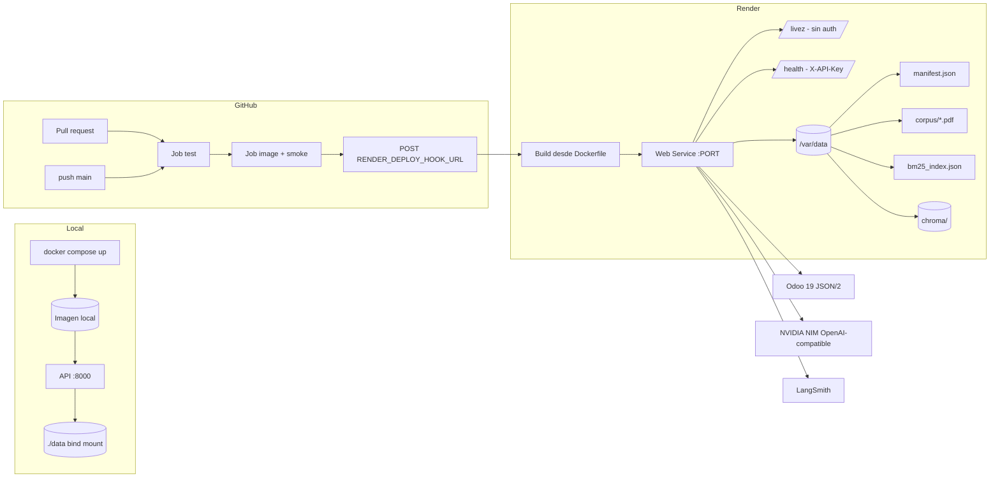

# Spec 004 — Dockerización y despliegue del backend (Render, Railway como alternativa)

| Campo | Valor |
|---|---|
| Estado | Borrador |
| Fecha | 2026-11-06 |
| Revisión | r1 |
| Autor | Planner SDD |
| Repo | `contafis-assistant` |
| Referencias | `AGENTS.md`, `docs/constitution.md`, `docs/memory.md`, `src/contafis_assistant/config.py`, `src/contafis_assistant/main.py`, `src/contafis_assistant/api/security.py`, `src/contafis_assistant/odoo/scope.py`, `src/contafis_assistant/rag/corpus.py`, `src/contafis_assistant/rag/manifest.py`, `.github/workflows/ci.yml`, `specs/006-digitize/spec.md` |

---

## 1. Contexto

El backend (`FastAPI` + `LangGraph` + `Chroma` + cliente Odoo JSON/2) hoy solo corre
desde el checkout local: no existe `Dockerfile`, ni `docker-compose.yml`, ni
`.dockerignore` (verificado: la búsqueda de `Dockerfile`, `docker-compose*`,
`render.yaml` y `.dockerignore` no devuelve nada). El CI actual solo ejecuta
`pytest -q` con variables *dummy* (`.github/workflows/ci.yml:14-42`).

La carpeta `specs/` contiene `001-chat-fiscal`, `002-ui-auth`, `005-session-auth` y
`006-digitize`; esta spec ocupa el número **004** por decisión de `docs/memory.md:27`
(«Spec 004: Dockerización y Deployment»). `SPEC.md:26` todavía dice que 004 es
«Ingesta dinámica de PDFs»: esa discrepancia se trata en §19 (OQ-5).

El objetivo es que el mismo artefacto (imagen de contenedor) corra en local, en
staging y en producción, con el contrato de configuración **real** que impone
`Settings` —no uno idealizado— y sin romper las compuertas de seguridad ya
implementadas: API key compartida, atestación read-only y fail-fast de alcance.

---

## 2. Objetivo y métricas de éxito

**Objetivo:** entregar una imagen OCI reproducible y un pipeline que la construya,
pruebe y despliegue en Render (Railway como alternativa), con el corpus normativo
persistido fuera de la imagen y las compuertas de seguridad activas.

**Métricas de éxito:**

| Métrica | Umbral | Cómo se verifica |
|---|---|---|
| Build de imagen en CI | ≤ 10 min con caché de pip | duración del job `image` |
| Tamaño de imagen | ≤ 1.8 GB sin comprimir | `docker image inspect --format '{{.Size}}'` |
| Arranque en frío sin corpus | ≤ 10 s hasta `/health` 200 | smoke test |
| Arranque en frío con corpus | ≤ 30 s hasta `/health` 200 | smoke test con volumen |
| Tests existentes | 0 fallos, mismo conteo que `main` (686 según `docs/memory.md:7`) | `pytest -q` |
| Secretos en imagen | 0 coincidencias de `.env`, claves o tokens | `docker history` + `test ! -e /app/.env` |
| Deploy en PR | 0 ejecuciones del job `deploy` | logs de Actions |
| Criterios de aceptación (§16) | 100% | suite + verificación manual |

---

## 3. Usuarios y casos de uso

| ID | Actor | Caso de uso |
|---|---|---|
| UC-01 | Desarrollador | `docker compose up` levanta la API en `localhost:8000` con su `.env`, sin instalar Python ni Chroma en el host. |
| UC-02 | Desarrollador | Ejecuta el smoke test del contenedor y verifica `/health` sin depender de Odoo ni de internet. |
| UC-03 | DevOps / mantenedor | Hace push a `main`; CI construye la imagen, corre tests y dispara el deploy hook de Render solo si todo está verde. |
| UC-04 | DevOps | Despliega staging en Render con `APP_ENV=development` mientras Odoo no es públicamente accesible; la app arranca en estado `degraded`. |
| UC-05 | DevOps | Promueve a producción con Odoo público, API key read-only dedicada y `ODOO_READONLY_ATTESTED=true`; si el alcance no es seguro, el servicio **no arranca** (comportamiento intencional). |
| UC-06 | DevOps | Monta un disco persistente con `manifest.json`, PDFs, `bm25_index.json` y `chroma/`; `/health` pasa a `corpus_status: ok`. |
| UC-07 | DevOps | Sin disco (o disco vacío), el servicio sigue respondiendo: `/health` 200 `degraded` y `corpus_status: missing`. |
| UC-08 | DevOps | Hace rollback redeployando el artefacto anterior sin reconstruir la imagen. |
| UC-09 | Auditor | Comprueba que ningún secreto viaja en capas de imagen, logs de CI ni `render.yaml`. |

---

## 4. Glosario

| Término | Significado en esta spec |
|---|---|
| **Imagen** | Artefacto OCI construido por `Dockerfile` multi-stage; único artefacto desplegable. |
| **Compose** | `docker-compose.yml` de **desarrollo local únicamente**; no se usa en Render/Railway. |
| **Deploy hook** | URL secreta de Render (`https://api.render.com/deploy/srv-...?key=...`) que dispara un deploy con `POST`. Se guarda como `RENDER_DEPLOY_HOOK_URL`. |
| **Liveness** | Señal de «proceso vivo, capaz de servir HTTP»; no evalúa Odoo ni corpus. Endpoint propuesto: `GET /livez`. |
| **Readiness / health** | Señal de estado agregado (Odoo, scope, corpus) que ya expone `GET /health` (`main.py:459-525`). |
| **Disco persistente** | Volumen de Render/Railway montado en el contenedor; sobrevive a redeploys. |
| **Corpus** | `manifest.json` + PDFs + `bm25_index.json` + `chroma/`, generado offline por `scripts/ingest_corpus.py`. |
| **Fail-fast** | `ScopeStartupError` que aborta el arranque en producción cuando el alcance es `scope_unsafe` (`odoo/scope.py:190-200`, `main.py:122-130`). |
| **Stage** | Etapa del Dockerfile (`builder`, `runtime`). No confundir con «staging». |
| **Manifiesto** | `data/manifest.json`, validado por `rag/manifest.py:79-158`; declara hashes SHA-256 y páginas de cada PDF. |

---

## 5. Alcance

### Dentro del alcance

1. `Dockerfile` multi-stage, `python:3.12-slim`, usuario no root, `HEALTHCHECK`, sin secretos en capas.
2. `docker-compose.yml` **solo desarrollo local**: build local, puerto 8000, `env_file: .env`, volumen para `data/`.
3. `.dockerignore` que excluya `.env`, `.venv`, `tests/`, cachés, `data/chroma/`, PDFs y artefactos de test.
4. Contrato completo de variables de entorno reconciliado con `Settings` (`config.py:32-89`).
5. Extensión del CI (`.github/workflows/ci.yml`) con job de imagen y smoke test.
6. Nuevo workflow/job de deploy a Render por deploy hook, solo en push a `main`.
7. `render.yaml` (Blueprint) con servicio Docker, `healthCheckPath`, `numInstances: 1`, disco y variables.
8. Estrategia de corpus: layout de disco, manifiesto, hashes, ingesta one-off idempotente y semántica de degradación.
9. Endpoint de liveness sin autenticación (`GET /livez`) y allowlist exacta en el middleware.
10. Runbook de staging/producción, rollback y checklist de promoción.
11. Alternativa Railway documentada (misma imagen, mismo contrato de env).

### Fuera de alcance

- UI Streamlit (`app.py`): no se dockeriza en esta spec; su despliegue y `ASSISTANT_API_URL` quedan para otra iteración.
- Cambios al módulo Odoo (`ContaFis`) o a su infraestructura.
- Migración/versionado de la base de datos de Odoo.
- Autoescalado horizontal, Kubernetes, Terraform, service mesh.
- Reindexado del corpus en runtime (Spec 005, `docs/memory.md:28`).
- Sustituir Chroma por un vector store gestionado.
- Compras, dominios, TLS y DNS (los provee la plataforma).
- Optimización del prompt o del grafo LangGraph.

---

## 6. Hallazgos del repositorio que condicionan el diseño

Estos puntos **no son opinables**: están en el código y la spec los resuelve explícitamente.

| ID | Hallazgo (evidencia) | Consecuencia de diseño |
|---|---|---|
| **H1** | El middleware `_api_key_middleware` envuelve **todas** las rutas (`main.py:996-1003`) y `ApiKeyGuard` protege también `/health` (`security.py:40-61`; test `tests/api/test_chat_api.py:163-196`). Con `API_SHARED_SECRET` definido, `GET /health` sin `X-API-Key` devuelve **401**. | El health check de Render **no permite headers personalizados**. Se necesita un endpoint de liveness sin auth (§7-D5, §17.2, RF-DEP-08). Sin esto, Render marca el servicio como unhealthy y no completa el deploy. |
| **H2** | En `APP_ENV=production`, `ChatRuntime.startup()` lanza `ScopeStartupError` si el snapshot es `None` o `scope_unsafe` (`main.py:122-130`); `ScopeService.startup()` hace lo mismo (`scope.py:190-200`). Un Odoo inalcanzable produce `scope_unsafe` con `reason=odoo_error` (`scope.py:309-321`). | Un deploy a Render con Odoo local (`127.0.0.1:8069`) **no arranca** en producción: entra en crash loop. Staging debe usar `APP_ENV=development`; producción exige Odoo público + key read-only atestada. |
| **H3** | `UVICORN_WORKERS = 1` es intencional (`main.py:69`) y está fijado por test (`tests/api/test_lifespan.py:51-59`). `ThreadStore` vive en memoria del proceso (`main.py:916-919`). | El `CMD` debe usar `--workers 1`; Render debe tener `numInstances: 1`. Escalar workers o instancias pierde hilos de conversación y rompe `worker_count`. |
| **H4** | `Settings` lee `API_HOST`/`API_PORT` (`config.py:73-74`) y `run()` los usa (`main.py:1016-1023`), pero Render inyecta `PORT`. Además `Settings` exige `API_SHARED_SECRET` cuando `API_HOST` no es loopback (`config.py:112-115`). | El arranque en contenedor debe ser `--host 0.0.0.0 --port ${PORT:-8000}` **y** declarar `API_HOST=0.0.0.0` para que la validación de secreto se active (si solo se usa el flag CLI, `Settings` no lo ve y la API quedaría abierta). |
| **H5** | `Settings` **no** conoce `NVIDIA_API_KEY`: la clave de NVIDIA se lee como `OPENAI_API_KEY` (`config.py:42`) y se usa con `OPENAI_BASE_URL` (`main.py:711-717`, `.env.example:11-12`). `LANGSMITH_API_KEY` sí existe (`config.py:67`). | La tabla de env vars debe mapear `NVIDIA_API_KEY → OPENAI_API_KEY`. Si la plataforma define `NVIDIA_API_KEY`, el arranque falla por `openai_api_key` faltante. No se añaden alias (implicaría tocar código). |
| **H6** | `load_manifest` exige que **cada PDF declarado exista** y que su SHA-256 coincida (`rag/manifest.py:129-142`). Si falta el manifiesto → `CorpusStatus.missing`; si el manifiesto existe y falta un PDF → `mismatch` (`corpus.py:151-215`). `/health` agrega el estado (`main.py:467-498`). | No basta con subir `chroma/` + `bm25_index.json`: sin los **PDFs** en el disco el corpus queda `mismatch`, no `ok`. El disco persistente debe contener también `corpus/*.pdf`. |
| **H7** | `data/` solo tiene `chroma/` (vacío) y `corpus/README.md`; no existen `data/manifest.json` ni `data/bm25_index.json` (verificado por listado). `scripts/ingest_corpus.py` delega en `rag/ingest_cli.py`, que busca `.env` en la raíz del repo (`ingest_cli.py:18-24`). | La imagen no puede generar el corpus en build (no hay PDFs ni claves). La ingesta es un paso **one-off** con volumen montado y variables de entorno inyectadas (sin `.env`). |
| **H8** | `requirements.txt` no tiene versiones (`requirements.txt:1-28`) y diverge de `pyproject.toml:11-40` (p. ej. `orjson`, `python-dateutil` están en `pyproject` y no en `requirements`; `rank-bm25`, `rapidfuzz`, `pypdf`, `langchain-community`, `pillow` están en `requirements` y no en `pyproject`). El CI instala `requirements.txt` (`ci.yml:38-42`). | Builds no reproducibles y riesgo de que el contenedor difiera del CI. Mitigación en T2: `constraints.txt` + reconciliación de ambos manifiestos. |
| **H9** | `.env` existe en local y está gitignored (`.gitignore:115-118`); `data/chroma/` también (`.gitignore:153-154`). El patrón `.env.*` excluye variantes salvo `.env.example`. | `.dockerignore` debe excluir `.env` y `.env.*` explícitamente, además de `data/`. Un `COPY . .` sin `.dockerignore` filtraría claves a la imagen. |
| **H10** | `app.py` (Streamlit) lee `API_SHARED_SECRET` y `ASSISTANT_API_URL` (`app.py:26-28`), pero no forma parte de este despliegue. | Cualquier cambio de secreto debe coordinarse con la UI; se documenta, no se implementa. |

---

## 7. Decisiones

| ID | Decisión | Justificación |
|---|---|---|
| **D1** | **Un solo artefacto**: imagen Docker multi-stage `python:3.12-slim`; Render y Railway consumen la misma imagen. | Elimina divergencia dev/prod y permite rollback por imagen. `pyproject.toml:10` exige `>=3.10`; 3.12 es el runtime que ya usa el CI (`ci.yml:32-35`). |
| **D2** | **Contrato de env = `Settings`**, sin alias nuevos. `NVIDIA_API_KEY` se expone como `OPENAI_API_KEY`; `OPENAI_BASE_URL=https://integrate.api.nvidia.com/v1`. | Evita tocar `src/` y mantiene una única fuente de verdad (`config.py`). |
| **D3** | **Staging con `APP_ENV=development`** y `API_SHARED_SECRET` obligatorio; producción con `APP_ENV=production`. No se inventa un valor `staging` en el enum (`config.py:39`). | `production` exige Odoo sano y atestación (H2); staging debe poder arrancar sin Odoo público. |
| **D4** | **Dockerfile con `--workers 1`** y `numInstances: 1`. No se parametriza el número de workers. | `ThreadStore` en memoria (H3); el test de workers ya lo fija. |
| **D5** | **`GET /livez` sin autenticación** como health check de plataforma; `/health` sigue protegido por `X-API-Key`. Render usa `healthCheckPath: /livez`. | Único camino compatible con un health check sin headers (H1) sin desactivar la seguridad de `/health`. Payload mínimo, sin datos de Odoo, corpus ni versión de dependencias. |
| **D6** | **La imagen no contiene corpus ni PDFs**; se monta un disco persistente en `/var/data` y se apuntan `CHROMA_PATH` y `BM25_INDEX_PATH` allí. | Corpus pesado y licenciado; rebuilds rápidos y sin secretos (H6, H7). |
| **D7** | **Ingesta idempotente one-off** (`python scripts/ingest_corpus.py --manifest /var/data/manifest.json`) protegida por comparación de hash/estado, no en cada request ni en cada arranque. | Evita costo de embeddings por deploy y arranques lentos. |
| **D8** | **Deploy por hook** (`POST $RENDER_DEPLOY_HOOK_URL`) solo en `push` a `main`, nunca en PR. | Simple, sin `RENDER_API_KEY`, y el secreto queda en GitHub Environments. |
| **D9** | **Render primario, Railway alternativa** con el mismo `Dockerfile` y las mismas variables. | Portabilidad; Railway inyecta `PORT` igual que Render. |
| **D10** | **Sin Alpine**. | `chromadb` arrastra `onnxruntime`, `numpy`, `chroma-hnswlib`; en musl no hay wheels para todo y habría que compilar (gcc/cmake/Rust), con imagen final mayor y builds frágiles. `slim` (glibc) usa wheels manylinux. |
| **D11** | **`API_HOST=0.0.0.0` explícito** en cualquier entorno no local, aunque el bind lo haga el flag `--host`. | Activa la validación `API_SHARED_SECRET` no vacío (H4) y falla cerrado si falta el secreto. |

---

## 8. Requisitos funcionales (EARS)

| ID | Requisito |
|---|---|
| **RF-DEP-01** | Cuando se ejecute `docker build .`, el sistema deberá producir una imagen que instale dependencias en una etapa `builder` y copie solo wheels + código a la etapa `runtime`. |
| **RF-DEP-02** | La imagen resultante deberá ejecutar el proceso como usuario sin privilegios (UID ≠ 0). |
| **RF-DEP-03** | La imagen resultante no deberá contener `.env`, `.env.*`, claves de API ni el directorio `.git`. |
| **RF-DEP-04** | Cuando un desarrollador ejecute `docker compose up`, el servicio deberá construir la imagen localmente, publicar el puerto `8000` y leer variables desde `.env`. |
| **RF-DEP-05** | Cuando la plataforma inyecte `PORT`, el contenedor deberá escuchar en `0.0.0.0:$PORT`; cuando `PORT` no exista, deberá usar `8000`. |
| **RF-DEP-06** | El proceso deberá arrancar con exactamente 1 worker de Uvicorn y `/health` deberá reportar `worker_count: 1`. |
| **RF-DEP-07** | Cuando `API_SHARED_SECRET` esté configurado, `GET /health` sin `X-API-Key` deberá responder `401`. |
| **RF-DEP-08** | Cuando se invoque `GET /livez`, el sistema deberá responder `200` con `{"status": "alive"}` **sin** requerir `X-API-Key`, Odoo ni corpus. |
| **RF-DEP-09** | Cuando `APP_ENV=development` y Odoo sea inalcanzable, el servicio deberá arrancar y `/health` deberá responder `200` con `status: degraded` y `odoo_available: false`. |
| **RF-DEP-10** | Cuando `APP_ENV=production` y no se cumpla `ODOO_READONLY_ATTESTED=true`, `Settings` deberá rechazar el arranque con error de validación. |
| **RF-DEP-11** | Cuando `APP_ENV=production` y el scope inicial sea `scope_unsafe` o no verificable, el arranque deberá abortar con `ScopeStartupError`. |
| **RF-DEP-12** | Cuando el disco persistente contenga `manifest.json`, PDFs con hash correcto, `bm25_index.json` y `chroma/`, `/health` deberá reportar `corpus_status: ok` y `chroma_available: true`, `bm25_available: true`. |
| **RF-DEP-13** | Cuando el corpus no esté disponible, el servicio deberá seguir arrancando y `/health` deberá responder `200` `degraded` con `corpus_status: missing` (o `mismatch`/`empty` según el caso), sin exponer rutas ni mensajes internos. |
| **RF-DEP-14** | Cuando se abra un pull request, el CI deberá ejecutar tests y build de imagen, y **no** deberá ejecutar el deploy. |
| **RF-DEP-15** | Cuando se haga push a `main` con tests e imagen verdes, el CI deberá invocar el deploy hook de Render usando el secreto `RENDER_DEPLOY_HOOK_URL`, sin imprimirlo en logs. |
| **RF-DEP-16** | La ingesta del corpus deberá ser idempotente: si el manifiesto y el índice ya coinciden en hash y versión, no deberá re-embeber documentos. |
| **RF-DEP-17** | Cuando cambie `EMBEDDING_MODEL` o `EMBEDDING_DIMENSIONS`, el procedimiento documentado deberá exigir borrar `chroma/`, reingresar y actualizar `manifest.json`. |
| **RF-DEP-18** | El repositorio deberá documentar el rollback (redeploy de la imagen/commit anterior) y el procedimiento de promoción staging → producción. |

---

## 9. Requisitos no funcionales

| ID | Requisito | Verificación |
|---|---|---|
| **RNF-DEP-01 Reproducibilidad** | Dos builds del mismo commit deberán producir el mismo conjunto de versiones instaladas. | `pip freeze` comparado entre builds; `constraints.txt` (T2). |
| **RNF-DEP-02 Seguridad de secretos** | 0 secretos en capas, historial, `render.yaml`, logs de CI o artefactos. | `docker history --no-trunc`, `docker run … test ! -e /app/.env`, revisión de logs. |
| **RNF-DEP-03 Mínimo privilegio** | Proceso no root; sin `sudo`; sin `docker.sock`; sin paquetes de compilación en `runtime`. | `id -u` en el contenedor; inspección del Dockerfile. |
| **RNF-DEP-04 Portabilidad** | La imagen deberá correr igual en Render y Railway sin cambios de código. | Deploy de staging en ambas plataformas (T9 opcional). |
| **RNF-DEP-05 Tamaño** | Imagen ≤ 1.8 GB sin comprimir. | `docker image inspect`. |
| **RNF-DEP-06 Arranque** | ≤ 10 s sin corpus; ≤ 30 s con corpus (excluido pull de imagen). | Smoke test con `time`. |
| **RNF-DEP-07 Observabilidad** | Logs a stdout/stderr; sin PII ni claves; `/health` sin datos sensibles. | Revisión de logs de Render; tests existentes de `/health`. |
| **RNF-DEP-08 Privacidad** | `LANGSMITH_HIDE_CONTENT=true` por defecto; tracing solo donde se autorice. | `.env.example:54`, `config.py:70`. |
| **RNF-DEP-09 Costo** | Corpus en disco (no en imagen), 1 instancia, ingesta solo cuando cambia el hash. | Revisión de blueprint y logs de ingesta. |
| **RNF-DEP-10 Testabilidad** | El smoke test de contenedor corre en CI y localmente con `RUN_DOCKER_TESTS=1`, sin red externa salvo loopback. | `tests/docker/` + `pytest -m docker`. |
| **RNF-DEP-11 Sin archivos temporales** | Nada de `fix_*.py`, `debug.py` ni logs a disco en el repo. | Revisión de `git status`. |
| **RNF-DEP-12 Documentación** | Runbook con variables, promoción, rollback y diagnóstico de `/health`. | Revisión de `docs/DEPLOY.md`. |

---

## 10. Arquitectura de despliegue



### 10.1 Topología por entorno

| Aspecto | Local (compose) | Staging (Render) | Producción (Render) |
|---|---|---|---|
| Origen de imagen | `build: .` | registry de Render | registry de Render |
| `APP_ENV` | `development` | `development` (D3) | `production` |
| `API_HOST` | `0.0.0.0` | `0.0.0.0` | `0.0.0.0` |
| `API_SHARED_SECRET` | obligatorio (aunque sea local) | obligatorio | obligatorio |
| `ODOO_URL` | `http://127.0.0.1:8069` o contenedor Odoo | Odoo accesible o inalcanzable (degradado) | Odoo público con TLS |
| `ODOO_READONLY_ATTESTED` | `false` | `false` | `true` |
| Corpus | bind mount `./data:/app/data` | disco `/var/data` (si hay plan pago) | disco `/var/data` |
| Health check plataforma | `HEALTHCHECK` → `/health` con header | Render → `/livez` | Render → `/livez` |
| Workers / instancias | 1 / 1 | 1 / 1 | 1 / 1 |
| Tracing LangSmith | on | on con `HIDE_CONTENT=true` | off o `HIDE_CONTENT=true` |
| Deploy | manual | hook en `main` | hook en `main` + promoción manual |

> **Nota H2:** staging usa `development` porque `production` exige scope seguro y
> atestación. Esto implica que en staging los tools pueden quedar habilitados aun con
> key admin (con warning `scope_admin_key`); es aceptable porque el acceso está
> protegido por `API_SHARED_SECRET` y no hay datos reales.

### 10.2 Layout del disco persistente

```
/var/data/
├── manifest.json          # obligatorio; valida hashes y páginas
├── bm25_index.json        # salida de la ingesta
├── chroma/                # salida de la ingesta (chroma.sqlite3 + segmentos)
└── corpus/
    ├── ley-islr.pdf
    ├── ley-iva.pdf
    └── providencia-seniat.pdf
```

Variables que deben apuntar al disco:

```
CHROMA_PATH=/var/data/chroma
BM25_INDEX_PATH=/var/data/bm25_index.json
```

`manifest.json` se deriva del directorio de `BM25_INDEX_PATH`
(`rag/manifest.py:50-51`); no existe una variable `MANIFEST_PATH`. Los `file` del
manifiesto se resuelven **relativos a `/var/data`** (`manifest.py:129-131`), por eso
deben empezar con `corpus/`.

---

## 11. Contrato de configuración (variables de entorno)

### 11.1 Reconciliación con los nombres pedidos

| Nombre solicitado | Nombre real leído por `Settings` | Acción |
|---|---|---|
| `NVIDIA_API_KEY` | `OPENAI_API_KEY` (`config.py:42`) | Exponer el valor bajo `OPENAI_API_KEY` + `OPENAI_BASE_URL=https://integrate.api.nvidia.com/v1`. **No** definir `NVIDIA_API_KEY` sola. |
| `LANGSMITH_API_KEY` | `LANGSMITH_API_KEY` (`config.py:67`) | Igual. |
| `ODOO_URL` | `ODOO_URL` (`config.py:33`) | Igual. |
| `EMBEDDING_MODEL` | `EMBEDDING_MODEL` (`config.py:45`) | Igual. |
| `EMBEDDING_DIMENSIONS` | `EMBEDDING_DIMENSIONS` (`config.py:46`) | Igual; debe coincidir con `dimensions` del manifiesto. |

### 11.2 Tabla completa (fuente: `config.py:32-89`)

**Obligatorias sin default** (el arranque falla si faltan):

| Variable | Secreto | Ejemplo / valor | Notas |
|---|---|---|---|
| `ODOO_URL` | no | `https://odoo.ejemplo.com` | Sin `/` final; el cliente añade `/json/2/...`. |
| `ODOO_API_KEY` | **sí** | `••••` | Key dedicada read-only; nunca la del admin/MCP. |
| `OPENAI_API_KEY` | **sí** | `nvapi-••••` | Es la key de NVIDIA NIM. |
| `LLM_MODEL` | no | `nvidia/nemotron-3.5-lightning-30b-a3b` | `.env.example:13`. |
| `EMBEDDING_MODEL` | no | `nvidia/nemotron-3-embed-1b` | `.env.example:14`. |
| `CHROMA_PATH` | no | `/var/data/chroma` | En contenedor sin disco: `data/chroma`. |

**Condicionales:**

| Variable | Secreto | Condición | Valor |
|---|---|---|---|
| `API_SHARED_SECRET` | **sí** | Obligatoria si `API_HOST` no es loopback (`config.py:112-115`). En Render siempre. | ≥ 32 caracteres aleatorios. |
| `ODOO_READONLY_ATTESTED` | no | Obligatoria `true` si `APP_ENV=production` (`config.py:120-123`). | `false` en dev/staging, `true` solo tras auditar la key. |

**Opcionales con default:**

| Variable | Default | Secreto | Uso |
|---|---|---|---|
| `ODOO_DB` | `contea` | no | Base Odoo. |
| `ODOO_PROTOCOL` | `json2` | no | Solo `json2` es válido (`config.py:102-103`). |
| `ODOO_TIMEOUT_SECONDS` | `15` | no | Timeout RPC. |
| `APP_ENV` | `development` | no | `development` \| `test` \| `production`. |
| `OPENAI_BASE_URL` | `https://api.openai.com/v1` | no | **Debe** ser el endpoint NIM en este proyecto. |
| `EMBEDDING_DIMENSIONS` | `2048` | no | Debe coincidir con el manifiesto. |
| `LLM_TIMEOUT_SECONDS` | `60` | no | `.env.example:16` usa 30. |
| `CHROMA_COLLECTION` | `contafis_normativa_v1` | no | |
| `BM25_INDEX_PATH` | `data/bm25_index.json` | no | En Render: `/var/data/bm25_index.json`. |
| `BM25_INDEX_VERSION` | `1` | no | Debe coincidir con el manifiesto. |
| `RETRIEVAL_DENSE_TOP_K` | `10` | no | |
| `RETRIEVAL_BM25_TOP_K` | `10` | no | |
| `RETRIEVAL_FINAL_TOP_K` | `5` | no | |
| `RRF_K` | `60` | no | |
| `DENSE_MIN_SCORE` | `0.30` | no | |
| `BM25_MIN_SCORE` | `1.0` | no | |
| `RETRIEVAL_TIMEOUT_SECONDS` | `10` | no | |
| `FUZZY_MIN_SCORE` | `85` | no | |
| `LANGSMITH_TRACING` | `None` → `true` en development (`config.py:117-118`) | no | `false` en producción si no se autoriza. |
| `LANGSMITH_API_KEY` | `None` | **sí** | Opcional; si falta, tracing debe estar off. |
| `LANGSMITH_PROJECT` | `contafis-assistant` | no | |
| `LANGSMITH_ENDPOINT` | `None` | no | |
| `LANGSMITH_HIDE_CONTENT` | `true` | no | Mantener `true`. |
| `API_HOST` | `127.0.0.1` | no | **`0.0.0.0`** en contenedor (D11). |
| `API_PORT` | `8000` | no | El `CMD` prioriza `PORT` (RF-DEP-05). |
| `MAX_MESSAGE_CHARS` | `2000` | no | |
| `MAX_TOOL_CALLS` | `3` | no | `ge=1, le=3`. |
| `RECURSION_LIMIT` | `12` | no | Debe ser ≥ `2*MAX_TOOL_CALLS+4`. |
| `DETAIL_LIMIT` | `50` | no | |
| `MEMORY_MAX_TURNS` | `20` | no | |
| `MEMORY_MAX_THREADS` | `500` | no | |
| `SCOPE_CHECK_TTL_SECONDS` | `300` | no | |
| `SESSION_MAX_AGE_HOURS` | `24` | no | |
| `DIGITIZE_TIMEOUT_SECONDS` | `30.0` | no | Rango 5–120. |
| `DIGITIZE_MAX_IMAGE_MB` | `5` | no | Rango 1–20. |

**Secretos fuera de la app (solo CI):**

| Nombre | Dónde | Uso |
|---|---|---|
| `RENDER_DEPLOY_HOOK_URL` | GitHub Environment `production` (secret) | `POST` para disparar deploy (RF-DEP-15). |
| `RENDER_API_KEY` | opcional, no requerido | Solo si se quiere consultar estado del deploy (OQ-3). |

### 11.3 Mapeo de `PORT`

El `CMD` del Dockerfile (forma shell) debe ser equivalente a:

```
uvicorn contafis_assistant.main:app \
  --app-dir src --host 0.0.0.0 --port ${PORT:-8000} --workers 1
```

Reglas:

1. El puerto sale **siempre** de `PORT` con fallback `8000`; `API_PORT` no se usa para el bind.
2. `API_HOST=0.0.0.0` se declara igualmente para que `Settings` exija `API_SHARED_SECRET` (H4/D11).
3. `--workers 1` es obligatorio (H3).
4. `--app-dir src` evita instalar el paquete y mantiene `PYTHONPATH` limpio.
5. No se usa `python -m contafis_assistant.main` porque `run()` ignora `PORT`.

---

## 12. Dockerfile y compose (diseño, no implementación)

### 12.1 Etapas

| Stage | Base | Contenido | Sale al runtime |
|---|---|---|---|
| `builder` | `python:3.12-slim` + `build-essential` | `pip wheel --wheel-dir /wheels -r requirements.txt` | solo `/wheels` |
| `runtime` | `python:3.12-slim` | usuario `appuser` (UID 10001), `pip install --no-index --find-links=/wheels -r requirements.txt`, `COPY src /app/src`, `COPY scripts /app/scripts` | imagen final |

Puntos obligatorios:

- `ENV PYTHONDONTWRITEBYTECODE=1`, `PYTHONUNBUFFERED=1`, `PIP_NO_CACHE_DIR=1`.
- `WORKDIR /app`.
- `USER appuser` antes del `CMD`.
- `EXPOSE 8000` (informativo).
- `HEALTHCHECK --interval=30s --timeout=5s --start-period=40s --retries=3` contra
  `/health` con `X-API-Key: $API_SHARED_SECRET`; se migra a `/livez` en T4.
- Sin `ARG`/`ENV` con valores secretos.
- Sin `COPY . .`; copias explícitas (`requirements.txt`, `src/`, `scripts/`).
- No se copia `data/` (D6).

### 12.2 Tamaño esperado y Alpine

`chromadb` arrastra `onnxruntime`, `numpy`, `tokenizers`, `pydantic-core` y
`chroma-hnswlib`. Presupuesto realista: **1.2–1.8 GB** sin comprimir
(~500–700 MB comprimido). Alpine se descarta (D10): musl obliga a compilar
`onnxruntime`/`hnswlib` y añade toolchain al build; el runtime quedaría igual o más
grande y más frágil.

### 12.3 `docker-compose.yml` (solo desarrollo)

- `build: .`, `image: contafis-assistant:dev`.
- `ports: ["8000:8000"]`.
- `env_file: [.env]`.
- `environment: API_HOST=0.0.0.0`.
- `volumes: ["./data:/app/data"]` para corpus y Chroma.
- `restart: unless-stopped`.
- Sin secretos literales en el YAML.

### 12.4 `.dockerignore` mínimo

```
.git
.github
.venv
venv
env
__pycache__
*.py[cod]
.pytest_cache
.mypy_cache
.ruff_cache
htmlcov
.coverage
tests
notebooks
specs
docs
data
.env
.env.*
pytest-of-*
pip-*
*.log
```

`README.md`, `pyproject.toml` y `requirements.txt` sí se incluyen (metadatos y build).

---

## 13. Corpus: carga, persistencia y degradación

### 13.1 Restricción dura (H6)

`load_manifest` valida, para cada documento declarado:

1. Que el archivo exista en `manifest.parent / file` (`manifest.py:129-131`).
2. Que su SHA-256 coincida (`manifest.py:137-142`).

Por tanto, un disco con solo `chroma/` + `bm25_index.json` produce
`manifest_status: missing` → `corpus_status: missing`. Un disco con manifiesto pero sin
PDFs produce `mismatch`. **El disco debe incluir los PDFs.**

### 13.2 Estrategia propuesta

| Paso | Acción | Ejecuta |
|---|---|---|
| 1 | Obtener PDFs de la fuente oficial (Gaceta/SENIAT) y calcular SHA-256 y páginas (`data/corpus/README.md:100-115`). | Operador |
| 2 | Crear `manifest.json` con `dimensions=EMBEDDING_DIMENSIONS` y hashes reales. | Operador |
| 3 | Depositar PDFs + manifiesto en el disco `/var/data` del servicio. | Operador / job |
| 4 | Ejecutar ingesta one-off: `python scripts/ingest_corpus.py --manifest /var/data/manifest.json`. | Job |
| 5 | Copiar el `sha256` impreso a `bm25_index_sha256` del manifiesto (`data/corpus/README.md:140-148`). | Job/operador |
| 6 | Reiniciar el servicio y verificar `/health`. | CI/operador |

**Idempotencia (RF-DEP-16):** antes de embeber, el job compara
`BM25_INDEX_VERSION`, `bm25_index_sha256` y el estado de la colección; si coinciden con
el manifiesto, termina con código 0 sin llamar al embedder. Esto evita costo por
deploy.

**Canal de subida de PDFs (bloqueante, OQ-2):** los PDFs no están versionados
(`data/corpus/README.md:11-24`). Render no expone subida de archivos al disco desde el
dashboard: el contenido se escribe desde un proceso del servicio (job,
`preDeployCommand` o shell del servicio si el plan la habilita). Verificar la vía
disponible antes de T7. Opciones:

- **A (recomendada):** almacenar los PDFs en un bucket privado y que el job de ingesta
  los descargue con una URL firmada (`CORPUS_SOURCE_URL`, secreto), verifique hash y
  escriba en `/var/data/corpus/`.
- **B:** `preDeployCommand` idempotente que descarga + ingiere (requiere plan que lo
  soporte y acepta el costo de arranque en cada deploy).
- **C:** versionar los PDFs en un repositorio privado y clonarlos en el job (requiere
  credencial de solo lectura).

Sin una de estas vías, el corpus **no puede** llegar a `ok` en Render.

### 13.3 Semántica si el corpus falta (RF-DEP-13)

| Situación | `corpus_status` | `/health` | Efecto en `/chat` |
|---|---|---|---|
| Sin disco / sin `manifest.json` | `missing` | 200 `degraded` | RAG no disponible; tools ERP siguen si el scope lo permite. |
| Manifiesto válido, falta un PDF o hash malo | `mismatch` | 200 `degraded` | Ídem; warning `corpus_unavailable`. |
| `chroma/` sin vectores | `empty` | 200 `degraded` | Ídem. |
| Todo presente y hashes correctos | `ok` | 200 `ok` (si scope y Odoo sanos) | RAG operativo. |
| `APP_ENV=production` y scope inseguro | (cualquiera) | **503** `unhealthy` | 503 sin ejecutar tools (`main.py:483-508`). |

Ningún caso expone rutas del sistema de archivos ni mensajes de error internos
(verificado por `tests/api/test_health.py:157-176`).

---

## 14. CI/CD

### 14.1 Jobs

| Job | Dispara | Pasos | Secreto |
|---|---|---|---|
| `test` (existente) | PR y push a `main` | checkout, Python 3.12, `pip install -r requirements.txt`, `pytest -q` | ninguno |
| `image` (nuevo) | PR y push a `main` | checkout, `docker build`, `docker run` smoke, `id -u` ≠ 0, `test ! -e /app/.env`, `docker history` sin `.env`, presupuesto de tamaño | ninguno |
| `deploy` (nuevo) | **solo** push a `main` | `needs: [test, image]`, `if: github.event_name == 'push' && github.ref == 'refs/heads/main'`, `curl -fsS -X POST "$RENDER_DEPLOY_HOOK_URL"` | `RENDER_DEPLOY_HOOK_URL` (Environment `production`) |

### 14.2 Reglas

1. `permissions: contents: read` a nivel de workflow.
2. `concurrency: {group: deploy-main, cancel-in-progress: false}`.
3. Prohibido `echo "$RENDER_DEPLOY_HOOK_URL"`, `set -x` y `curl -v`.
4. `curl -fsS --retry 3 --retry-delay 5 -o /dev/null` para no volcar la URL.
5. El job `deploy` nunca corre en `pull_request` ni en forks.
6. El deploy no espera el resultado del build de Render (limitación del hook, OQ-3);
   la verificación se hace con `GET /livez` y revisión manual.

### 14.3 `render.yaml` (esbozo, sin secretos)

```yaml
services:
  - type: web
    name: contafis-assistant
    runtime: docker
    dockerfilePath: ./Dockerfile
    healthCheckPath: /livez        # requiere T4
    numInstances: 1                # H3
    autoDeploy: false              # el deploy lo dispara el hook (T6)
    envVars:
      - key: APP_ENV
        value: production
      - key: API_HOST
        value: 0.0.0.0
      - key: ODOO_READONLY_ATTESTED
        value: "true"
      - key: OPENAI_API_KEY
        sync: false                # se carga en el dashboard
      - key: ODOO_API_KEY
        sync: false
      - key: API_SHARED_SECRET
        sync: false
      - key: ODOO_URL
        sync: false
      - key: LLM_MODEL
        value: nvidia/nemotron-3.5-lightning-30b-a3b
      - key: EMBEDDING_MODEL
        value: nvidia/nemotron-3-embed-1b
      - key: EMBEDDING_DIMENSIONS
        value: "2048"
      - key: OPENAI_BASE_URL
        value: https://integrate.api.nvidia.com/v1
      - key: CHROMA_PATH
        value: /var/data/chroma
      - key: BM25_INDEX_PATH
        value: /var/data/bm25_index.json
    disk:
      name: corpus-data
      mountPath: /var/data
      sizeGB: 1
```

> `sync: false` evita versionar valores; el contenido se carga en el dashboard de
> Render. Validar el esquema vigente de Blueprints antes de mergear (no se asume
> versión de API).

### 14.4 Railway (alternativa)

- Deploy desde el mismo `Dockerfile` (detección automática).
- `PORT` inyectado por la plataforma; mismo `CMD`.
- Volumen montado en `/var/data` con el mismo layout.
- Variables equivalentes; los secretos se cargan en el panel, no en el repo.
- Sin `render.yaml`; la configuración vive en el panel de Railway.

---

## 15. Seguridad

| Control | Implementación |
|---|---|
| Sin `.env` en contexto de build | `.dockerignore` + `COPY` selectivo (H9). |
| Sin secretos en capas | No se usan `ARG`/`ENV` con valores; se inyectan en runtime. |
| Usuario no root | `USER appuser` (UID 10001) (RF-DEP-02). |
| Superficie de endpoints | `/livez` devuelve solo estado; `/health` sigue con `X-API-Key` (RF-DEP-07/08). |
| Protección de la API | `API_SHARED_SECRET` obligatorio con `API_HOST=0.0.0.0` (D11). |
| Odoo read-only | Key dedicada + `ODOO_READONLY_ATTESTED=true`; scope `scope_unsafe` bloquea tools en producción (`scope.py:61-68`, `main.py:233-236`). |
| Fail-closed en producción | `ScopeStartupError` (H2) y 503 en `/health` (RF-DEP-11). |
| Logs | Sin PII ni claves; `/health` no expone ids ni rutas (`test_health.py:59-67`). |
| Trazas | `LANGSMITH_HIDE_CONTENT=true`; tracing off en producción si no se autoriza. |
| CI | Secreto en GitHub Environment; sin impresión; `permissions` mínimos. |
| Cadena de suministro | `constraints.txt` (T2); opcional escaneo de imagen en T3. |

---

## 16. Criterios de aceptación

| ID | Escenario | Esperado |
|---|---|---|
| **AC-01** | `docker build .` desde un checkout limpio | Exit 0; imagen creada. |
| **AC-02** | `docker run image id -u` | Distinto de `0`. |
| **AC-03** | `docker run image test -e /app/.env` | Exit 0 (no existe). |
| **AC-04** | `docker history --no-trunc image \| grep -i secret` | 0 coincidencias de valores secretos. |
| **AC-05** | Contenedor con `PORT=18001` | `/health` responde en `127.0.0.1:18001`. |
| **AC-06** | Contenedor sin `PORT` | Escucha en `8000`. |
| **AC-07** | `/health` con `API_SHARED_SECRET` y sin header | 401 `{"detail":"Unauthorized"}`. |
| **AC-08** | `/health` con header correcto, Odoo inalcanzable, `APP_ENV=development` | 200 `degraded`, `odoo_available:false`, `corpus_status:"missing"`. |
| **AC-09** | `/livez` sin header, `API_SHARED_SECRET` configurado | 200 `{"status":"alive"}`. |
| **AC-10** | `POST /livez` | 405. |
| **AC-11** | `/health` sin header tras T4 | 401 (sin regresión). |
| **AC-12** | `APP_ENV=production` sin `ODOO_READONLY_ATTESTED` | Arranque falla con `ValidationError` (no sirve tráfico). |
| **AC-13** | `APP_ENV=production` con Odoo inalcanzable | Arranque aborta con `ScopeStartupError`; el contenedor sale ≠ 0. |
| **AC-14** | `APP_ENV=production`, key read-only, Odoo sano, attested | `/health` 200 `ok`; `worker_count:1`. |
| **AC-15** | `docker compose up` con `.env` local | API en `:8000`; `./data` montado; logs sin secretos. |
| **AC-16** | Volumen con manifiesto + PDFs + BM25 + Chroma válidos | `/health` 200 `corpus_status:"ok"`, `chroma_available:true`, `bm25_available:true`. |
| **AC-17** | Volumen sin `manifest.json` | `/health` 200 `degraded`, `corpus_status:"missing"`. |
| **AC-18** | Volumen con manifiesto y un PDF ausente | `/health` 200 `degraded`, `corpus_status:"mismatch"`. |
| **AC-19** | Push a `main` con CI verde | Job `deploy` ejecutado una vez; hook invocado. |
| **AC-20** | Pull request | Job `deploy` omitido (`skipped`). |
| **AC-21** | Logs del job `deploy` | No contienen la URL del hook ni claves. |
| **AC-22** | `pytest -q` completo tras T1–T3 | 0 failed; conteo ≥ 686. |
| **AC-23** | `RUN_DOCKER_TESTS=1 pytest -m docker` | Todos los tests de contenedor verdes. |
| **AC-24** | Imagen `docker image inspect` | Tamaño ≤ 1.8 GB. |
| **AC-25** | Reinicio del servicio en Render | `/livez` 200 antes de que el corpus termine de abrir. |

---

## 17. Plan de tests (TDD)

### 17.1 Smoke test de contenedor — `tests/docker/test_container_health.py`

Marcador `docker` (debe registrarse en `pyproject.toml` porque `addopts` usa
`--strict-markers`, `pyproject.toml:45-50`). Se ejecuta solo con
`RUN_DOCKER_TESTS=1`; en CI lo activa el job `image`.

| Test | Assert |
|---|---|
| `test_image_builds` | `docker build` exit 0; imagen etiquetada. |
| `test_container_health_responds` | `/health` 200; `status in {ok, degraded}`; `corpus_status == "missing"`; `worker_count == 1`. |
| `test_container_requires_api_key_when_secret_set` | 401 sin `X-API-Key`; 200 con header correcto. |
| `test_container_runs_as_non_root` | `docker run --rm image id -u` ≠ `0`. |
| `test_image_has_no_env_file` | `test ! -e /app/.env`. |
| `test_dockerignore_excludes_sensitive_paths` | `.dockerignore` contiene `.env`, `.env.*`, `.venv`, `tests`, `data`. |
| `test_port_variable_is_honored` | `PORT=18001` + `-p 18001:18001` → `/health` responde en 18001. |
| `test_image_size_within_budget` | `Size ≤ 1.8 GB`. |
| `test_healthcheck_is_defined` | `docker inspect` reporta `Healthcheck` distinto de `null`. |

Notas de entorno:

- El `conftest` raíz bloquea red externa pero permite loopback
  (`tests/conftest.py:82-87`), así que `httpx` a `127.0.0.1` funciona.
- Odoo se apunta a `http://127.0.0.1:9` para forzar fallo inmediato y estado
  `degraded` sin esperas.
- `API_SHARED_SECRET=test-container-secret` y `APP_ENV=development` en el contenedor
  de prueba.

### 17.2 Tests de liveness (T4) — `tests/api/test_liveness.py`

| Test | Assert |
|---|---|
| `test_livez_without_api_key` | 200, `{"status":"alive"}` aun con `API_SHARED_SECRET` configurado. |
| `test_livez_does_not_touch_runtime` | 200 antes de `runtime.startup()` (no requiere `ready`). |
| `test_health_still_requires_key` | 401 sin header (no regresión de H1). |
| `test_livez_rejects_other_methods` | `POST /livez` → 405. |
| `test_livez_payload_has_no_sensitive_data` | Sin `scope_state`, `corpus_status`, rutas ni claves. |

### 17.3 Tests de contrato de entorno (T2/T5) — `tests/deployment/test_env_contract.py`

| Test | Assert |
|---|---|
| `test_every_settings_field_has_documented_env` | El conjunto de campos de `Settings` aparece en la tabla de `docs/DEPLOY.md`. |
| `test_render_yaml_uses_real_settings_names` | Cada `key` de `render.yaml` está en `Settings.model_fields` (o es `sync`). |
| `test_no_nvidia_api_key_alias` | No se documenta `NVIDIA_API_KEY` como variable de la app. |
| `test_manifest_requires_pdfs` | `load_manifest` devuelve `mismatch` si falta un PDF (regresión de H6). |

### 17.4 Tests de configuración ya existentes (no regresión)

- `tests/api/test_health.py` — estados `ok`/`degraded`/`unhealthy`.
- `tests/api/test_chat_api.py:163-196` — 401 en `/chat` y `/health`.
- `tests/api/test_lifespan.py:51-59` — 1 worker.
- `tests/api/test_startup.py` — degradación sin scope.
- `tests/acceptance/test_security_audit.py:67-95` — claves de `.env.example`.

Suite completa esperada: **0 failed**, conteo ≥ 686 (`docs/memory.md:7`).

---

## 18. Riesgos y mitigaciones

| ID | Riesgo | Impacto | Mitigación |
|---|---|---|---|
| **R1** | `/health` 401 por middleware → Render marca unhealthy | Deploy nunca completa (H1) | `/livez` sin auth (T4) antes de `render.yaml` (T5). |
| **R2** | Producción en Render sin Odoo público → crash loop | Servicio caído (H2) | Staging con `APP_ENV=development`; checklist de promoción (T8). |
| **R3** | `requirements.txt` sin pin → builds distintos | Incidentes irreproducibles (H8) | `constraints.txt` + reconciliación con `pyproject` (T2). |
| **R4** | Corpus sin PDFs en el disco → `mismatch` | RAG inoperante (H6) | Layout de disco con `corpus/*.pdf` validado en T7. |
| **R5** | No hay canal para subir PDFs a Render | Corpus nunca `ok` (OQ-2) | Opción A: bucket privado + URL firmada; decidir en T7. |
| **R6** | Imagen > 2 GB o build > 15 min | Costos y timeouts | Multi-stage, `--no-cache-dir`, wheels cacheadas; presupuesto en CI. |
| **R7** | Escalar workers/instancias pierde hilos | Conversaciones inconsistentes (H3) | `--workers 1` + `numInstances: 1`; test de regresión. |
| **R8** | Disco persistente impide zero-downtime | Microcorte en cada deploy | Aceptado para MVP; documentar ventana; evaluar store externo a futuro. |
| **R9** | UID no root sin permiso de escritura en el disco | Ingesta falla | Verificar permisos del mount en T7; si no, job de ingesta con UID adecuado. |
| **R10** | Secreto del hook filtrado en logs/PR | Deploy no autorizado | `curl -fsS -o /dev/null`, sin `set -x`, Environment protegido, rotación. |
| **R11** | Ingesta re-embebe en cada deploy | Costo NIM y tiempo | Guard de hash/versión idempotente (RF-DEP-16). |
| **R12** | Plan free de Render sin disco y con spin-down | Corpus ausente y cold starts | Staging en free solo para `/livez`; corpus y producción en plan pago. |
| **R13** | Odoo con allowlist de IPs rechaza a Render | `odoo_available:false` | Verificar egress/allowlist antes de producción (OQ-4). |
| **R14** | Cambio de `EMBEDDING_*` sin reingesta | `mismatch` o error de dimensión | Procedimiento de `data/corpus/README.md:182-201` en el runbook. |
| **R15** | `.env` copiado por error en un refactor del Dockerfile | Fuga de claves | Test `test_image_has_no_env_file` + `.dockerignore` versionado. |

---

## 19. Preguntas abiertas

| ID | Pregunta | Bloquea |
|---|---|---|
| **OQ-1** | ¿Plan/región de Render y tamaño de disco (1 GB inicial)? ¿Se acepta el costo de un plan pago para staging con disco? | **Resuelto**: Diferido a T7/T8. Staging inicial en plan Free (sin disco, solo `/livez`); producción en plan Starter (o superior) con disco 1 GB persistente para corpus. La decisión final de plan/región se tomará cuando exista el corpus (T7) y se valide la atestación read-only (T8). | T7, T8 |
| **OQ-2** | ¿Cuál es el canal autorizado para depositar PDFs en el disco (bucket privado, repo privado, job con descarga firmada)? | T7 (bloqueante para `corpus_status: ok`) |
| **OQ-3** | ¿Se requiere `RENDER_API_KEY` para consultar el estado del deploy y automatizar rollback, o basta el hook + verificación manual de `/livez`? | T6, T10 |
| **OQ-4** | ¿Odoo 19 de producción es públicamente accesible desde Render (TLS, allowlist, IP estática de egress)? | T8 |
| **OQ-5** | `SPEC.md:26` numera 004 como «Ingesta dinámica de PDFs», pero `docs/memory.md:27` y esta spec usan 004 = Deployment. ¿Se actualiza `SPEC.md` y se renumeran las specs pendientes? | T10 (documentación) |
| **OQ-6** | ¿Se despliega también la UI Streamlit (`app.py`) en esta fase o queda para una spec posterior? | Fuera de alcance; afecta `ASSISTANT_API_URL` |
| **OQ-7** | ¿Se autoriza tracing LangSmith en staging con contenido oculto, o se desactiva por completo? | T5 |
| **OQ-8** | ¿Se exige escaneo de vulnerabilidades de imagen (p. ej. Trivy) en CI o queda como mejora posterior? | T3 (opcional) |

---

## 20. Entregables

1. `specs/004-deployment/spec.md` (este archivo).
2. `specs/004-deployment/tasks.md` (T1–T10).
3. `Dockerfile`, `docker-compose.yml`, `.dockerignore` (T1).
4. `constraints.txt` y reconciliación de dependencias (T2).
5. `.github/workflows/ci.yml` extendido + workflow de deploy (T3, T6).
6. `GET /livez` y allowlist del middleware (T4).
7. `render.yaml` + `docs/DEPLOY.md` (T5, T7, T8).
8. `tests/docker/`, `tests/api/test_liveness.py`, `tests/deployment/` (T1, T4, T5).
9. Runbook de rollback y actualización de `docs/memory.md` (T10).

---

## 21. Trazabilidad requisito → tarea

| Requisito | Tarea |
|---|---|
| RF-DEP-01..06 | T1 |
| RNF-DEP-01, RF-DEP-17 | T2 |
| RF-DEP-14, RNF-DEP-10 | T3 |
| RF-DEP-07, RF-DEP-08 | T4 |
| RF-DEP-09, RF-DEP-10, RF-DEP-11 | T4, T5, T8 |
| RF-DEP-12, RF-DEP-13, RF-DEP-16 | T7 |
| RF-DEP-15 | T6 |
| RF-DEP-18, RNF-DEP-12 | T10 |
| RNF-DEP-04 (Railway) | T9 |
