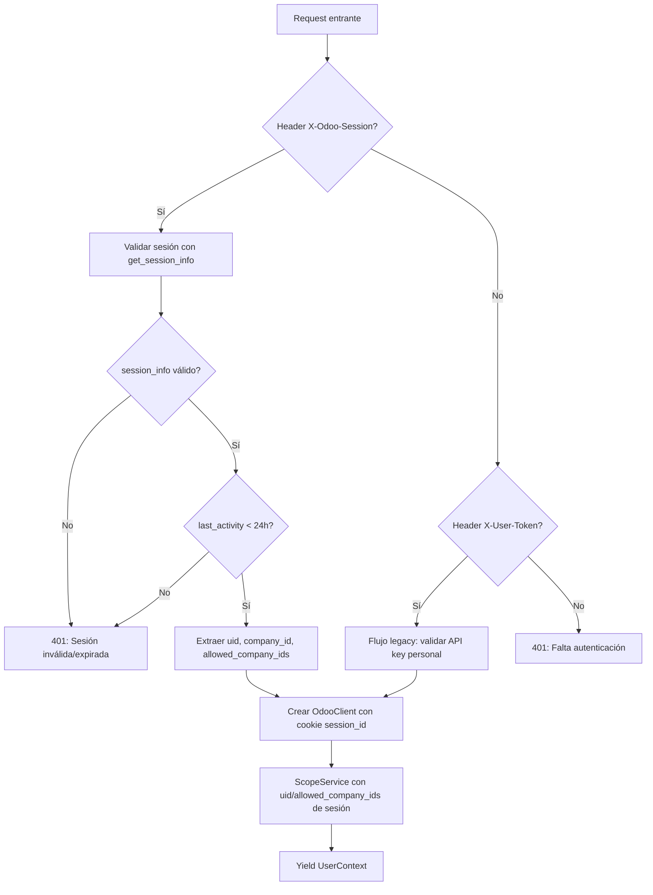

# Spec 005 — Autenticación por Session ID de Odoo

| Campo | Valor |
|---|---|
| Estado | Borrador |
| Fecha | 2026-10-31 |
| Revisión | r1 |
| Autor | Planner SDD |
| Repo | `contafis-assistant` |
| Referencias | `AGENTS.md`, `docs/memory.md`, `specs/001-chat-fiscal/spec.md`, `specs/002-ui-auth/spec.md` |

---

## 1. Contexto

Actualmente, la autenticación de usuario en el asistente fiscal usa un header `X-User-Token` que contiene una **API key personal de Odoo** (Bearer token). El bot de Odoo 19, sin embargo, ya mantiene una **sesión de usuario** estándar (`session_id` cookie) tras el login web. Para simplificar la integración y evitar que los usuarios gestionen API keys personales, el bot enviará el header `X-Odoo-Session` con el `session_id` de la sesión web activa.

El backend FastAPI debe:
1. Validar el `session_id` contra el endpoint `/web/session/get_session_info` de Odoo.
2. Extraer `uid`, `company_id` (compañía activa), y `allowed_company_ids` (compañías permitidas).
3. Usar ese `session_id` (como cookie `session_id=...`) para las llamadas JSON-RPC posteriores a Odoo.
4. Mantener `X-User-Token` como **fallback legacy** para tests y compatibilidad temporal.

---

## 2. Objetivo y métricas de éxito

**Objetivo:** Sustituir la autenticación por API key personal (`X-User-Token`) por autenticación por sesión de Odoo (`X-Odoo-Session`), validando la sesión contra Odoo y propagando la cookie de sesión en las llamadas RPC.

**Métricas de éxito:**
- 100% de los criterios de aceptación (sección 11) pasan en CI con mocks, sin red ni tokens reales.
- El header `X-Odoo-Session` tiene prioridad sobre `X-User-Token`.
- La validación de expiración de sesión (24h) rechaza sesiones caducadas con 401.
- El fallback a `X-User-Token` funciona para tests legacy existentes.
- La suite de tests completa (686 tests) sigue en verde.

---

## 3. Usuarios y casos de uso

| ID | Caso de uso | Descripción |
|---|---|---|
| UC-01 | Login vía bot Odoo | El usuario hace login en Odoo web; el bot extrae la cookie `session_id` y la envía como `X-Odoo-Session`. |
| UC-02 | Sesión válida | `X-Odoo-Session` válido → `get_session_info` devuelve `uid`, `company_id`, `allowed_company_ids` → request autorizado. |
| UC-03 | Sesión expirada | `get_session_info` devuelve error o `uid` nulo → 401 con detail "Sesión de Odoo expirada o inválida." |
| UC-04 | Sesión > 24h | Sesión válida pero `last_activity` > 24h → 401 con detail "Sesión de Odoo expirada (24h)." |
| UC-05 | Fallback legacy | Sin `X-Odoo-Session` pero con `X-User-Token` válido → funciona como antes (tests legacy). |
| UC-06 | Sin autenticación | Sin `X-Odoo-Session` ni `X-User-Token` → 401 "Falta autenticación (X-Odoo-Session o X-User-Token)." |

---

## 4. Glosario

| Término | Significado en esta spec |
|---|---|
| `session_id` | Identificador de sesión web de Odoo (cookie `session_id`). |
| `get_session_info` | Endpoint Odoo `/web/session/get_session_info` (JSON-RPC) que devuelve info de la sesión actual. |
| `X-Odoo-Session` | Header HTTP que el bot envía con el `session_id`. |
| `X-User-Token` | Header legacy con API key personal de Odoo (fallback). |
| `UserContext` | Contexto de usuario autenticado (ya existe en `user_auth.py`); se extiende para soportar sesión. |
| `OdooClient` | Cliente HTTP que ahora puede usar cookie de sesión en lugar de Bearer token. |

---

## 5. Alcance

### Dentro del alcance
1. Nueva dependencia FastAPI: `get_user_context_from_session` (reemplaza/extiende `get_user_context`).
2. Validación de sesión contra `/web/session/get_session_info`.
3. Extracción de `uid`, `company_id`, `allowed_company_ids`, `last_activity` (para expiración 24h).
4. `OdooClient` modificado para aceptar y enviar cookie `session_id`.
5. Fallback a `X-User-Token` (comportamiento actual preservado).
6. Tests unitarios con mock de `get_session_info`.
7. Actualización de `ScopeService` para usar `uid` y `allowed_company_ids` de la sesión.

### Fuera de alcance
- Renovación automática de sesión (refresh token).
- Logout explícito (el bot maneja el ciclo de vida de la sesión).
- Múltiples sesiones concurrentes por usuario.
- Cambios en la UI Streamlit (Spec 002 ya completada).

---

## 6. Decisiones confirmadas

| ID | Decisión | Justificación |
|---|---|---|
| D1 | **Prioridad**: `X-Odoo-Session` > `X-User-Token` | El bot moderno usa sesión; API key es legacy. |
| D2 | **Validación**: llamada real a `/web/session/get_session_info` | Es la forma estándar de Odoo de verificar sesión. |
| D3 | **Expiración**: 24h desde `last_activity` | Política de seguridad estándar; configurable vía setting. |
| D4 | **Cookie en RPC**: `OdooClient` envía `Cookie: session_id=<value>` | Odoo JSON/2 acepta autenticación por cookie de sesión. |
| D5 | **Fallback**: `X-User-Token` se mantiene sin cambios | No romper tests legacy ni integraciones existentes. |
| D6 | **Error 401 unificado**: mismo detail para sesión inválida/expirada | No filtrar información sobre estado interno de Odoo. |

---

## 7. Flujo funcional



---

## 8. Contrato de datos

### 8.1 Request headers

| Header | Requerido | Descripción |
|---|---|---|
| `X-Odoo-Session` | No (preferido) | `session_id` de la sesión web de Odoo. |
| `X-User-Token` | No (fallback) | API key personal de Odoo (legacy). |
| `X-API-Key` | Sí | Shared secret del servicio (middleware existente). |

### 8.2 `get_session_info` response (Odoo)

```json
{
  "jsonrpc": "2.0",
  "id": 1,
  "result": {
    "uid": 7,
    "is_system": false,
    "is_admin": false,
    "user_context": {
      "lang": "es_VE",
      "tz": "America/Caracas",
      "uid": 7,
      "allowed_company_ids": [1, 2],
      "company_id": 1,
      "partner_id": 12
    },
    "session_id": "abc123...",
    "last_activity": "2026-10-31 14:30:00"
  }
}
```

Campos relevantes:
- `result.uid` (int): ID del usuario.
- `result.user_context.company_id` (int): Compañía activa.
- `result.user_context.allowed_company_ids` (list[int]): Compañías permitidas.
- `result.last_activity` (str): Timestamp de última actividad (formato Odoo).

### 8.3 `UserContext` (extendido)

```python
@dataclass
class UserContext:
    token: str                    # session_id O api_key (legacy)
    user_key: str                 # SHA-256 hex del token (para cache/segmentación)
    client: OdooClient            # Cliente con cookie o Bearer según modo
    snapshot: ScopeSnapshot       # Resultado del scope_check
    companies: list[dict]         # [{"id": int, "name": str}, ...]
    scope_service: ScopeService   # Para refresh dinámico
    auth_mode: Literal["session", "token"]  # NUEVO: distingue el modo
    session_uid: int | None       # NUEVO: uid de la sesión validada
    session_company_id: int | None  # NUEVO: company_id activo
```

---

## 9. Cambios en el código

### 9.1 `config.py` — Nuevo setting

```python
# Expiración de sesión en horas (default 24)
session_max_age_hours: int = 24
```

### 9.2 `odoo/client.py` — Soporte para cookie de sesión

- Nuevo parámetro opcional `session_id: str | None` en `__init__`.
- Si `session_id` presente: headers incluyen `Cookie: session_id=<value>` y **no** `Authorization: Bearer`.
- `api_key` pasa a ser opcional si hay `session_id`.
- Mantener compatibilidad: si no hay `session_id`, usa `Authorization: Bearer <api_key>`.

### 9.3 `api/user_auth.py` — Nueva dependencia `get_user_context_from_session`

```python
SESSION_HEADER = "X-Odoo-Session"
USER_TOKEN_HEADER = "X-User-Token"  # Legacy

def get_user_context_from_session(
    request: Request,
    x_odoo_session: Annotated[str | None, Header(alias=SESSION_HEADER)] = None,
    x_user_token: Annotated[str | None, Header(alias=USER_TOKEN_HEADER)] = None,
) -> Generator[UserContext, None, None]:
    """
    1. Si X-Odoo-Session presente → validar con get_session_info.
    2. Si no, pero X-User-Token presente → flujo legacy (get_user_context original).
    3. Si ninguno → 401.
    """
```

#### Validación de sesión (`_validate_session`)

1. POST a `{odoo_url}/web/session/get_session_info` con `Content-Type: application/json`, body `{"jsonrpc": "2.0", "method": "call", "params": {}}` y header `Cookie: session_id=<value>`.
2. Verificar `result.uid` no nulo.
3. Verificar `last_activity` < `session_max_age_hours` (default 24h) comparando con `Clock.now()` en UTC.
4. Extraer `uid`, `company_id`, `allowed_company_ids` de `result.user_context`.
5. Crear `OdooClient(session_id=session_id, uid=uid, allowed_company_ids=allowed_company_ids)`.
6. `ScopeService` usa ese cliente (ya tiene `uid` y `allowed_company_ids` seteados).

#### Flujo legacy (`_legacy_user_context`)

- Delega a la lógica actual de `get_user_context` (se refactoriza como función privada).

### 9.4 `api/routes.py` — Cambio de dependencia

```python
# Antes
user_ctx: UserContext = Depends(get_user_context)

# Después
user_ctx: UserContext = Depends(get_user_context_from_session)
```

### 9.5 `main.py` — Inyección de `Clock` y settings

- `get_user_context_from_session` necesita `Clock` (para expiración 24h) y `Settings` (para `session_max_age_hours` y `odoo_url`).
- El `ChatRuntime` ya tiene `clock` y `settings`; se pasan via `request.app.state`.

---

## 10. Endpoints afectados

| Endpoint | Cambio |
|---|---|
| `POST /chat` | Usa `get_user_context_from_session` |
| `GET /scope` | Usa `get_user_context_from_session` |
| `GET /health` | Sin cambios (solo `X-API-Key`) |

---

## 11. Criterios de aceptación

| ID | Escenario | Expected |
|---|---|---|
| AC-01 | Request con `X-Odoo-Session` válido, `last_activity` < 24h | 200, `UserContext.auth_mode == "session"`, `session_uid` seteado |
| AC-02 | Request con `X-Odoo-Session` inválido (Odoo devuelve error) | 401, detail "Sesión de Odoo expirada o inválida." |
| AC-03 | Request con `X-Odoo-Session` válido pero `last_activity` > 24h | 401, detail "Sesión de Odoo expirada (24h)." |
| AC-04 | Request sin `X-Odoo-Session` pero con `X-User-Token` válido | 200, `UserContext.auth_mode == "token"` (flujo legacy) |
| AC-05 | Request sin `X-Odoo-Session` ni `X-User-Token` | 401, detail "Falta autenticación (X-Odoo-Session o X-User-Token)." |
| AC-06 | `OdooClient` con `session_id` envía `Cookie: session_id=...` y **no** `Authorization` | Verificado en mock transport |
| AC-07 | `OdooClient` sin `session_id` envía `Authorization: Bearer <api_key>` | Comportamiento actual preservado |
| AC-08 | `ScopeService` usa `uid` y `allowed_company_ids` de la sesión validada | `snapshot.uid == session_uid`, `user_company_ids == allowed_company_ids` |
| AC-09 | Tests legacy existentes (`test_user_auth.py`) siguen pasando sin cambios | Suite completa en verde |
| AC-10 | Header `X-Odoo-Session` tiene prioridad sobre `X-User-Token` si ambos presentes | Modo "session" |

---

## 12. Plan de tests (TDD)

### 12.1 Tests unitarios (`tests/unit/test_session_auth.py`)

| Test | Descripción |
|---|---|
| `test_validate_session_success` | Mock `get_session_info` → devuelve uid, company_ids, last_activity reciente → UserContext modo session |
| `test_validate_session_invalid_uid` | Mock devuelve `uid: null` → 401 |
| `test_validate_session_expired_24h` | Mock devuelve `last_activity` > 24h → 401 |
| `test_validate_session_odoo_error` | Mock devuelve 500/timeout → 503 service_unavailable |
| `test_odoo_client_with_session_cookie` | Verificar headers: `Cookie: session_id=...`, sin `Authorization` |
| `test_odoo_client_without_session_uses_bearer` | Verificar headers: `Authorization: Bearer`, sin `Cookie` |

### 12.2 Tests de API (`tests/api/test_session_auth.py`)

| Test | Descripción |
|---|---|
| `test_chat_with_valid_session` | `X-Odoo-Session` válido → 200, modo session |
| `test_chat_with_expired_session` | `X-Odoo-Session` > 24h → 401 |
| `test_chat_with_invalid_session` | `X-Odoo-Session` rechazado por Odoo → 401 |
| `test_chat_with_legacy_token` | Sin session, con `X-User-Token` válido → 200, modo token |
| `test_chat_without_auth` | Sin headers de auth → 401 |
| `test_session_priority_over_token` | Ambos headers → modo session |
| `test_session_info_mock_structure` | Verificar que el mock de `get_session_info` replica estructura real de Odoo |

### 12.3 Tests de integración (existentes)

- Ejecutar `tests/api/test_user_auth.py` sin modificaciones → deben pasar (fallback legacy).
- Ejecutar suite completa → 686 tests en verde.

---

## 13. Riesgos y mitigaciones

| Riesgo | Mitigación |
|---|---|
| Odoo cambia formato de `get_session_info` | Test con estructura real documentada; mock estricto. |
| Reloj del servidor desincronizado | Usar `Clock` inyectable (ya existe) para `now()`; tests controlan el tiempo. |
| Cookie no propagada en RPC | Test unitario de `OdooClient._headers()` con/sin `session_id`. |
| Regressión en tests legacy | Ejecutar suite completa antes de merge; `test_user_auth.py` intacto. |

---

## 14. Entregables

1. **Spec**: `specs/005-session-auth/spec.md` (este archivo).
2. **Plan**: `specs/005-session-auth/plan.md` (fases y tareas).
3. **Tasks**: `specs/005-session-auth/tasks.md` (checklist T01–Txx).
4. **Implementación**: cambios en `config.py`, `odoo/client.py`, `api/user_auth.py`, `api/routes.py`, `main.py`.
5. **Tests**: `tests/unit/test_session_auth.py`, `tests/api/test_session_auth.py`.
6. **Validación**: `/tdd-check` pasa, suite completa en verde.