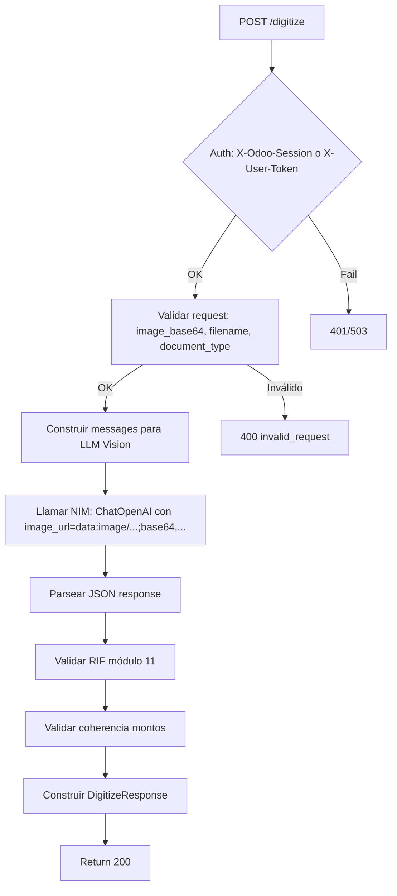

# Spec 006 — Digitize: Endpoint POST /digitize con LLM Vision

| Campo | Valor |
|---|---|
| Estado | Borrador |
| Fecha | 2026-10-31 |
| Revisión | r1 |
| Autor | Planner SDD |
| Repo | `contafis-assistant` |
| Referencias | `AGENTS.md`, `docs/memory.md`, `specs/001-chat-fiscal/spec.md`, `specs/005-session-auth/spec.md` |

---

## 1. Contexto

El wizard de Odoo necesita digitalizar facturas venezolanas desde imágenes (fotos, scans). El usuario sube una imagen en el wizard; el bot de Odoo la convierte a base64 y la envía al endpoint `/digitize` del asistente fiscal. El endpoint debe:

1. Recibir imagen base64 + metadatos (nombre archivo, tipo documento esperado).
2. Enviar a **NVIDIA NIM** (`llama-3.2-90b-vision-instruct`) via API OpenAI-compatible.
3. Extraer campos estructurados con prompt especializado para facturas venezolanas.
4. Validar RIF (módulo 11) y coherencia de montos (IVA, IGTF, total).
5. Devolver JSON estructurado con `document_type`, `confidence`, `extracted`, `warnings`.

El endpoint se usa **solo desde el bot de Odoo** (autenticado con `X-Odoo-Session` o `X-User-Token` heredado de Spec 005). No es un endpoint público.

---

## 2. Objetivo y métricas de éxito

**Objetivo:** Exponer `POST /digitize` que digitalice facturas venezolanas con LLM vision, validando campos críticos y devolviendo estructura tipada.

**Métricas de éxito:**
- 100% criterios de aceptación (sección 11) pasan en CI con mocks (sin red real).
- Validación RIF módulo 11 rechaza RIFs inválidos con warning estructurado.
- Coherencia montos: `subtotal + iva + igtf = total ± 0.01` → warning si falla.
- Latencia P95 < 8s (mock) / < 15s (real NIM) en tests de aceptación.
- Suite completa (686+ tests existentes + nuevos) sigue en verde.

---

## 3. Usuarios y casos de uso

| ID | Caso de uso | Descripción |
|---|---|---|
| UC-01 | Factura tipo Z (venta) | Usuario fotografía factura Z → endpoint extrae: proveedor, RIF, fecha, número, control, subtotal, IVA (16%), IGTF (3%), total. |
| UC-02 | Nota de crédito | Usuario fotografía nota de crédito → extrae: referencia a factura original, motivo, montos negativos. |
| UC-03 | Nota de débito | Similar a nota de crédito pero montos positivos. |
| UC-04 | Imagen ilegible/borrosa | LLM devuelve `confidence < 0.5` → warning `low_confidence` + campos `null`. |
| UC-05 | RIF inválido | RIF extraído no pasa módulo 11 → warning `invalid_rif` + RIF original en `extracted`. |
| UC-06 | Montos incoherentes | `subtotal + iva + igtf != total` → warning `amount_mismatch` con detalle. |

---

## 4. Glosario

| Término | Significado en esta spec |
|---|---|
| `image_base64` | Imagen codificada en base64 (sin prefix `data:image/...;`). Formatos: JPEG, PNG, WebP. |
| `document_type` | Tipo esperado: `factura_z`, `nota_credito`, `nota_debito`, `auto` (detección automática). |
| `NIM` | NVIDIA Inference Microservice — endpoint OpenAI-compatible para `llama-3.2-90b-vision-instruct`. |
| `RIF` | Registro de Información Fiscal (Venezuela): `J-12345678-9`, `V-12345678-9`, `E-12345678-9`, `G-12345678-9`. Validación módulo 11. |
| `NCF` / `Control` | Número de Control Fiscal (factura): 10-15 dígitos alfanuméricos. |
| `IGTF` | Impuesto a las Grandes Transacciones Financieras (3% en divisas). |
| `confidence` | Score 0.0–1.0 del LLM sobre calidad de extracción. |

---

## 5. Alcance

### Dentro del alcance
1. Endpoint `POST /digitize` en `api/routes.py` (router existente).
2. Dependencia `get_digitize_service` que construye cliente NIM + prompt.
3. Pydantic models: `DigitizeRequest`, `DigitizeResponse`, `ExtractedInvoice`, `ExtractedLine`, `DigitizeWarning`.
4. Prompt especializado para facturas venezolanas (system + few-shots).
5. Validación RIF (módulo 11) en Python (no en LLM).
6. Validación coherencia montos en Python.
7. Tests unitarios (prompt, validaciones, parsing) + tests API (mock NIM).
8. Fixtures sintéticos con PIL para tests deterministas.

### Fuera de alcance
- OCR tradicional (Tesseract, etc.) — solo LLM vision.
- Procesamiento por lotes (batch) — una imagen por request.
- Almacenamiento de imágenes — efímero en memoria del request.
- UI / frontend — solo API para consumo del bot Odoo.
- Tipos de documento fuera de: factura Z, nota crédito, nota débito.

---

## 6. Decisiones confirmadas

| ID | Decisión | Justificación |
|---|---|---|
| D1 | **Modelo**: `llama-3.2-90b-vision-instruct` via NIM | Ya configurado en `openai_base_url` + `openai_api_key` (Spec 001/002). |
| D2 | **Protocolo**: API OpenAI-compatible (`chat.completions`) | NIM expone `/v1/chat/completions` compatible con `ChatOpenAI`. |
| D3 | **Prompt**: System + 3 few-shots (Z, nota_credito, nota_debito) | Few-shots mejoran extracción estructurada vs zero-shot. |
| D4 | **Output**: JSON estructurado via `response_format=json_object` | Garantiza parsing determinista; LLM no devuelve prosa. |
| D5 | **Validación RIF**: Python (módulo 11) post-LLM | Determinista, no depende de LLM; evita alucinaciones. |
| D6 | **Validación montos**: Python post-LLM | `subtotal + iva + igtf ≈ total` con tolerancia 0.01. |
| D7 | **Auth**: Reutiliza `get_user_context_from_session` (Spec 005) | Consistencia con `/chat` y `/scope`; bot Odoo ya autentica. |
| D8 | **Timeout**: 30s request a NIM (configurable `digitize_timeout_seconds`) | NIM vision puede tardar 10-20s; buffer para reintentos. |
| D9 | **Imagen**: máx 5MB, base64 → ~6.7MB payload | Límite razonable para fotos móviles; configurable. |

---

## 7. Flujo funcional



---

## 8. Contrato de datos

### 8.1 Request (`DigitizeRequest`)

```json
{
  "image_base64": "string (required, base64 sin prefix, máx 5MB original)",
  "filename": "string (required, ej: factura_001.jpg)",
  "document_type": "enum: factura_z | nota_credito | nota_debito | auto (default: auto)"
}
```

Validaciones:
- `image_base64`: base64 válido, decodificable, ≤ 5MB original.
- `filename`: extensión en {`.jpg`, `.jpeg`, `.png`, `.webp`}.
- `document_type`: enum válido.

### 8.2 Response (`DigitizeResponse`)

```json
{
  "document_type": "factura_z | nota_credito | nota_debito",
  "confidence": 0.92,
  "extracted": {
    "supplier_name": "Distribuidora El Sol C.A.",
    "supplier_rif": "J-12345678-9",
    "invoice_number": "001-001-00001234",
    "control_number": "ABC1234567890",
    "invoice_date": "2026-10-15",
    "due_date": "2026-11-15",
    "currency": "USD",
    "subtotal": 100.00,
    "iva_rate": 0.16,
    "iva_amount": 16.00,
    "igtf_rate": 0.03,
    "igtf_amount": 3.00,
    "total": 119.00,
    "lines": [
      {"description": "Servicios contables oct 2026", "quantity": 1, "unit_price": 100.00, "total": 100.00}
    ],
    "credit_note_ref": null,
    "debit_note_ref": null
  },
  "warnings": [
    {"code": "amount_mismatch", "message": "subtotal + iva + igtf = 119.00 != total 119.50", "field": "total"}
  ]
}
```

### 8.3 Modelos Pydantic

**`DigitizeRequest`**
```python
class DigitizeRequest(BaseModel):
    image_base64: str = Field(..., description="Imagen base64 sin prefix data:")
    filename: str = Field(..., pattern=r".*\.(jpg|jpeg|png|webp)$", description="Nombre archivo con extensión válida")
    document_type: Literal["factura_z", "nota_credito", "nota_debito", "auto"] = "auto"
```

**`ExtractedInvoice`**
```python
class ExtractedLine(BaseModel):
    description: str
    quantity: float
    unit_price: float
    total: float

class ExtractedInvoice(BaseModel):
    supplier_name: str | None
    supplier_rif: str | None
    invoice_number: str | None
    control_number: str | None
    invoice_date: str | None  # YYYY-MM-DD
    due_date: str | None
    currency: Literal["VES", "USD"] = "VES"
    subtotal: float | None
    iva_rate: float | None
    iva_amount: float | None
    igtf_rate: float | None
    igtf_amount: float | None
    total: float | None
    lines: list[ExtractedLine] = []
    credit_note_ref: str | None  # Para nota_credito: factura original
    debit_note_ref: str | None   # Para nota_debito: factura original
```

**`DigitizeWarning`**
```python
class DigitizeWarning(BaseModel):
    code: Literal[
        "low_confidence",
        "invalid_rif",
        "amount_mismatch",
        "missing_field",
        "unknown_document_type"
    ]
    message: str
    field: str | None = None
    extracted_value: str | None = None
```

**`DigitizeResponse`**
```python
class DigitizeResponse(BaseModel):
    document_type: Literal["factura_z", "nota_credito", "nota_debito"]
    confidence: float = Field(ge=0.0, le=1.0)
    extracted: ExtractedInvoice
    warnings: list[DigitizeWarning] = []
```

### 8.4 Códigos de error HTTP

| Código | Cuándo |
|---|---|
| 400 | Request inválido (base64 malformed, extensión inválida, etc.) |
| 401 | Sin autenticación o sesión/token inválido |
| 503 | NIM no disponible / timeout / error upstream |
| 413 | Imagen > 5MB (opcional, validar en request) |

---

## 9. Prompt para LLM Vision

### System Prompt

```
Eres un extractor experto de facturas venezolanas (tipo Z, notas de crédito/débito).
Recibes una imagen y devuelves SOLO un objeto JSON válido con los campos especificados.
NO incluyas prosa, explicaciones, ni markdown. Solo el JSON.

Reglas críticas:
1. RIF venezolano: formato J-12345678-9, V-12345678-9, E-12345678-9, G-12345678-9 (módulo 11).
2. Fechas en YYYY-MM-DD.
3. Montos en número decimal (punto decimal), sin separadores de miles.
4. IVA estándar 16% (0.16), IGTF 3% (0.03) si aplica.
4. Si un campo no es legible, usa null. NO inventes.
5. `document_type`: "factura_z", "nota_credito" o "nota_debito".
6. Para nota_credito/debito: incluir `credit_note_ref` o `debit_note_ref` con número de factura original.
7. `confidence`: 0.0–1.0 según legibilidad global de la imagen.
```

### Few-shots (3 ejemplos)

**Ejemplo 1 — Factura Z**
```json
{
  "document_type": "factura_z",
  "confidence": 0.95,
  "extracted": {
    "supplier_name": "Distribuidora El Sol C.A.",
    "supplier_rif": "J-12345678-9",
    "invoice_number": "001-001-00001234",
    "control_number": "ABC1234567890",
    "invoice_date": "2026-10-15",
    "due_date": "2026-11-15",
    "currency": "USD",
    "subtotal": 100.00,
    "iva_rate": 0.16,
    "iva_amount": 16.00,
    "igtf_rate": 0.03,
    "igtf_amount": 3.00,
    "total": 119.00,
    "lines": [{"description": "Servicios contables oct 2026", "quantity": 1, "unit_price": 100.00, "total": 100.00}]
  }
}
```

**Ejemplo 2 — Nota de Crédito**
```json
{
  "document_type": "nota_credito",
  "confidence": 0.92,
  "extracted": {
    "supplier_name": "Distribuidora El Sol C.A.",
    "supplier_rif": "J-12345678-9",
    "invoice_number": "001-001-00001235",
    "control_number": "DEF0987654321",
    "invoice_date": "2026-10-20",
    "due_date": null,
    "currency": "USD",
    "subtotal": -50.00,
    "iva_rate": 0.16,
    "iva_amount": -8.00,
    "igtf_rate": 0.03,
    "igtf_amount": -1.50,
    "total": -59.50,
    "lines": [{"description": "Devolución servicio sep 2026", "quantity": 1, "unit_price": -50.00, "total": -50.00}],
    "credit_note_ref": "001-001-00001234",
    "debit_note_ref": null
  }
}
```

**Ejemplo 3 — Nota de Débito**
```json
{
  "document_type": "nota_debito",
  "confidence": 0.90,
  "extracted": {
    "supplier_name": "Distribuidora El Sol C.A.",
    "supplier_rif": "J-12345678-9",
    "invoice_number": "001-001-00001236",
    "control_number": "GHI5555555555",
    "invoice_date": "2026-10-25",
    "due_date": "2026-11-25",
    "currency": "USD",
    "subtotal": 25.00,
    "iva_rate": 0.16,
    "iva_amount": 4.00,
    "igtf_rate": 0.03,
    "igtf_amount": 0.75,
    "total": 29.75,
    "lines": [{"description": "Ajuste por diferencia de tasa", "quantity": 1, "unit_price": 25.00, "total": 25.00}],
    "credit_note_ref": null,
    "debit_note_ref": "001-001-00001234"
  }
}
```

---

## 10. Validaciones post-LLM (Python)

### 10.1 Validación RIF (Módulo 11)

Algoritmo estándar venezolano:
```
RIF: J-12345678-9
Base: 12345678 (8 dígitos)
Pesos: [4,3,2,7,6,5,4,3,2] (9 pesos para 8 dígitos + tipo)
Tipo: J=1, V=2, E=3, G=4, P=5
Cálculo: sum(digit * peso) % 11
Digito control: 11 - (sum % 11)
  Si resultado 10 → 0
  Si resultado 11 → 1
Validar que dígito final coincide.
```

Implementar `validate_rif(rif: str) -> tuple[bool, str | None]` que retorna `(True, None)` si válido, `(False, "mensaje")` si inválido.

### 10.2 Validación coherencia montos

```python
def validate_amounts(extracted: ExtractedInvoice) -> list[DigitizeWarning]:
    warnings = []
    if extracted.subtotal is not None and extracted.iva_amount is not None and extracted.total is not None:
        igtf = extracted.igtf_amount or 0.0
        calculated = extracted.subtotal + extracted.iva_amount + igtf
        if abs(calculated - extracted.total) > 0.01:
            warnings.append(DigitizeWarning(
                code="amount_mismatch",
                message=f"subtotal + iva + igtf = {calculated:.2f} != total {extracted.total:.2f}",
                field="total",
                extracted_value=str(extracted.total)
            ))
    return warnings
```

---

## 11. Criterios de aceptación

| ID | Escenario | Expected |
|---|---|---|
| AC-01 | Request válido con factura Z legible | 200, `document_type="factura_z"`, `confidence>0.8`, campos poblados |
| AC-02 | Request válido con nota crédito legible | 200, `document_type="nota_credito"`, montos negativos, `credit_note_ref` poblado |
| AC-03 | Request válido con nota débito legible | 200, `document_type="nota_debito"`, `debit_note_ref` poblado |
| AC-04 | Imagen borrosa/illegible | 200, `confidence<0.5`, warnings incluye `low_confidence`, campos `null` |
| AC-05 | RIF extraído inválido (módulo 11) | 200, warning `invalid_rif` con RIF original en `extracted_value` |
| AC-06 | Montos incoherentes (subtotal+iva+igtf≠total) | 200, warning `amount_mismatch` con detalle |
| AC-07 | Request sin `image_base64` | 400, detail "image_base64 es requerido" |
| AC-08 | Request con base64 inválido | 400, detail "image_base64 no es base64 válido" |
| AC-09 | Request con extensión inválida (.pdf, .txt) | 400, detail "extensión de archivo no soportada" |
| AC-10 | Imagen > 5MB | 413 o 400, detail "imagen excede tamaño máximo" |
| AC-11 | NIM timeout / 5xx | 503, detail "service_unavailable" |
| AC-12 | Sin autenticación (sin X-Odoo-Session ni X-User-Token) | 401 |
| AC-13 | `document_type=auto` detecta correctamente tipo | 200, `document_type` inferido coincide con contenido |
| AC-14 | Respuesta LLM no es JSON válido | 503, warning `parsing_error` |
| AC-15 | Campo `currency` por defecto VES si no detectado | 200, `currency="VES"` |

---

## 12. Cambios en el código

### 10.1 `config.py` — Nuevo setting
```python
digitize_timeout_seconds: float = Field(default=30.0, ge=5.0, le=120.0)
digitize_max_image_mb: int = Field(default=5, ge=1, le=20)
```

### 10.2 `api/digitize.py` — Nuevo módulo (service layer)
- `DigitizeService` class con método `digitize(request: DigitizeRequest) -> DigitizeResponse`
- Construcción de messages para `ChatOpenAI` (system + few-shots + user con imagen)
- Llamada a NIM con `response_format={"type": "json_object"}`
- Parsing + validaciones post-LLM (RIF, montos)

### 10.3 `api/routes.py` — Nuevo endpoint
```python
@router.post("/digitize", response_model=DigitizeResponse)
async def digitize(
    request: Request,
    digitize_request: DigitizeRequest,
    user_ctx: UserContext = Depends(get_user_context_from_session),
) -> DigitizeResponse:
    service = get_digitize_service(request)
    return await run_in_threadpool(service.digitize, digitize_request)
```

### 10.4 `api/__init__.py` — Exportar modelos

---

## 13. Plan de tests (TDD)

### 13.1 Tests unitarios (`tests/unit/test_digitize.py`)

| Test | Descripción |
|---|---|
| `test_validate_rif_valid_j` | RIF J-12345678-9 válido → True |
| `test_validate_rif_valid_v` | RIF V-12345678-9 válido → True |
| `test_validate_rif_invalid_checksum` | RIF J-12345678-0 (checksum wrong) → False |
| `test_validate_rif_invalid_format` | "123456789" sin guiones → False |
| `test_validate_amounts_ok` | subtotal 100 + iva 16 + igtf 3 = total 119 → sin warnings |
| `test_validate_amounts_mismatch` | subtotal 100 + iva 16 + igtf 3 = 119 ≠ total 120 → warning amount_mismatch |
| `test_validate_amounts_no_igtf` | sin IGTF → solo subtotal + iva |
| `test_parse_llm_response_valid` | JSON válido → ExtractedInvoice parseado |
| `test_parse_llm_response_missing_fields` | campos faltantes → nulls, warning missing_field |
| `test_build_messages_structure` | messages incluyen system, few-shots, user con image_url |

### 13.2 Tests de API (`tests/api/test_digitize.py`)

| Test | Descripción |
|---|---|
| `test_digitize_factura_z_success` | Mock NIM devuelve factura Z → 200, estructura correcta |
| `test_digitize_nota_credito_success` | Mock NIM devuelve nota crédito → montos negativos, ref poblado |
| `test_digitize_low_confidence` | Mock NIM devuelve confidence 0.3 → warning low_confidence |
| `test_digitize_invalid_rif_warning` | Mock NIM devuelve RIF inválido → warning invalid_rif |
| `test_digitize_amount_mismatch_warning` | Mock NIM devuelve montos incoherentes → warning amount_mismatch |
| `test_digitize_without_auth` | Sin headers → 401 |
| `test_digitize_invalid_base64` | base64 corrupto → 400 |
| `test_digitize_invalid_extension` | filename .pdf → 400 |
| `test_digitize_nim_timeout` | Mock NIM timeout → 503 |
| `test_digitize_auto_detect_type` | document_type=auto → detecta factura_z |

### 13.3 Fixtures sintéticos (`tests/api/conftest.py`)

```python
def make_fake_invoice_image(document_type: str = "factura_z") -> str:
    """Genera imagen sintética PIL (texto simple) y retorna base64."""
    from PIL import Image, ImageDraw, ImageFont
    import io, base64
    img = Image.new('RGB', (800, 600), color='white')
    draw = ImageDraw.Draw(img)
    # Dibujar texto simple simulando factura
    text = f"FACTURA {document_type.upper()}\nRIF J-12345678-9\nTOTAL 119.00"
    draw.text((50, 50), text, fill='black')
    buf = io.BytesIO()
    img.save(buf, format='JPEG')
    return base64.b64encode(buf.getvalue()).decode()
```

---

## 14. Riesgos y mitigaciones

| Riesgo | Mitigación |
|---|---|
| NIM vision no devuelve JSON válido | `response_format=json_object` + try/except parsing + fallback 503 |
| LLM alucina RIF/fechas | Validación determinista post-LLM (RIF módulo 11, fechas ISO) |
| Latencia alta (>30s) | Timeout configurable; mock en tests; async + threadpool |
| Imagen muy grande OOM | Validar tamaño base64 antes de enviar; límite 5MB |
| Prompt no generaliza a todos formatos | Few-shots diversos; `document_type=auto` con detección LLM |

---

## 15. Entregables

1. **Spec**: `specs/006-digitize/spec.md` (este archivo).
2. **Plan**: `specs/006-digitize/plan.md` (fases y tareas).
3. **Tasks**: `specs/006-digitize/tasks.md` (checklist T01–Txx).
4. **Implementación**: `config.py`, `api/digitize.py`, `api/routes.py`, modelos en `domain/contracts.py` o nuevo `domain/digitize.py`.
5. **Tests**: `tests/unit/test_digitize.py`, `tests/api/test_digitize.py`, fixtures en `conftest.py`.
6. **Validación**: `/tdd-check` pasa, suite completa en verde.